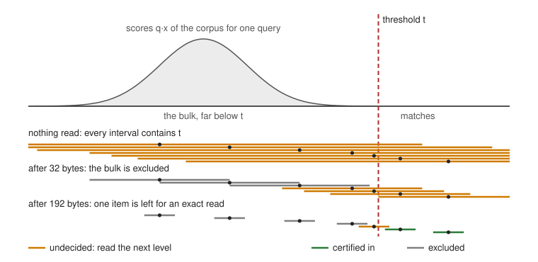
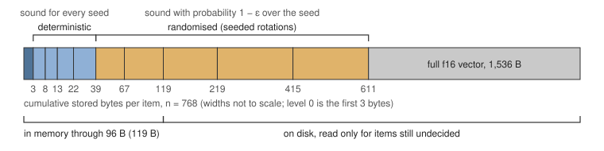

# Exact similarity search inside a viewer's visible set

A collection holds a billion items, each represented by an embedding vector of several hundred
dimensions, and each viewer may see only some of them. A viewer supplies a query vector, often the
embedding of a short piece of text, and asks which of the items they may see are similar to it. This
overview describes a design that answers that question exactly and at any answer size, on one machine,
while items are inserted and deleted.

Every figure below carries its status. **Measured** means counted or timed in a run, and the data and
scale are given. **Modelled** means a measured count multiplied by an assumed rate, or an
extrapolation. **Proved** means a written proof exists, and **refereed** means an independent reader
has checked it. Most measurements use one dataset, a 1 million item sample of BioCLIP-2 image
embeddings (n = 768 dimensions), with corpus items and about 370 short text prompts as queries.

## 1. The problem

This section states what is asked, and why each requirement is there.

**Vectors and queries.** Items and queries are unit vectors in $\mathbb{R}^n$, and similarity is the
inner product $q \cdot x$, which for unit vectors is the cosine. The dimension is a parameter: real
embeddings are generally 512 dimensions or more, and the design must work from about 100 to 5,000
dimensions without being tuned to a particular model.

**Two queries.** A **threshold query** names a query $q$ and a threshold $t$ and returns every visible
item with $q \cdot x \ge t$, as a set of item identifiers (a bitmap). A **k-nearest-neighbour query**
returns the $k$ visible items with the largest $q \cdot x$. The same index answers both, because a
k-nearest-neighbour query is a threshold query whose threshold is found during the search.

**Visible sets.** Each viewer has a visible set, given as a compressed bitmap over item identifiers,
and every query runs inside it and inside any other filters. The answer must equal the answer computed
over the visible items alone, and so must anything computed from it, such as a count or a density
drawn on a map. A system that searches all items and then filters can leak hidden items, for example
when an approximate index returns a viewer fewer results because hidden items crowded visible ones
out.

**Exactness.** The threshold answer must be a plain set, with no "maybe" members, so that it composes
with other filters and counts over it are counts of something definite. Exactness makes
$q \cdot x \ge t$ behave like any other database predicate: results nest as $t$ rises, counts add
across shards, and the answer does not change when unrelated items are inserted or the index is
rebuilt. "Exact" means exact against the stored half-precision (f16) vectors, with the similarity
computed in fixed-point integers so that it has one value. The design meets it with probability at
least $1 - \varepsilon$ over a random seed, with $\varepsilon = 10^{-9}$ per query (section 5).

**Scale and change.** A threshold answer may hold ten items or a tenth of the corpus, and large
answers may take a few seconds because results are cached. The target is a billion items on one
machine under a memory cap, with full vectors on NVMe disk, and items inserted, deleted and suppressed
while queries run. A build must be the same as inserting every item into an empty index.

**Fitted to the data alone.** Users cannot be asked for example queries, and the query path does not
know whether a query is an image, a sentence or something else. Everything the index learns is fitted
from the corpus, with corpus items standing in for queries. A query log can refine the fit later,
because, as section 3 shows, the fit changes cost and never correctness.

**Side channels.** The guarantee covers results, which depend only on what the viewer may see, while
the time a query takes can depend on hidden items. Such side channels are minimised and recorded
rather than banned, so reading the stored bytes of invisible items is acceptable when it is cheaper.

## 2. The core idea: decide most items from a few bytes

Reading every full vector costs $2n$ bytes per item, which is 1.5 TB per query at a billion items and
768 dimensions. The design avoids most of that by computing, for each item, a guaranteed interval for
$q \cdot x$ from a few stored bytes. If the whole interval lies above $t$, the item is **certified
in**; if it lies below, the item is **excluded**; if it contains $t$, the item is **undecided** and
more of its bytes are read. Each item's code is stored as a nested stream, so reading more means
reading the next level of the same stream, and each level gives a narrower interval. The full vector
is read only for the few items that no level decides.

*Figure 1. With nothing read, every interval contains the threshold. After 32 bytes the items far
below it are excluded; after 192 bytes nearly every item is decided and the last undecided item is
read in full. The widths are illustrative.*

An item is decided once its interval's half-width falls below its distance from the threshold, its
**margin**. The bytes needed to reach a half-width $h$ grow roughly as $1/h$ (measured on BioCLIP-2:
the width falls as bytes$^{-0.7}$ up to 96 bytes and bytes$^{-1.3}$ beyond), so an item with a small
margin is expensive and an item with a large margin is cheap. Items close to the threshold are the
most expensive, but they are few, so most of the cost of a query is spent on the great mass of items
that score well below the threshold yet not far enough below it to be excluded with nothing read.

With nothing read, an item's interval spans about ±6.1 standard deviations of the query's score
distribution for text queries and ±4.5 for image queries, while the threshold sits only 1.8 to 4.9
standard deviations above the median score, so almost every item starts undecided. Items 2 to 8
standard deviations below the threshold carry 56 to 87% of the reading cost of a text query at answers
of 1% and below, and items within half a standard deviation of it carry 4 to 19% (measured, 200,000
items, 62 text and 40 image queries). The cost is therefore set by how far the bulk sits from the
threshold, and the first bytes, which every item reads, matter more than anything done near the
threshold.

## 3. The geometry: clusters, residuals and the metric

This section explains which part of $q \cdot x$ is known exactly, which part is uncertain, and in what
coordinates the uncertain part is cheapest to bound.

### Clusters and residuals

The corpus is clustered by k-means into clusters of about 1,000 items. Each item is written as
$x = m + r$, where $m$ is its cluster's centre (stored at 8 bits per dimension, and the decomposition
is exact against the stored centre) and $r$ is the **residual**. With a per-query, per-cluster number
$\alpha$ chosen to make the bound tightest, the score splits into three terms:

$$q \cdot x \;=\; q \cdot m \;+\; \alpha\, m \cdot r \;+\; \Delta \cdot r, \qquad \Delta = q - \alpha m.$$

The first term is one number per query and cluster. The second is a stored exact scalar per item,
which for unit vectors follows from one 16-bit number, $\hat a = x \cdot m/\lVert m \rVert$. Only the
third term is uncertain, and both of its factors are short: $\Delta$ is the query's offset from the
cluster, and $r$ is the item's offset from its centre. Bounding $\Delta \cdot r$ instead of
$q \cdot x$ directly made the bounds about three times tighter in the earliest measurements.

### Local bases

Clusters are grouped (64 groups at 1 million items), and each group has its own basis for the
residuals, so that the first few coordinates of a residual carry most of its energy. Moving from one
global basis to 64 local ones made the interval about three times tighter at 96 bytes; moving from 64
to 256 gained only 12 to 16% (measured).

### The metric: the dual pair

Cauchy–Schwarz gives $\lvert \Delta \cdot r \rvert \le \lVert \Delta \rVert\, \lVert r \rVert$, and
the bound is tight only when the two vectors are aligned. For any positive definite matrix $M$ the
same inequality holds in a weighted form,
$\lvert \Delta \cdot r \rvert \le \lVert \Delta \rVert_M \lVert r \rVert_{M^{-1}}$ with
$\lVert v \rVert_M^2 = v^\top M v$, and the choice of $M$ decides how loose the bound is on average.
Write $\Sigma_Q$ for the covariance of query offsets $\Delta$ and $\Sigma_R$ for the covariance of
residuals. A good metric rescales each direction so that residuals and query offsets have the same
spread in it, shrinking whichever side is relatively large there.

The best such metric has a closed form. Let $\gamma_1 \ge \gamma_2 \ge \dots$ be the eigenvalues of
$\Sigma_Q^{1/2} \Sigma_R \Sigma_Q^{1/2}$. Then

$$\mathbb{E}\lVert \Delta \rVert_M^2 \cdot \mathbb{E}\lVert r \rVert_{M^{-1}}^2 \;\ge\; \Big(\sum_i \sqrt{\gamma_i}\Big)^2,$$

with equality at $M = \Sigma_Q^{-1} \# \Sigma_R$, the **matrix geometric mean** of the inverse
query-offset covariance and the residual covariance. The geometric mean of two positive definite
matrices $A$ and $B$ is $A^{1/2}(A^{-1/2} B A^{-1/2})^{1/2} A^{1/2}$, the unique positive definite $M$
with $M A^{-1} M = B$; here it is the unique metric under which the query offsets and the residuals
have the same covariance. The proof is a few lines of Cauchy–Schwarz for the trace inner product
(proved, not refereed).

In coordinates the metric becomes a pair of linear maps, one applied to the query side and one to the
item side, such that the transformed offset $g$ and the transformed residual $\tilde r$ satisfy
$g \cdot \tilde r = \Delta \cdot r$ exactly, both have uncorrelated coordinates, and coordinate $i$
has variance $\sqrt{\gamma_i}$ on both sides. This is the **dual pair**. Every bound written for an
orthonormal basis carries over unchanged, because the bounds use only that identity and
Cauchy–Schwarz. The earlier basis, principal components of the residuals with diagonal weights,
matches it only when $\Sigma_Q$ and $\Sigma_R$ commute, which on real data they do not.

**Fitting it.** $\Sigma_R$ is fitted per group from the residuals. $\Sigma_Q$ is fitted from the data
alone: corpus items are used as pseudo-queries against clusters drawn in proportion to their size, the
component along the cluster centre is projected out, one matrix is shared by all groups, and a ridge
of 0.1 times the mean eigenvalue is added. At compaction, $\Sigma_Q$ can be refitted from the query
log. Soundness never depends on the fit, because the bound is computed against whatever pair is
stored; a poor fit only widens intervals.

What the metric buys was measured in the native prototype on the 1 million BioCLIP-2 sample. With
$\Sigma_Q$ fitted from corpus items only, bytes read on the index path fell by 9, 17, 24 and 30% for
image queries and by 10, 9, 7 and 6% for text queries, at answers of 0.01, 0.1, 1 and 5%. With text
prompts mixed into the fit, standing in for a query log, text fell by 25 to 34% and ran 12 to 26%
faster on one thread. Every run returned exact answers and recorded no interval violation.

> **Note on sources.** An early experiment recorded this transform as hurting beyond 16 bytes. A later
> check traced the loss to that experiment's fit of $\Sigma_Q$ (one matrix per group, from offsets to
> the nearest clusters only); with the fit above, the transform wins at every budget. A numpy run at
> 150,000 items found it leaves more items undecided than the old basis from 32 bytes on, because the
> randomised levels were designed for the old basis, yet it still read 4 to 14% fewer code bytes.

## 4. The stored code

Each item is stored once, as one nested stream in which every prefix is a valid code with its own
interval, so a query reads as far into each item as it needs. This section describes the levels and
why the early ones are deterministic and the later ones randomised.

*Figure 2. Cumulative stored bytes per item at n = 768 in the reference design. The suggested
resident prefix is through 96 bytes; a tighter memory budget keeps the first 39 bytes only.*

### Level 0

Three bytes: $\hat a$ (2 bytes), from which $m \cdot r$ and $\lVert r \rVert$ follow for a unit
vector, and a 1-byte bound on the residual's norm in the metric. Items are sorted within each cluster
by $\hat a$, which section 6 uses to skip items without reading them.

### Deterministic levels (4, 8, 16 and 32 bytes of code)

These code the transformed residual $\tilde r$ coordinate by coordinate, most important first, with an
**escape code**: each coordinate gets a sign, then a unary index on a fixed grid, then halvings, in
one greedy order per group. Nothing is clipped, so an outlying coordinate costs more bits instead of
overflowing the quantiser. (Overflow was the source of the worst errors in an earlier fixed-range
quantiser.) Each level also stores one byte: the norm of the remaining coding error $e$ in that
level's weights, on a geometric grid with ratio $2^{1/16}$, rounded up. The interval at level $\ell$
is then

$$q \cdot x \in q \cdot m + \alpha\, m \cdot r + g \cdot \hat r_\ell \;\pm\; \lVert W_\ell\, g \rVert \,\lVert W_\ell^{-1} e_\ell \rVert,$$

where $\hat r_\ell$ is the decoded prefix, $W_\ell$ a diagonal weighting fixed at build, and the last
factor is the stored byte. This is weighted Cauchy–Schwarz on the coding error. It holds for every
item, every query and every seed, so a decision made at these levels is always correct.

### Randomised levels (48, 96, 192, 384 and 576 bytes)

A deterministic bound pays for the worst case, in which the coding error points straight along the
query offset. In high dimension that alignment is rare, and randomness lets the index pay for the
typical case while keeping a guarantee. The randomised levels code what the 32-byte prefix left,
whitened and split into fixed blocks (96, 128, 256 and 288 dimensions at n = 768), each multiplied by
a random rotation drawn from a public seed before it is quantised.

The estimator is rescaled so that its error is orthogonal to the true block vector $y$. A short
symmetry argument then gives the exact law of the error: it equals $A\,u$, where
$A = \lVert y \rVert \tan\varphi$ is a stored scalar ($\varphi$ is the angle between the code and the
rotated vector) and $u$ is uniform on the unit sphere of the $(n_b - 1)$-dimensional space orthogonal
to $y$, independent of $A$ (proved and refereed; it holds for any codebook). The error in the estimate
of $\Delta \cdot y$ is therefore $A\, \lVert \Delta_\perp \rVert\, u_1$, one coordinate of a uniform
unit vector, whose variance is $1/(n_b - 1)$ and whose tail is known exactly:

$$\Pr[\lvert u_1 \rvert \ge s] = I_{1-s^2}\!\big(\tfrac{m-1}{2}, \tfrac12\big) \le 2(1-s^2)^{m/2}, \qquad m = n_b - 1,\; s \le 1/\sqrt2,$$

where $I$ is the regularised incomplete beta function (the closed bound is proved and refereed). The
blocks use independent rotations, so their errors add independently and an exact Chernoff bound over
the blocks gives a half-width of the form

$$h = c\,\sqrt{\textstyle\sum_b A_b^2 \lVert \Delta_b \rVert^2/(n_b - 1)},$$

with the **confidence constant** $c$ chosen so that each interval fails with a stated small
probability. Section 5 sets $c$.

**Why randomness buys width.** At a deterministic level the error term is bounded by its full length,
$A\lVert\Delta_\perp\rVert$. At a randomised level it is bounded by $c$ standard deviations of a
coordinate, $c A \lVert\Delta_\perp\rVert/\sqrt{m}$. Over all coded dimensions the ratio is about
$\sqrt{m}/c$: 3.2 for 768 dimensions at $c = 8.7$, and less than one for a short code, which is why
the first 32 bytes stay deterministic. On BioCLIP-2 the randomised levels saved text queries 8 to 18%
of bytes and cost image queries 1 to 3% (measured, 1 million items), and they were kept because text
is expected to be the common query.

**The deterministic backstop.** Every randomised interval lies inside the deterministic interval
computed from the same stored scalars, because $\lvert u_1 \rvert \le 1$ and $c$ is below $\sqrt{m}$.
So even on the rare seed where a randomised interval fails, the item's true score is within its
deterministic interval.

**Sub-bit rates and stored scalars.** Where a block's rate is below one bit per dimension, the code
keeps the signs of the first $k'$ rotated coordinates. Each block stores its norm (2 bytes, once) and
$\tan\varphi$ (1 byte, rounded so that the width rounds up) whenever its rate rises. Stored scalars
count as code bytes in every figure, because one exact real number could otherwise encode anything.

### Layout

Items are stored in cluster order and, within a cluster, in sort order. Each level is stored
contiguously per cluster, so a pass over one level streams memory; figure 2 gives the cumulative
sizes. Shared structure (centres, bases, rotations, weights) comes to about 1 GB at a billion items.
The native prototype uses another schedule of the same design, with deterministic levels ending at 4,
8, 12, 16, 24 and 32 bytes, randomised levels from 40 to 256 bytes, int8 bases, and codes in 4-bit
units over blocks of 32 items so that a level is scored by table lookup.

### How close the code is to the best possible

For any encoder of $B$ bits and any sound interval, the mean half-width is at least
$\kappa_k (\gamma_1 \cdots \gamma_k)^{1/2k} 2^{-B/k}$ for Gaussian residuals and query offsets and
every $k$, where $\kappa_k \ge k$ (checked numerically up to $k = 200{,}000$). The proof is the
Shannon lower bound with Urysohn's inequality, which says the ball has the least mean width among
bodies of a given volume, in place of the second-moment step (proved and refereed). The deterministic
code sits 1.36 to 1.42 times above this floor on Gaussian data (measured). Two corollaries explain why
no cluster-level summary can replace per-item codes: a summary of $S$ bits shared by $M$ items is
worth at most $S/M$ bits per item, and assigning an item to one of $K$ clusters is worth at most
$\log_2 K$ bits.

## 5. The guarantee

This section says exactly what is promised, why the confidence constant has the value it has, and what
a user could see when the improbable happens.

### The statement

The index is built with a seed $\omega$, drawn at random and stored in the clear. For a threshold
query, write $S(t)$ for the visible items with $q \cdot x \ge t$ and $R$ for the returned set. For
every query, threshold and visible set chosen without reference to the seed,

$$\Pr_\omega\big[\, S(t) \subseteq R \subseteq S(t - d) \,\big] \ge 1 - \varepsilon,$$

with $d = 0$ (exact) by default and $\varepsilon = 10^{-9}$ per query at $N = 10^9$ items. The event
is simultaneous: with probability $1 - \varepsilon$ every item is decided correctly at once. It is a
statement about each query separately; for any one seed, some query exists on which it fails.

Decisions at deterministic levels are correct for every seed, so only randomised decisions carry
$\varepsilon$. A client that chooses each query from earlier answers is covered too: over $T$ such
queries the chance of any wrong answer is at most $T\varepsilon$, because a correct answer is unique
(proved and refereed). Because the seed is public, someone who reads it can craft an item whose code
error points against a chosen query, but that item affects only its own decision, by at most its
deterministic width, which its writer could equally have done by writing a different vector. A query
crafted against the seed can spoil only its own answer.

### Setting the constant: the union bound

Each randomised interval fails with probability $\delta(c)$, the exact sphere tail at $c$ standard
deviations. By the union bound the query fails with probability at most the number of possible failure
events times $\delta(c)$, and $c$ is set to make that product $\varepsilon$. Because $\delta(c)$ falls
like $e^{-c^2/2}$, $c$ grows only as the square root of the logarithm of the count: a thousand times
more items widens every interval by about 9%. The union needs a set of events fixed independently of
the seed, and the items reaching the randomised levels are such a set, because the deterministic
levels that select them do not read the seed.

The first observation that lowers the constant is that **each item has one harmful side**. A true
match can be decided wrongly only by its upper bound falling below $t$, and a non-match only by its
lower bound rising above $t$. So the union is over one one-sided event per item and level, half the
events of a two-sided count. For threshold queries over all $N = 10^9$ items, the resulting constant
is 8.6 to 8.8 for $n$ between 512 and 1,536 (8.66 at $n = 768$ with three randomised levels, 8.72 with
five), against 9.35 to 9.46 from the sub-Gaussian bound used in the prototypes (proved and refereed).
These figures are for one rotation over all dimensions. With block rotations the effective constant
lies between them and the sub-Gaussian figure, because a sum over blocks is closer to Gaussian than
one sphere coordinate.

### k nearest neighbours: a union over k items

For k-nearest-neighbour queries the union shrinks from $N$ items to $k$. Suppose the algorithm drops
an item only when its upper bound is strictly below a running threshold $\tau$, and $\tau$ is never
more than the $k$-th best exact score among items scored so far. Then $\tau$ never exceeds the true
$k$-th score, so a true neighbour is dropped only if its own upper bound fails, and what happens to
any other item cannot make the answer wrong. The failure events are the $k \times L$ upper-bound
events of the true neighbours over $L$ levels, a set fixed by the query, the data and the filter. At
$k = 10$, three levels and one-sided tails the constant is 6.44 at $n = 768$ (6.28 at $n = 256$), and
it does not depend on $N$ (proved and refereed with repairs).

The proof holds only under conditions that an implementation must keep, and the referee showed that
breaking any one of them breaks it:

- The visible set, the filter and the query are fixed without reference to the seed. A filter built
  from an earlier exact result is fine; one built from an approximate result is correlated with the
  code errors and is not.
- $\tau$ is taken over distinct entities. If one item can appear in two rows (a second assignment, or
  two versions of an updated item), the $k$-th best over rows can exceed the true $k$-th score.
- The drop test is strict, and ties are broken by item identifier, so a neighbour tied at the $k$-th
  score is never dropped.
- Every visible item not dropped is scored exactly, and the answer is the first $k$ exactly scored
  items. No randomised lower bound may raise $\tau$, admit an item or skip a cluster.
- The bound must bound the score the exact read computes, including its rounding.

What a user could see, with probability at most $\varepsilon$, is a true neighbour missing and
replaced by the next best item. A returned score is never wrong and an invisible item is never
returned. The miss repeats on every run of that query, for every viewer whose top $k$ contains that
item, until the item is re-encoded under a new seed.

### Threshold sets: what is proved and what is not

A threshold answer has no small fixed set to take the union over, because any item could be a match.
The design uses the **mixed rule**: at each level, certify in when the lower bound reaches $t$,
exclude when the upper bound is below $t$, pass the rest on, and read in full whatever the last code
level leaves. Confirming every certified item by an exact read instead would cost 0.89 to 1.17 full
reads per match against 0.08 to 0.37 (measured, flat code, 200,000 items), too much for large answers.

The two sides behave differently. The exclusion constant can only harm true matches, so its union can
be taken over matches alone. The number of matches is unknown in advance, but a self-bounding argument
handles that: use the constant for the current count of items not yet excluded, which cannot fall
below the number of matches unless some match's bound has already failed. That gives 7.2 at $10^3$
matches, 7.7 at $10^5$ and 8.25 at $10^7$, at $n = 768$ (proved and refereed). The certify-in constant
can only harm non-matches, and its union must be over every non-match that reaches a randomised level;
no argument for a smaller set has been checked, so it stays at about 8.7. An argument that takes the
union over the items left undecided after each level has been written but not refereed.

For threshold queries the constant matters little. Exact reads grow only linearly in the sum of the
two constants, because the last level is narrow. The best provable constants cut exact reads by 1 to
5% against the all-items constant, and even a single-item constant of about 6.1, which cannot hold
simultaneously over all items, would cut them by only 25 to 30% (measured, flat code, 200,000 items,
constants set as if $N = 10^9$). In the local-basis stream exact reads are only 0.1 to 5% of the bytes
read (measured, 150,000 items). What does move exact reads is the depth of the last code level and the
tolerance $d$.

If a randomised decision is wrong, a match may be missing or a non-match present. One statement holds
with certainty, for every seed: $S(t + G) \subseteq R \subseteq S(t - G)$, where $G$ is the largest
gap between the deterministic and randomised ends of the intervals used. At $n \ge 512$ that gap is
about 1.6 to 2.7 times the randomised half-width.

### The tolerance d

A caller may pass a tolerance $d > 0$, allowing items within $d$ below the threshold to be in or out,
and items are then certified in once their lower bound reaches $t - d$. This removes the exact reads
near the threshold: in the local-basis stream at 150,000 items, $d = 0.002$ removed every one at every
answer size (measured). It does little for the bulk, because an excluded item still needs its upper
bound below $t$, so code bytes fell by only 0 to 12%. A tolerance also makes the answer non-unique,
which voids the adaptive-query guarantee, so exactness is the default and $d$ is the caller's choice.
A band above the threshold was rejected, because it is the same as raising the threshold and matches
crowd just above it: 40 to 69% of a text answer of 1% or less lies within a quarter of a standard
deviation above $t$.

### Cached results

A cached threshold result is computed once and then masked by each viewer's visible set. With the
all-items constant every decision depends only on that item's own bytes, the query and shared
structures, so a masked result equals the result computed over the visible set, for every seed. A
constant chosen from counts (the self-bounding rule) depends on other items, including invisible ones,
so cached results use the plain all-items constant, at a cost of 1 to 5% more exact reads.

## 6. Query algorithms

This section describes how a query walks the index for each kind of question, and how a planner picks
between the index and a plain scan.

### Threshold queries

1. **Per cluster.** Skip any cluster with no visible item. For the rest, compute $q \cdot m$, the best
   $\alpha$, and the query-side transform of $\Delta$.
2. **Cluster cut.** A table stores, for each cluster and each anchor direction (the anchors are the
   cluster centres), the exact largest and smallest value of anchor $\cdot\, x$ over its members. The
   query reads one row, for its nearest anchor, and a cluster whose extremes decide it is never
   opened.
3. **Sorted range.** Within an opened cluster, items are sorted by $\hat a$. Both available zero-read
   bounds are concave in $\hat a$ above and convex below, so the undecided items form one contiguous
   range of the sort order, found by binary search. Items on either side are decided without reading a
   byte of them (proved; the argument is short and has not been refereed).
4. **Levels.** The undecided visible items are read level by level. At each level every survivor's
   code is decoded, its interval computed and compared with $t$, and survivors are packed together
   before the next level so that the decoding stays dense.
5. **Exact reads and output.** Items still undecided after the last code level are scored exactly from
   their full vectors, and the matches are mapped from rows to item identifiers as a bitmap.

> **Proposed, not yet run natively.** Sorting each cluster by the residual's norm in the metric,
> $\lVert r \rVert_{M^{-1}}$, instead of by $\hat a$, makes the anchor table unnecessary. Each item's
> zero-read interval is then
> $\lvert\Delta\cdot r\rvert \le \lVert\Delta\rVert_M \lVert r\rVert_{M^{-1}}$ around a centre term
> bounded by the cluster's extremes of $m \cdot r$, so the decided items are the ones with small keys
> and the undecided ones are a contiguous range. In exact-coordinate counts it matches the table for
> image queries (13 to 84% of items left, against 14 to 84%) and beats it for text (61 to 97% against
> 75 to 100%, data-only fit). It also removes the table's size problem at a billion items and the need
> to widen table entries on insert.

### k nearest neighbours

1. **Seed.** From the clusters with the best bounds that hold a visible item, read a short level of
   their visible items, refine the best candidates, and read about $2k + 8$ of them in full. The
   $k$-th best exact score among them is the first $\tau$.
2. **Sweep.** Run the threshold query at $\tau$ over the visible items, using only the exclusion test:
   drop an item when its upper bound is strictly below $\tau$. Raise $\tau$ whenever exact reads find
   better items.
3. **Select.** Read the survivors in full and return the first $k$ by exact score, with ties broken by
   identifier.

Any algorithm that returns the exact top $k$ must hold, for every other item, an upper bound below the
$k$-th score, so it reads at least what the threshold query at that score reads (proved). The sweep
measured 5 to 22% above an oracle that knows the $k$-th score in advance (1 million items).

> **Note on sources.** The reference design certifies an item into the top $k$ from its lower bound,
> which is sound with the all-items constant and is how the 5 to 22% was measured. Under the $k$-item
> constant a randomised lower bound may not admit an item, so the algorithm above, which follows the
> refereed statement, reads the finalists exactly, at a cost of a few times $k$ full reads.

### Under a filter

The visible bitmap is applied before anything is read. Once per session it is permuted into the
index's row order, with a count of visible items per cluster, so clusters with no visible item cost
nothing and a block of 16 or 32 codes is decoded only if it holds an undecided visible item. The
$k$-th score is taken over visible items only. When the visible set is sparse, the codes of visible
rows are gathered and packed so that decoding stays dense; when it is dense, whole blocks are decoded
and invisible lanes masked, which reads invisible items' bytes, as the side-channel rule allows.

### The planner

For a small visible set a plain exact scan of the visible full vectors beats the index, because the
index has fixed costs per query and per cluster. A planner therefore chooses, before reading, between
scanning the visible set and using the index, and after the seed it chooses per cluster between the
index path and reading full vectors. Its cost constants are timed when the index opens. Measured at 1
million items, it tracks the better path to within a fraction of a millisecond, though it still trails
a plain visible scan by 0.1 to 0.4 ms at 1% visible and below (section 8).

## 7. Scale and the write path

This section estimates memory, disk and query cost at $10^8$ and $10^9$ items, explains why no index
can promise sublinear work for a fresh query, and describes how inserts, deletes and compaction keep
the guarantee.

### Memory and disk (n = 768; derived from stored sizes)

| | $10^8$ items | $10^9$ items |
|---|---|---|
| Resident codes through 32 bytes (39 B per item) | 3.9 GB | 39 GB |
| Resident codes through 96 bytes (119 B per item) | 12 GB | 119 GB |
| Row-to-item map (4 B per item) | 0.4 GB | 4 GB |
| Centres, bases, rotations (8-bit centres, float32 bases) | about 0.3 GB | about 1 GB |
| On disk: deeper levels and full vectors (about 2 KB per item) | 0.2 TB | 2 TB |

The anchor table adds 5 bytes per item on disk. Deep levels read from disk were measured on a virtual
disk at 1 million items with the first native prototype: walking the levels read 1.3 to 11 times fewer
4 KB pages than going straight to the full vector, because items in one sorted block share pages, and
a text query at a 0.1% answer with 96 bytes resident read 1,771 pages in 83 ms.

### What an unfiltered exact query costs at a billion items

At 1 million items the native prototype reads 19 to 134 bytes per item for text queries and 2 to 68
for image queries, across answers of 0.01 to 5% (measured). If those figures held at a billion items,
a text query at a 0.1% answer would read about 29 GB. At the test machine's measured 42.5 GB/s that is
under a second of bandwidth, but the measured kernel is far slower than bandwidth: scaling its
4-thread times linearly gives 3 to 23 seconds for image queries and 13 to 33 seconds for text
(modelled). Per-item work falls as $N$ grows, so these are upper estimates.

Every query is exact at any visible-set size. A query over up to a few tens of millions of visible
items answers in under about 100 ms with the measured kernel on four threads (modelled from 1 million
items: up to roughly 34 million for image queries and 8 million for text, at $n = 768$). Above that a
fresh exact query takes seconds and the whole machine, and scales with cores and memory channels. That
is acceptable for very large threshold answers, which are cached, and it is not interactive for an
unfiltered query at a billion items.

> **Note.** A 10 million item test used synthetic items generated from each group's spectrum, and
> found text queries 3 to 4 times faster than a flat scan at tight answers and level with it at 5%.
> The current prototype's run on 10 million real items was stopped before it finished. Every figure above 1 million real items is an
> extrapolation.

### Why no index can be sublinear for a fresh query

A threshold query is at least as hard as asking whether any item clears the threshold. Under the
Strong Exponential Time Hypothesis no index with polynomial build time answers that in $N^{1-\delta}$
time once the dimension grows faster than $\log N$, by a reduction from Orthogonal Vectors (proved,
given that conjecture). The useful question is therefore how the work grows on real data.

A level whose interval has half-width $w$ is read by exactly the items scoring within $w$ below the
threshold (proved). With $k$ fixed, the threshold climbs into the top of the score distribution as $N$
grows, so for any level whose half-width does not shrink, the share of items it reads tends to a
constant, and the level is asymptotically linear (proved). Measured between 31,000 and 1 million items
at $k = 10$, with clusters kept near 1,000 items: items touched by the first pass grow as $N^{0.91}$
to $N^{0.93}$ for text and $N^{0.49}$ to $N^{0.64}$ for image queries, and coordinates read as
$N^{0.79}$ to $N^{0.87}$ and $N^{0.49}$ to $N^{0.60}$. Text queries fare worse because they sit far
from the data, so their matches are not concentrated in a few clusters. Extrapolated three decades
(modelled), a fresh text query at a billion items still touches a third to a half of the items in its
first pass.

Each standard deviation of slack removed from the first certificate leaves 3 to 4 times fewer items at
that level and lowers its exponent by about 0.05 (measured). The only measured route to an exponent
well below one (0.12 to 0.34) was knowing a query's exact per-cluster extremes, which a cache can
supply only for a repeated query direction.

### Inserts, deletes and suppressions

**Insert.** A new item is assigned to a nearby centre, encoded against that centre and its group's
basis and rotations, and appended to a delta segment with its cluster recorded. Any centre gives a
valid code, and a closer one gives a shorter interval. Delta items are not in sort order, so they miss
the sorted-range shortcut, which costs time only. A kept anchor table must widen its extremes.

**Delete and suppress.** Both are bitmaps applied to each request before the scan and before $\tau$ is
taken, and are not folded into a cached session bitmap, so a suppression applies to every request that
starts after it is accepted. Deleted items' codes go at the compaction that removes their rows;
suppressed items' codes stay, because a suppression can be lifted.

**Stale structure costs only speed, provided these conditions hold:**

- A stored centre is never edited in place, because every code and scalar is a function of the item,
  the centre bytes it was encoded against and the rotation. Re-clustering makes new centres and
  re-encodes.
- Clustering, assignment and the trigger for re-clustering may use the vectors and residual norms,
  never any rotated code or anything derived from the seed. The error law requires the residual to be
  independent of the rotation.
- Per-cluster visible counts may be stale-high (a suppression not yet counted) but never stale-low,
  because a count that is too low after an insert or a lifted suppression would skip a cluster holding
  a visible item.
- Per-cluster extremes only widen between compactions.

**Compaction** re-clusters a range of the corpus, refits bases and $\Sigma_Q$ (from the query log if
one exists), re-encodes, and swaps the new range in through the manifest. At a billion items it runs
partition by partition, about a minute each under 4 GB of memory in one estimate (modelled). It draws
a new rotation whenever centres are refitted: centres refitted from a corpus that contains items
crafted against the public seed would make other items' residuals depend on the rotation, and the
error law would no longer hold for them.

> **Note on sources.** One design note recommends keeping the seed across compaction; the referee
> rejected that for this reason, and this overview follows the referee.

**Crash safety.** An insert writes the log, the full vector and then the code levels before it
advances the committed row count, so a row is served only when every level holds it, and rows past the
count are re-derived on restart. Code pages and scalar blocks carry checksums, because a torn scalar
that reads too small narrows an interval and can drop a true match.

**A build is an ingest into an empty index.** An empty index has its seed and a trivial centre and
basis, and the code is valid from the first item. A build inserts every item into the delta and then
compacts, so the encoding function, the commit rules and the deny rules are the same on both paths.
Everything fitted (centres, bases, weights, $\Sigma_Q$) is fitted from stored data.

## 8. What has been measured

This section collects the measured comparisons in one place, with the data and machine for each, and
draws the regime map that follows from them, including the unflattering results.

**Correctness.** Every run counted bound violations against brute force. Across the native prototype's
runs (569 queries times four answer sizes, about 731 million per-level interval checks, 192 filtered
configurations) there were no wrong answers and no deterministic or randomised violations; the largest
randomised error was 5.1 standard deviations against a constant of 9.46. Exact k-nearest-neighbour
answers matched brute force on all 569 queries, and on all 10,000 queries of each of two public
benchmarks with filters from none to 0.1% visible. Zero violations at these sample sizes says nothing
about a rate of $10^{-9}$; the proofs carry that.

**Threshold and k-NN times, 1 million BioCLIP-2 items, n = 768** (native prototype, data-only fit,
4-core AVX-512 virtual machine, median ms):

| Queries | Threads | 0.01% | 0.1% | 1% | 5% | k-NN, k = 10 | Flat f16 scan | Flat int8 scan |
|---|---|---|---|---|---|---|---|---|
| Image | 1 | 5.3 | 8.1 | 27.9 | 75.6 | 4.8 | 175 | 88 |
| Image | 4 | 2.6 | 3.5 | 9.1 | 23.0 | 2.9 | 45 | 23 |
| Text | 1 | 38.6 | 47.6 | 75.6 | 110.1 | 35.3 | 175 | 88 |
| Text | 4 | 13.1 | 15.5 | 21.0 | 32.5 | 12.5 | 46 | 23 |

Against a flat int8 scan, image queries win 17 times at the smallest answer, 1.2 times at a 5% answer
and 18 times on k-NN. Text queries win 2.5 times on k-NN, and on thresholds 2.3 times at the smallest
answer, 1.2 times at 1% and not at all at 5%; on four threads at 1% they are level with the scan (21.0
against 23 ms). For text thresholds the structure is worth little over a flat scan today, because the
time goes into per-level work: of 83.5 ms at a 1% text answer on one thread, 24 went to bounds and
decisions, 19 to decoding, 18 to packing survivors and 13 to lookup tables. The kernel costs about 1.4
ns per byte read where a flat scan costs 0.11, so a fifty-fold saving in bytes becomes a two- to
five-fold saving in time.

**Against approximate indexes, unfiltered** (1 million BioCLIP-2 items, k = 10, one thread): faiss
HNSW reached recall 0.994 for image queries and 0.924 for text in 0.87 ms, and 0.998 and 0.947 in 1.37
ms; IVF-PQ with re-ranking reached 1.000 and 0.851 in 3.8 ms. Unfiltered, the graph index is about 5
times faster than exact search for image queries and 25 to 40 times for text, and it is approximate,
most visibly for text.

**Under filters** the comparison turns. With random filters at 1 million items, faiss HNSW (ef 256)
fell to recall 0.82 for image queries at 1% visible and 0.18 at 0.1%, returning short lists; even at
ef 4,096 it reached 0.82 at 0.1%. The exact index's cost falls with the visible set. The fair
competitor is a plain exact scan of the visible items, which is exact and leaks nothing, and against
it the planner's results were (median ms at the 1% threshold, 1 thread):

| Visible, random | Image: planner / visible scan | Text: planner / visible scan |
|---|---|---|
| 50% | 6.3 / 98 | 71 / 99 |
| 10% | 3.5 / 20 | 23 / 21 |
| 1% | 1.3 / 1.2 | 1.4 / 0.99 |
| 0.1% | 0.42 / 0.15 | 0.42 / 0.19 |

**Public benchmarks, low dimension** (GloVe, 1.18 million items, n = 100, and NYTimes, 290,000 items,
n = 256, all 10,000 queries, one pinned thread of a Ryzen 9 5900X). The exact k-NN path ran at 68 and
104 queries per second unfiltered, faster than faiss's float32 brute force (52 and 94) but slower than
a scan of the same stored f16 vectors (88 and 129). At every filter level it was within 1 to 35% of
that scan and never faster. At 1 to 10% visible, faiss brute force over a compacted copy of the
visible rows was 1.3 to 2.8 times faster still, because it reads densely packed rows. Filtered IVF-PQ
reached recall 0.999 only by probing nearly every list, at 15 to 100 times below the exact path at 1%
and 0.1% visible, and filtered HNSW topped out at recall 0.92 to 0.93 at 0.1% visible.

**The regime map** at n = 768 on one machine, extrapolated linearly from 1 million items (modelled
above 1 million):

| Visible set | What wins, exactly |
|---|---|
| Under about $10^4$ items (text: $10^5$) | A plain scan of the visible items, which the planner chooses |
| $10^4$ to a few million | The index for image queries (5 to 36 times); for text, 1 to 2.5 times |
| A few million to a few tens of millions | The index is the only exact answer under about 100 ms |
| Above that, including $10^9$ unfiltered | Exact answers take seconds; only approximate search is interactive |

The index gains more as the dimension rises. At n = 100 a deterministic bound is only 9.95 standard
deviations wide, randomness buys a factor of 1.66, and the index loses to a scan everywhere. At n =
768, at 150,000 items, the local-basis stream left 3 to 5 times fewer undecided items per match than a
flat code with one global rotation, needed 3.5 to 5.5 times fewer exact reads and read 1.5 to 3.4
times fewer code bytes (measured). So the local-basis stream with the dual metric is the code to build
on at 512 dimensions and above, and the flat code, which needs no bases, is the fallback for low
dimension.

For ranking by relevance, exactness against stored f16 vectors is worth little over recall 0.999. What
it buys is a similarity predicate with database semantics: threshold sets of $10^5$ to $10^7$ items,
which approximate indexes do not return, with counts and densities over them, guarantees that hold per
query under filters, and decisions that depend only on what the viewer may see.

## 9. What is ruled out, and what is open

### Ruled out

- **Pruning by cluster bounds.** For a k-NN query, an oracle that knew each cluster's best score would
  open 1.1% of clusters on BioCLIP-2 and 0.5% on GloVe, while the best stored bound opens 61% and 98%
  (measured). The corollaries of section 4 cap what any group summary can buy, and an idealised one
  with exact extremes in 64 local coordinates still left 89 to 100% of items for text.
- **Hierarchies over centres.** A tree over centres read 129% of the leaf centres for text, because a
  ball bound barely tightens with depth (measured).
- **Finer clusters.** The residual shrinks only as $K^{-0.053}$, and every step to more clusters cost
  more in centres than it saved per item (measured).
- **Tolerance bands above the threshold**, for the reason in section 5.
- **Two independent codes intersected.** Both intervals centre on the truth, so intersecting gained 5%
  for double the bytes, less than one finer code (measured).
- **Hashing and query-time randomness.** Idealised hashing left 34 to 61% of items as candidates for
  text at 1 to 16 KB of tables per item. Randomness drawn at query time cannot help, because two items
  that store the same bytes are indistinguishable to any decoder (proved).

### Open

- **The kernel's speed per byte**, 1.4 ns against 0.11 for a flat scan. An integer decision kernel has
  been designed with soundness proofs; the referee found gaps in its saturation arithmetic and its
  single-precision thresholds, with stated repairs. Its predicted gain for a text query, 83.5 to about
  50 ms, is an estimate.
- **Text queries.** The prompts used were written from templates, and text, the expected common case,
  is where the structure gains least. No test on real text queries against a tuned flat scan with
  re-ranking has been run.
- **Scale past 1 million real items.** Survivor counts at deep levels, page locality on a real NVMe
  disk, and latency under a memory cap at $10^8$ items are unmeasured.
- **A lower certify-in constant for threshold sets.** Not proved; at a billion items it is worth about
  10% of exact reads at most, which are themselves a small share of the cost.
- **The sort key replacing the anchor table.** Counted in numpy, not yet run natively.
- **Euclidean distance.** The same decomposition holds for
  $\lVert q - x \rVert^2 = \lVert\Delta\rVert^2 + \lVert r \rVert^2 - 2\Delta\cdot r$ with
  $\Delta = q - m$, so the uncertain term is again $\Delta \cdot r$ and only one more stored scalar
  per item, $\lVert r \rVert^2$, is needed. The unit norm is used implicitly in a few places (level 0,
  the sorted-range argument and some absolute slacks), and those must be re-derived before the port is
  sound.

## 10. Related work

Most components have precedents, and the novelty is in the combination and in a few specific results.

**Exact search over compressed approximations.** The VA-file (Weber, Schek and Blott, 1998) scans
scalar-quantised approximations, bounds each distance from both sides and reads full vectors only
where the bounds do not decide, and the design is in that line. LEMP (Teflioudi, Gemulla and Mykytiuk,
2015) solves the same threshold problem for inner products, bounding unread coordinates by
Cauchy–Schwarz with stored norms. Panorama (Ramani et al., 2025) is the closest deterministic
precedent: an energy-compacting basis, stored tail energies per level, Cauchy–Schwarz bounds and exact
refinement. The sorted range is iDistance's ordering by distance to a reference point, and the anchor
table is GNAT's per-cluster range table.

**Randomised bounds.** RaBitQ (Gao and Long, 2024) gives an unbiased estimator with an error bound
from a random rotation, and its technical report states the exact density of the error coordinate; its
search uses a fixed constant of about 1.9 standard deviations with no union bound. Extended RaBitQ
nests a multi-bit code behind the one-bit code. ADSampling (Gao and Long, 2023) samples rotated
coordinates incrementally, and its Corollary 4.2 already observes that correct decisions are needed
only for the $k$ true neighbours. A concurrent preprint, PQR-Search (Loh and Lee, arXiv:2611.07579,
November 2026), states per-query exactness guarantees with the union over the $k$ true neighbours,
uses exact Beta-law quantiles of the rotated error in place of a constant, has a multi-stage cascade
ending in exact re-ranking, and a bitmap-filter corollary, and it notes that range queries would need
a union over all items. (It was read from a text extraction of its second version.) The $k$-neighbour
union and the exact sphere tail are therefore known results.

**What appears new.** No earlier scheme was found in which one per-item stream carries deterministic
certificates in its first levels and randomised ones after. The weighted certificate in the
geometric-mean metric, fitted from the data alone, and the floor on certified width per bit were not
found stated elsewhere, though the floor has not been checked by a specialist in quantisation theory.
For threshold sets, the one-harmful-side union and the self-bounding exclusion constant go beyond
PQR-Search's union over all items. The combination is the main contribution: exact, set-valued
threshold search inside a per-request visible set, in which every decision depends only on the item's
own stored bytes, so that a masked result equals the result over the visible set. Post-filtering over
a shared index has been shown to leak hidden rows through timing and scores (Espiritu and Cash). The
design's claim covers results: timing can still depend on hidden items, as section 1 records.
