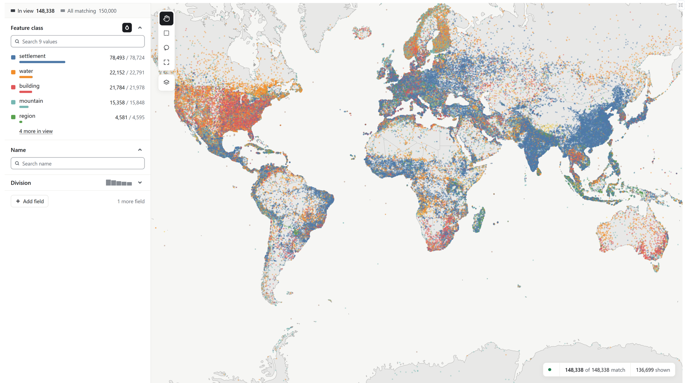

<h1>
  <picture>
    <source media="(prefers-color-scheme: dark)" srcset="brand/mosaica-lockup-white.svg">
    
  </picture>
</h1>

**Interactive maps of billions of points.**

Mosaica is a database for serving interactive maps over billions of spatial data points with granular access control on every point. Give it records with a position, such as every place in a gazetteer, every specimen in a biodiversity archive or millions of papers laid out by their embeddings, and it serves a map anyone can pan, zoom, filter and search, in a browser or a notebook.



## Why Mosaica

- **Nothing is thrown away.** Tile pipelines drop points to keep tiles small, so a filter can only narrow what survived. Mosaica answers each view from the full data, so a filter down to ten points shows those ten points.
- **Big data, small hardware.** It is built to serve billions of points from a single machine to many viewers at once.
- **Live data.** Insert, delete and hide records while it serves, with no rebuild.
- **A map per viewer.** Give records access labels, and each viewer's map, its points and every count, is computed only from what they may see.
- **Use it from anywhere.** Deploy as a server with the bundled explorer, integrate with your existing UI, run directly in a Python notebook, or script it from the command line or the HTTP API.
- **Secure enrichments.** Serve layered enrichments over your data, such as clusters, groupings, and hierarchies, with access control applied to each artifact, or served only to viewers who can see the points it was made from.
- **Powerful filters.** Combine spatial filtering such as tiles or polygons with metadata and text search to build exactly the view you need.
- **Multiple views.** Build multiple views over the same data, across geospatial and abstract spaces, or visualise your data at different times.

## Try it in a notebook

```bash
git clone https://github.com/mosaicadb/mosaica && cd mosaica
python3 -m venv .venv && . .venv/bin/activate
pip install 'mosaica[widget]' pandas jupyterlab
jupyter lab
```

In a notebook in the clone, map the 150,000 GeoNames places the repository ships:

```python
import mosaica
import pandas as pd

places = pd.read_parquet("examples/data/geonames/points.parquet", dtype_backend="numpy_nullable")

db = mosaica.create()
db.declare_view("world", projection="web_mercator")
db.declare_columns(places, category=["feature_class"], render=["feature_class"], index=["name"])
db.insert("world", places, lon="lon", lat="lat")
db.commit()
db.map(colour_by="feature_class")
```

[Your first map in Python](docs/start/python.md) carries on from here, [your first map from files](docs/start/first-map.md) serves the same map to a browser, and [Run Mosaica with Docker](docs/guides/docker.md) puts it on a server.

## Install

| For | Install |
|---|---|
| Python 3.12+ (brings the server on Linux and macOS) | `pip install mosaica` |
| A web page | `npm install @mosaicajs/components` |
| A server | `docker pull ghcr.io/mosaicadb/mosaica:latest` |
| The command line | a [release archive](https://github.com/mosaicadb/mosaica/releases/latest), or `cargo install --locked mosaica` |

[Install and configure](docs/start/install.md) covers platforms and setting up a database.

## When to use something else

- Your data fits in the browser: draw it there, with deck.gl or a plotting library.
- It never changes and has no access rules: static tiles such as PMTiles are cheaper to host.
- You need ad hoc SQL: use a columnar database such as ClickHouse.

Mosaica runs on one machine, with no replication yet, and search filters rather than ranks.

## Status

0.1.0 is an alpha. Expect formats and APIs to change before 1.0.

## Learn more

- [Documentation](docs/index.md): tutorials, [how it works](docs/system/overview.md), [guides](docs/guides/index.md) and the [reference](docs/reference/index.md).
- Examples for the [browser](clients/ts/examples) and [Python](clients/py/examples).
- [Contributing](CONTRIBUTING.md) and the [changelog](CHANGELOG.md).

Apache License 2.0. See [LICENSE](LICENSE).
