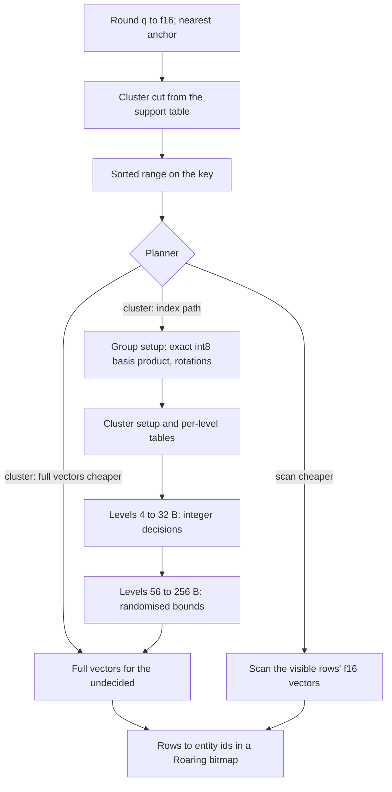

# LIMINAL: the index as it stands

LIMINAL (A Level-wise Interval Membership Index for Nearness Above a Limit) answers one question exactly: given a query
vector q and a threshold t, which of the items a viewer may see have an inner product with q of at least t? It reads a
few bytes of most items and the full vector of a few, and it decides every item by a bound that holds for that item
alone. The index described here is the native prototype under `rust/` on `research/exact-vector-search`, and where the
code and a report disagree the code is followed and the disagreement named.

Every figure comes from one dataset and one machine unless it says otherwise. The dataset is 999,000 BioCLIP-2 image
embeddings in 768 dimensions, stored as half-precision (f16) vectors of 1,536 bytes. Queries come in two kinds, and
the distinction matters more than the modality. In-distribution queries are held-out image embeddings, drawn from the
same distribution as the data. Out-of-distribution (OOD) queries are embeddings of species prompts from the model's
text tower, searched against the image embeddings, so they come from a different region of the space. OOD queries
cost more for two reasons: they put much of their weight in directions where the data varies little and the code is
coarse, so each interval is wider for the same bytes; and their similarities to the data are low and bunched, so many
more items lie near any threshold. Supplying a sample of expected queries at build, which the fit uses for the basis
and the bit allocation, addresses the first reason directly (section 2). The machine is a Ryzen 9 5900X (AVX2, no AVX-512) under WSL2, timed on one pinned thread.

## 1. What it answers

A **row** is one stored vector, and each row belongs to one **entity**, the id that results are returned in. The build
refuses two rows of one entity, because the nearest-neighbour selection counts rows. A **viewer's visible set** is a
Roaring bitmap of entity ids, permuted into row order once per session (0.5 ms for a 1% set at 1M, 8–9 ms for 50%). Let
S(t) = {x visible : q·x ≥ t}, evaluated exactly on the stored f16 vectors and the query rounded to f16. "Exact" here
means exact in that arithmetic, so the answers differ from a float64 brute force only by items whose score lies within
f16 rounding of t.

The **threshold query** returns R, a bitmap of entity ids. At build time the index draws random rotations from a public
seed ω, and the guarantee is over that draw alone: for any query, threshold and visible set chosen without knowledge of
ω,

    Pr over ω [ S(t) ⊆ R ⊆ S(t − d) ] ≥ 1 − ε,  with ε = 10⁻⁹.

The **tolerance** d is the caller's option and defaults to 0, in which case R = S(t). A positive d takes an item in once
its lower bound reaches t − d but still leaves it out only when its upper bound is below t, so every match is returned
and some items just below the threshold may be returned too. The **k-nearest-neighbour query** returns the k visible
entities with the largest q·x, exact with the same probability.

Every decision about an item depends only on that item's stored data, the query and the threshold, so a result computed
over all rows and masked by a viewer's bitmap is the result that viewer would get directly, and one cached result can
serve every viewer. The guarantee spends ε over every row, so it uses **N**, the row count rounded up to a power of two
(2²⁰ at 999,000 rows), never a viewer's count. A cache must therefore drop its results when that power rises and must
not mix two powers in one result. Each item's budget is spent on one side only, so a result is valid for its own (query,
threshold), and reusing its intervals for another threshold or for k-NN needs the two-sided budget. The prototype has no
cache; every result carries the power (`Meta2::npow`) for one to use.

## 2. The pipeline

### 2.1 Build

`rust/tools/fit.py` fits what is learnt from the data and writes an index directory. The Rust build derives every other
parameter from it and encodes every item when the index is opened.

**Clusters.** The fit normalises the vectors, pads them to a multiple of 32 dimensions and runs k-means to clusters of
about 1,000 items (K = 999 at 1M). Each centre m is stored at 8 bits per dimension, and the residual r = x − m is taken
against the stored centre, so q·x = q·m + q·r holds exactly. Within a cluster the rows are sorted by a 16-bit **key**,
x·m̂. Because the vectors have unit length the key gives each item's m·r and residual norm, and from them a scale s that
normalises the residual so that one code table serves every item of a group.

**Groups and the dual basis.** Clusters are grouped by k-means on their centre directions (G = 64 at 1M, with at least 8
clusters and 20n items per group on average), and each group gets a basis. The measured index uses the **dual basis**
(`fit.py --basis dual`), built from the group's residual covariance and a covariance of query offsets estimated from
3,000 corpus items used as pseudo-queries (`--query-sample` mixes real queries in). In this basis the query-side
coordinates V_qᵀq and the item-side coordinates V_q⁻¹r are both uncorrelated, with equal variance on the two sides of
each coordinate, the pair that `groups/REPORT.md` section 2.4 derives as minimising the expected width of the bound.
Measured natively it reads 9–30% fewer bytes for in-distribution queries and 6–10% fewer for OOD queries than a PCA basis
(`dualproto/REPORT.md`). When the expected queries come from another distribution, as text prompts do against image
embeddings, supplying a sample of them with `--query-sample` fits the query side to where those queries point: on
BioCLIP-2 the text training prompts cut the bytes OOD queries read by a further 20–22% at answers of 1–75%
(`rust/results/combined/s1/bytes_dual_vs_dualmix.log`). The sample is optional and the default fit uses the data
alone. Every bound holds for any basis, so the fit affects only cost. The basis is stored in int8 with
one scale per vector and the build encodes z = V_q⁻¹r for that int8 V_q, so q·r = (V_qᵀq)·z + q·ε with |ε| ≤ e_inv|r|,
and the query computes V_qᵀq exactly in integers. A **profile**, the mean square of V_qᵀ(q − m) for 5,000 corpus items
against their four nearest centres, weights the bit allocation of both kinds of level.

**Deterministic levels.** The first six levels end at 4, 8, 12, 16, 24 and 32 bytes per item. Each coordinate of z is
coded additively, first as a tree field of depth 1, 2 or 4 on Gaussian centroids and then as 1-bit residual stages, and
a greedy allocation gives each next bit to the coordinate with the largest profile-weighted gain per bit, so every level
refines the one before. A level's new bits are packed into self-contained 4-bit units and stored in blocks of 32 items
with transposed nibbles, so that a query scores a level by looking each unit up in a 16-entry table, the layout known as
fast scan. Each item also stores, per level, a 4-bit code for the weighted norm of the error the level leaves, on a grid
of steps of 2^(1/16), rounded up, with code 15 escaping to an exact float in a side table. That norm makes any code
sound, because the unread part of the score is bounded by weighted Cauchy–Schwarz, |Δ·e| ≤ ‖DΔ‖·‖D⁻¹e‖ for the level's
weights D.

**Randomised levels.** Four further levels end at 56, 96, 160 and 256 bytes; above 768 dimensions the schedule continues
in steps of 1.6×, capped at 40% of the f16 vector. They code the error the 32-byte prefix leaves, weighted by the
profile, ordered by importance and split into four blocks at 1/8, 7/24 and 5/8 of n (96, 128, 256 and 288 coordinates at
n = 768). Each block has its own Haar-random rotation drawn from ω and shared by every group. Each rotated coordinate is
coded as a nested binary expansion, and a block's rate only rises from one level to the next, so each level adds bits to
the previous one. Because the rotation is random, the estimate's error in a coded block is A·u, where A = |y| tan φ is a
scale the item stores and u is uniform on the sphere orthogonal to y and independent of A (Lemma 8 of
`proofcheck/CONSOLIDATED_PROOFS.md`). The randomised bounds rest on that law alone, and it holds for any data.

**Stored scalars.** The first randomised level stores |y| per block in 8 bits, and each rise of a block stores the
estimator's scale κ in 4 or 8 bits and tan φ in 4 bits. The tables are fitted to round up with the least excess and are
decoded with byte permutes. A scale that is too large only widens the bound (R1 of `reports/bounds3/REPORT.txt`), so the
encoder rounds up against the stored tables, and the build asserts for every item, level and block that the decoded |y|
and tan φ are at least the true values. Values off the grids escape to exact floats, 41,393 of them at 1M.

**Support table, centre tables and certificate.** Every centre direction is an anchor, and for each (anchor, cluster)
pair the build stores the exact extremes of anchor·x over the cluster, rounded outward. It also stores each cluster's
centre tables, the query-independent part of every level's lookup tables. The fit takes the randomised constant for the
index's block layout from a shipped table of certificates (`rust/src/certs_table.json`), or else certifies it within
`--cert-time` (600 s by default; `rust/src/certify.rs`, the method of `rust/tools/certify.py`, which `fit.py` runs), and
writes it to `meta.json` (section 3).

**Opening.** The encoded codes are not written to disk, so opening an index derives the allocations, rates and scalar
grids and encodes every item: 147 s at 1M on three cores and 208 s on two in the runs in `rust/results/system/`. The
open also times the re-pack thresholds (0.1 s) and, unless a plan file is given, the planner's cost model (about 1 s).
The f16 vectors are held in row order, so a scan reads memory in order.

### 2.2 Query

*The threshold query. Each arrow carries only the items still undecided; an item leaves as soon as it is decided, to the
result if it matches.*

**Cut and sorted range.** The query is rounded to f16 and its nearest anchor p̂ found, giving β = q·p̂ and the norm ρ of
the rest of q. For every cluster holding a visible item, β times the stored extremes, plus or minus ρ times the largest
item norm, bounds every q·x in the cluster, so a cluster wholly above t is taken in and one wholly below skipped,
unread. In each remaining cluster the query computes q·m and bounds each item from its key alone. The items this decides
lie at the two ends of the sort order, which is a proved property of the bound, so the undecided items form one
contiguous range found by binary search, with certain matches above it and certain non-matches below. The visible rows
in the range are the cluster's **candidates**. At a 1% answer they are 22% of items for in-distribution queries and 95% for OOD queries
queries, whose scores are spread less widely.

**Planner.** A cost model in microseconds, timed when the index opens, chooses per cluster between the index path and
reading the candidates' full vectors, keeps a group's setup only if its clusters' savings pay for it, and sends the
whole query to a plain scan of the visible rows when that is cheaper, which happens for small visible sets.

**Group and cluster setup.** For each group on the index path the query computes V_qᵀq exactly, as int8 basis entries
times the query split into two 13-bit halves, summed in 32-bit integers and rounded once, and then rotates its weights
for the randomised blocks. Per opened cluster the query subtracts a multiple α of the centre from its weights, which
shrinks the weighted query norm that every deterministic bound multiplies. Tables are built only for the (cluster,
level) pairs some survivor reaches, by combining the group's float tables with the stored centre tables and quantising
to 16 bits with outward rounding and a bound on the rounding error.

**Deterministic levels.** Each candidate's key gives its scale and m·r, and from them integer thresholds for "in" and
"out"; per (cluster, level) the query tabulates the margin for each of the 15 norm codes. A level then decodes 32 items
at a time with byte shuffles and 16-bit additions and compares integer sums with thresholds, so no floating-point bound
is evaluated per item. Verify mode recomputes every such decision in float64.

**Randomised levels.** A survivor's estimate is a constant part, fixed at the first randomised level, plus κ_j times the
decoded sum of each coded block j. Its half-width is

    h = (c_ℓ · sd + deterministic terms) · (1 + 10⁻⁶),  sd² = Σ_j (|y_j| tan φ_j ‖Δ_j‖)² / d_j,

where d_j is the block's size less one, ‖Δ_j‖ the query's weight norm in the block and c_ℓ the constant of section 3.
The deterministic terms cover the 32-byte prefix's error, table and κ rounding, floating-point evaluation and, for a
block not yet coded, |y_j|·‖Δ_j‖ by Cauchy–Schwarz. An item is in when its lower bound reaches t and out when its upper
bound is below t.

**Re-pack and compaction.** Survivors move between levels as a structure of arrays. After each level the query compacts
only the arrays a later level reads, and it re-packs survivors into dense blocks of 32 when occupancy falls below a
threshold timed per level at open.

**Full vectors and result.** Items still undecided after 256 bytes are scored from their f16 vector in float32, with an
exact integer product only when the float score lies within its rounding bound of t; a full vector costs about 104 ns.
Accepted rows are mapped to entity ids and gathered into a Roaring bitmap.

**k-nearest neighbours.** A seed reads the 16-byte prefixes of up to 2,000 visible items in the most promising clusters
and scores the best 2k + 8 of them exactly, which gives a k-th best score τ₁, and the threshold query runs at τ₁. The
selection then drops a candidate when at least k others have a lower bound above its upper bound, certifies one when at
most k − 1 others have an upper bound at or above its lower bound, and refines the rest a level at a time. Both counts
exclude the candidate itself, which keeps the selection exact when only one side of each interval is guaranteed (R6 of
`reports/bounds3/REPORT.txt`).

## 3. The guarantee

The cut, the sorted range, the deterministic levels and the full-vector decisions are proved bounds with their rounding
covered, so they are never wrong. A randomised decision is wrong only when an estimate's error falls outside its
half-width on the side that misleads: a match is lost only through a failed upper bound and a non-match admitted only
through a failed lower bound. The index therefore spends δ = ε/(N·L) on one side of each (item, level) event, with L = 4
randomised levels, and the union bound over N·L events gives 1 − ε. The union cannot usefully be shortened, because one
item's errors at successive levels correlate only 0.45–0.47 and two levels almost never fail together (R7).

The constant c_ℓ is the quantile at δ of X = Σ_j a_j U_j, where U_j is one coordinate of a uniform unit vector in d_j
dimensions and the scales a_j are unknown. For one coded block the tail of U is an incomplete beta function, and c is
its exact quantile scaled by √d. For several blocks `rust/src/v2/tail.rs` takes the smallest of three bounds valid over
all scales: the certificate in `meta.json`, a closed form from convex order against one sphere of Σd_j dimensions (R4),
and Chernoff's bound with each coordinate's exact moment generating function. A certificate covers every subset of its
blocks and every budget at least as loose as its own. At 1M, ln(1/δ) = ln(2²⁰ · 4 / 10⁻⁹) = 35.97, and the build log
lists three sets of coded blocks:

| Level | Blocks coded (d_j) | c_ℓ | Source |
|---|---|---|---|
| 56 B | block 0 (95) | 6.931 | exact tail of one sphere coordinate |
| 96 B and 160 B | blocks 0–2 (95, 127, 255) | 7.963 | the four-block certificate, which covers its subsets |
| 256 B | all four (95, 127, 255, 287) | 7.963 | certificate |

The sub-Gaussian constant at the same budget would be 8.482. The certified value rests on four results in
`reports/bounds3/REPORT.txt`. Lemma 8 gives each block's error law and, because each block has its own rotation, the
independence of blocks. R1 shows the tail is non-decreasing in every scale, so rounded-up scalars are covered. R3
reduces the worst case over scales to a grid computation whose every approximation errs on the safe side. R6 proves the
one-sided budget for threshold queries and for the k-NN counts above. The referee
(`reports/bounds3/referee/REFEREE.txt`) found nothing unsound and computed the exact worst cases independently,
0.008–0.009 below each certified value; the certified figures are floating-point computations, not interval-verified.
The bit rates are designed with a fixed constant (`CSG`), so the stored code does not depend on N.

On a 50k index (N = 2¹⁶, constants 6.724 and 7.639), 200 item and 200 OOD queries at seven answer sizes and four
filtered visible sets gave no wrong item, no violation in 42.2 million interval checks, exact k-NN throughout, and a
largest randomised error of 5.47 standard deviations against a constant of 7.64. At 1M the benchmark of section 6 found
the index's answers byte-identical to the plain f16 scan at every visible set.

## 4. Speed at 1M, one thread

### 4.1 End to end

The table is the final build of `rust/REPORT_CONST.md`. Each time is the mean over three interleaved processes of the
median over three runs of the median over 20 queries, computed with `rust/results/const/cmp.py` from
`rust/results/system/t_s4_{2,3,4}.out`. The cores were shared with another benchmark, so times carry about ±5% noise,
while bytes and the full-vector share are exact. Bytes are read per item of N and include full vectors, so 15.4 B/item
is 1% of the f16 data. "Full" is the share of all rows whose full vector is read.

| Answer | In-dist ms | In-dist B/item | In-dist full | OOD ms | OOD B/item | OOD full |
|---|---|---|---|---|---|---|
| 0.01% | 2.48 | 2.9 | 0.11% | 20.2 | 20.6 | 0.55% |
| 0.1% | 3.51 | 5.8 | 0.24% | 23.6 | 26.1 | 0.40% |
| 1% | 8.06 | 18.6 | 0.71% | 39.6 | 67.0 | 0.78% |
| 10% | 53.2 | 133.2 | 2.85% | 61.1 | 184.5 | 4.80% |
| 50% | 72.9 | 276.2 | 8.43% | 80.6 | 322.8 | 10.38% |
| 75% | 69.0 | 238.9 | 6.82% | 75.5 | 282.2 | 8.49% |

A plain f16 scan of every row takes 86–89 ms on the same machine (`rust/REPORT_RAND.md`), so the index is faster at
every size, by 35× for in-distribution queries at 0.01% and by 1.1–1.2× at 50%. Large answers cost nearly as much as a scan because
almost every item must be read deep enough to be decided: at a 50% in-distribution answer 91% of items enter the first randomised
level and 20% the last. OOD queries cost more at small answers because their scores are concentrated, so at a 1% OOD
answer 95% of items enter the first level and 46% reach 56 B.

### 4.2 Where the time goes

The newest full breakdown, `rust/results/system/bd_p2c.out`, comes from the build of `rust/REPORT_BOUNDS.md`, just
before the constants work (constants 7.413 and 9.086 at N = 10⁹). The constants work changed bytes and the full-vector
share (in-distribution 50%: 301 → 276 B/item, 9.63% → 8.43%) and no phase. Its columns are decoded from `breakdown2` in
`rust/src/run2.rs`: the wall time is the best of two unprofiled runs, and the phases come from a third, profiled run
whose time stamps add their own cost, mostly to "level other". Times are ms per query, means over 20 queries.

| Phase | In-dist 1% | In-dist 50% | OOD 1% | OOD 50% |
|---|---|---|---|---|
| Wall, unprofiled | 7.70 | 75.75 | 40.06 | 79.77 |
| Wall, profiled | 12.79 | 87.69 | 47.97 | 93.34 |
| Query setup: anchor, cut, basis products, group post-processing, rotations | 3.76 | 6.66 | 6.64 | 6.41 |
| Cluster setup and per-level setup | 1.20 | 3.71 | 3.64 | 3.75 |
| Tables | 0.86 | 6.11 | 4.84 | 6.29 |
| Candidate init (key to scale, integer thresholds) | 0.66 | 3.03 | 2.79 | 3.08 |
| Level decode | 1.24 | 18.23 | 7.36 | 19.55 |
| Bounds and decisions | 1.19 | 21.23 | 8.23 | 22.66 |
| of which randomised scalars' decode | 0.58 | 10.78 | 4.20 | 11.61 |
| Re-pack and compaction | 1.66 | 9.14 | 7.97 | 8.90 |
| Level other (mostly profiler stamps) | 0.84 | 6.73 | 4.39 | 7.27 |
| Full vectors | 0.86 | 10.90 | 1.11 | 13.54 |
| Result bitmap | 0.13 | 0.58 | 0.16 | 0.57 |
| Other (bookkeeping, merge, unattributed) | 0.36 | 1.36 | 0.85 | 1.31 |
| Bytes read per item | 19.1 | 301.1 | 69.9 | 352.6 |
| Wrong items against brute force | 0 | 0 | 0 | 0 |

A query's fixed cost is 6–7 ms once most groups are open: about 3 ms for the 37.7 MB of int8 basis products, 1.8–1.9 ms
for the cut, which reads 6 MB of float64 centres, and 0.8 ms for the rotations. That is a sixth of a 1% OOD query and a
third of a 0.01% one. At large answers the work per item dominates. Decode, bounds and decisions together take 39–42 ms,
nearly half of the profiled time, and decode is bound by the bytes read, while half of the bounds time is decoding the
randomised scalars. Full vectors take 11–14 ms at 50% for about 100,000 reads, and re-pack and compaction 9 ms.

## 5. Memory

The per-item figures below are the build log's stored bytes per item; the fixed parts are computed from the structure
sizes in `rust/src/v2/mod.rs` and were not measured separately.

| Part | Per item | At 1M |
|---|---|---|
| Key (x·m̂, 16 bits) | 2 B | 2 MB |
| Deterministic levels through 32 B, codes and norm codes | 35 B | 35 MB |
| First randomised level (24 B of code, 5.5 B of scalars) | 29.5 B | 29 MB |
| Levels at 96, 160 and 256 B, codes and scalars | 209.8 B | 210 MB |
| Row-to-entity and entity-to-row ids | 8 B | 8 MB |
| Full f16 vectors | 1,536 B | 1.43 GiB |
| int8 bases, one per group | | 37.7 MB |
| Centre tables, per-cluster data, float64 centres and anchors, support table, rotations, escapes | | about 50 MB |

Codes and scalars take 0.26 GiB, a fifth of the vectors, and the whole index needs about 1.8 GiB. The benchmark report
of section 6 lists 0.14 GiB of bases in memory, which is the size of the float32 basis file on disk; a query reads the
int8 copy.

The share of a query's items that reads each part decides what must be resident. Every query reads the fixed parts of
the groups and clusters it opens, so those stay in memory. The first levels are read by most candidates: 95% of items
enter the 4-byte level for a 1% OOD answer and 97% for a 50% in-distribution answer. The 256-byte level is entered by 1.6% to 20%
of items across those two cells and full vectors by 0.1% to 10%, so the deep levels and the vectors are the parts to
leave on disk, where each level is already stored contiguously per cluster. Not measured yet: the index with any part on
disk or under a memory cap, which is in progress on `research/bench-capped`. The planner's plain scan reads every
visible vector, so its cost constant would change with the vectors on disk.

The prototype process measured 6.2 GiB resident after the benchmark queries (peak 6.6 GB) against the 1.8 GiB the
structures need. The codes are rebuilt at open and the process keeps the memory the build allocated, and the vectors are
held more than once, as a heap copy in row order and through more than one mapping of the vector file, which the build
reads in full.

## 6. Against other systems

`bench/threshold-db/REPORT.md` on branch `research/bench-update` (to be merged) compares the index with databases and
vector libraries on 999,950 vectors of the same corpus and 15 mixed queries (5 in-distribution image queries, 10 OOD OOD queries), with every answer
returned as a complete id set. Its index is the build of section 4.2, which reads 6.5–8.5% more bytes than the final
build at answers of 10–75%. Times are medians in ms at one thread.

| System | 100 items | 10k items | 300k items | 750k items | 1% visible |
|---|---|---|---|---|---|
| This index | 29.7 | 43.6 | 76.9 | 76.6 | 1.11–1.33 |
| Plain f16 scan of the same vectors | 80.9 | 83.0 | 90.7 | 98.9 | 0.75–0.91 |
| faiss Panorama flat, f32, exact | 42.0 | 61.7 | 159 | 191 | 3.4–9.9 |
| faiss IndexFlatIP range search, f32, exact | 151 | 151 | 134 | 131 | 1.0 on a compacted copy |
| ClickHouse 26.10, BFloat16 | 423 | 426 | 444 | 451 | 283–298 |

Among exact methods the index is the fastest at every unfiltered size: 5–14× faster than ClickHouse BFloat16, 1.4–2.5×
faster than faiss Panorama and 1.3–2.7× faster than its own plain scan. At four threads it takes 11.0 to 27.9 ms. It
loses inside a 1% visible set, where 10,000 items remain: a plain scan of the visible rows (0.75–0.91 ms) and faiss over
a compacted copy (1.0 ms) beat its 1.1–1.3 ms, because the planner still takes the index path.

Approximate methods win at small unfiltered answers. Tuned on the timed queries towards a recall of 0.99 (reaching
0.985–0.997), hnswlib answers 100 items in 4.7 ms, RaBitQ in 11.6 ms and IVF in 13.2 ms, against the index's 29.7, and
at 10,000 items they are level with it (24–41 ms against 43.6). At 100,000 items the index (62 ms) is faster than all of
them at that recall: IVF needs every cluster (113 ms), hnswlib takes 224 ms, RaBitQ 378 ms and faiss HNSW 4.5 s. Inside
a 1% visible set approximate search does not help, because IVF needs every cluster from 1,000 answers on (7–10 ms) and
filtered HNSW takes 3.2 s to reach recall 0.989 at 1,000 items. In memory the index needs about 1.8 GiB, against 1.43
GiB for a flat f16 index, 1.57 GiB for faiss HNSW over f16 vectors and 0.7 GiB for RaBitQ.

## 7. Known limits and open items

**Small visible sets.** Inside a 1% visible set the planner chooses the index, which is 0.3–0.5 ms slower than scanning
the visible rows, because the cut and group setup are fixed costs that a scan of 10,000 rows does not pay. A packed scan
of the visible rows (`pscan`) is built and off by default.

**Codes rebuilt at open.** Opening the index re-encodes every item, which takes 2.5–3.5 minutes at 1M on two or three
cores and leaves the process at 6.2 GiB. Not built: writing the encoded index to disk and opening it from there.

**One unexplained crash.** One run segfaulted in the timing loop for OOD queries with a fifth randomised level at 384 B
and the `bail` option (since deleted with the other rejected switches). Seven reruns of that configuration, three with guard pages and bounds
assertions, and an AddressSanitizer build at 50k and 1M were clean. The cause is unknown and may be hardware.

**Not measured.** This version has not been measured on real data above 1M rows (a synthetic 10M run stopped during its
build), on any dataset but BioCLIP-2, at any dimension but 768, under a memory cap or with any part on disk (in
progress), or behind a cache. The time gain of the constants work is unresolved, because the expected 1–3% is below the
±5% noise of runs on a shared machine. There is no write path: inserts, deletes and suppressions are designed in
`DESIGN.md` section 4 and not built.

**Built and off.** Several paths are built and off by default, among them the norm sort of `DESIGN.md` section 9. The
columnar store, which `rust/REPORT3.md` (branch `research/colorder`) rejected at 1–27% more bytes and 10–25% more time,
is deleted. The integer deterministic levels, tables combined from the group's and the centre's, and the per-level
repack thresholds are on by default (`--flags noint,nogtab,norepack` turns them off).
The tolerance is the one option that moves cost much: d = 0.01 halves the bytes and saves 17–19% of the time at 50%
answers, while small answers barely move, because their cost lies in items far below the threshold.

## 8. Map of the reports

`README.md` lists the early experiments by directory. `DESIGN.md` consolidates the design from the numpy prototypes,
with the write path and related work, and its query description and costs predate the native code. `FINDINGS.md` holds
the problem statement, the metric and the owner's decisions, and `proofcheck/` the refereed proofs of the floors and of
the randomised guarantees (Lemma 8, Theorems 5–7, Propositions 10–13).

Each report in `rust/` records one step and its before and after at 1M. `rust/README.md` says how to build and run.
`rust/REPORT2.md` introduced the fast-scan code, re-packing, int8 bases and the planner. `rust/REPORT3.md` (branch
`research/colorder`) rejected the columnar store. `rust/REPORT_SETUP.md` cut the fixed per-query costs and made the
breakdown account for every millisecond. `rust/REPORT_RAND.md` moved to four randomised levels. `rust/REPORT_BOUNDS.md`
made the randomised bounds cheaper and tighter, measured the tolerance and deeper schedules, and records the crash.
`rust/REPORT_CONST.md` set the certified constants, the one-sided budget, N from the index and the tan φ levels.

`reports/README.md` indexes the mathematics. `reports/bounds3/REPORT.txt` derives the constants (R1–R9) and
`reports/bounds3/referee/REFEREE.txt` checks them; `reports/surge/` holds the integer decision kernel and the
threshold-set constants, and `reports/surge2/` the approximate mode and the write path at scale. The result files this
document cites are in `rust/results/system/`.
