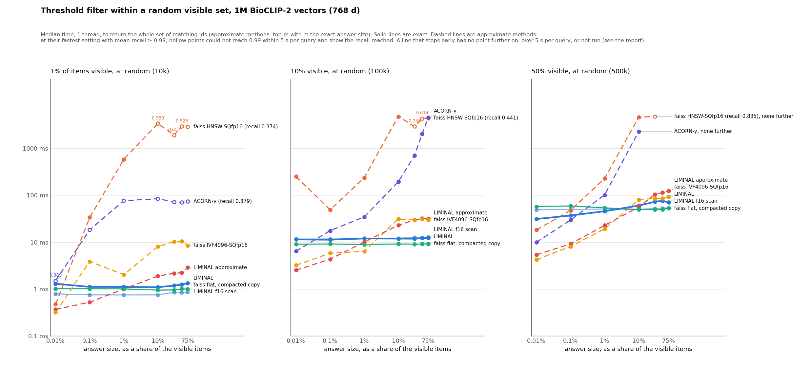
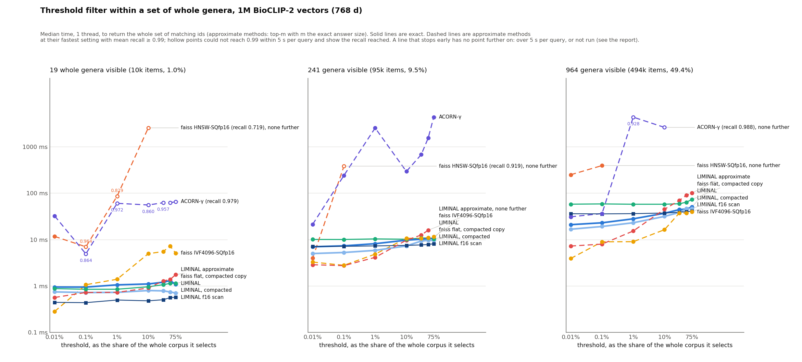

# Exact threshold filter: databases, ANN libraries and LIMINAL


The plots show one line per system so that they stay readable; the tables below hold every row, including LIMINAL
as measured on 13 Nov, ClickHouse Float32, the half-precision faiss variants (the same speed as f32 at half the memory,
except flat range search) and each approximate method at its default setting. Approximate methods appear at their
fastest setting with mean recall at least 0.99; a hollow point is one where the method could not reach 0.99 within
5 s per query, labelled with the recall it reached. In the 1% visible panel faiss flat is the search over a compacted
copy of the visible rows, which takes about 30 ms to build per visible set. The data behind both plots is in
[results/plot_data.csv](results/plot_data.csv).

This is the 14 Nov update of the 13 Nov report. The LIMINAL rows were re-measured with the current index. The approximate
rows were extended to larger answers, and half-precision faiss variants were added. The ClickHouse rows and the other
existing rows are as measured on 13 Nov.

**15 Nov: LIMINAL approximate is the new mode.** Its rows, here and in the filtered section, were re-measured on 15 Nov
with the best-first approximate k-NN mode (`knn2_fast`, described in `../topk/REPORT.md`) in place of `knn2_dial`.
Every other row is as committed. The rows of the old mode are kept in `results/approx/liminal_approx_old_mode.csv`
and `results/filtered/liminal_approx_old_mode.csv`, and the tables show them as "old mode".

## The question

The query is: given a unit query q and a threshold t, return the ids of every item with q·x ≥ t, together with
their count. It is run over the whole corpus, and within a viewer's visible set (visible ∩ {q·x ≥ t}). Every time below
covers the whole query, from the call to holding the full id set, so returning 750k ids is counted.

## Setup

- **Corpus.** 999,950 BioCLIP-2 image embeddings (768 d), from 20 random row groups of
  `imageomics/TreeOfLife-200M-Embeddings/bioclip-2_float16` (seed 7, the same picks as `../../fetch.py`), normalised in
  f64. 50 further rows were held out as image queries.
- **Queries.** 150 queries: 50 held-out images (in-distribution) and 100 out-of-distribution (OOD) queries, text-prompt
  embeddings searched against the image embeddings: 50 from `text_q.npy` and 50 from `text_insample.npy`. Timing used
  every 10th query, which gives 15 queries (5 of each kind). OOD queries cost LIMINAL more, because they point where
  the code is coarse and their scores bunch near any threshold; the medians mix the two kinds.
- **Thresholds.** For each query there are seven thresholds, with answers of 0.01%, 0.1%, 1%, 10%, 30%, 50% and 75% of
  the corpus. Each is the midpoint between the k-th and (k+1)-th f64 similarity, so the exact answer has exactly k items.
  Answer sizes run from 100 to 749,962.
- **Visible sets.** Random sets of 50%, 10% and 1% of the ids. ClickHouse and the ANN libraries ran unfiltered and at
  1%. LIMINAL ran at all four.
- **Machine.** Ryzen 9 5900X (AVX2, no AVX-512) under WSL2.
  - 13 Nov: every run was pinned to cores 8–11, with another agent timing on cores 0–7.
  - 14 Nov: 1-thread runs were pinned to core 10 and 4-thread runs to cores 8–11. Builds ran on cores 9–11 (3
    threads). Other agents were running on cores 0–3 throughout, and on cores 4–8 during the LIMINAL 1-thread run and the
    first approximate runs. Memory bandwidth is shared, so expect up to 35% run-to-run variation.
- **Repetitions.** Each (query, threshold, visible set) ran 5 times. A system's figure is the median over queries of each
  query's median, and the p90 is over the same per-query medians.
- **Cache state.** All figures are warm. Cold runs needed `sudo` to drop the page cache, which was not available.

## Versions and the forms used

- **ClickHouse 26.10.4.207**, official image `clickhouse/clickhouse-server:26.10.4.207` (sha256:4f491abc…035), 16 GB
  limit. Tables were `MergeTree ORDER BY id`, with `vec Array(Float32) CODEC(NONE)` and `Array(BFloat16) CODEC(NONE)`.
  BFloat16 is supported and not experimental. The query that ran is `SELECT id FROM t WHERE dotProduct(vec, q) >= t`
  with `optimize_move_to_prewhere = 0` (0.54 s against 0.7–0.9 s with automatic PREWHERE),
  `use_query_cache = 0` and `use_query_condition_cache = 0`, returning RowBinary over HTTP.
  - Also tried: `cosineDistance` (15–20% slower), `L2SquaredDistance` (slower), mmap reads and the uncompressed cache
    (no gain).
  - For the visible set, `PREWHERE id IN s_vis`, where `s_vis` is a Set-engine table built once at load, was the
    fastest correct form. `bitmapContains` on a stored `groupBitmap` state was about the same. An IN subquery was
    slightly slower, and a JOIN was slower again.
  - A 1% visible set saves little, because every 8192-row granule holds visible rows, so the whole `vec` column is still
    read.
  - The vector-similarity (HNSW) index is not used for a WHERE threshold in 26.10. On a test table, `EXPLAIN
    indexes = 1` shows the skip index on `ORDER BY cosineDistance … LIMIT 10` (2 of 20 granules) and no skip index on
    `WHERE cosineDistance(...) <= r` (20 of 20 granules).
- **DuckDB 1.5.6** was measured on 13 Nov and is left out of the plots, the table and the conclusion: it took about
  2 s per query (2.1–2.3 s unfiltered, 1.7–1.8 s at 1% visible, 1 thread), bound by reading the `FLOAT[768]` column
  (`SELECT sum(vec[1])` alone takes 1.6 s). Its rows are still in `results/duckdb.csv`.
- **LIMINAL.** The `research/bench-update` branch (from `research/rand-bounds` at 1d827e0de), with the `dbcmp` mode
  ported into `rust/src/run2.rs`. It takes explicit thresholds and visible-set files. It times query preparation, the
  query, and the entity-id answer as a Roaring bitmap.
  - The index is the current default: `fit.py --basis dual` (four randomised levels at 56, 96, 160 and 256 B), run
    with `--int --gtab --flags repack`. Its cost model was calibrated on core 10.
  - `index` is `threshold2` through the planner. `flat` is the plain f16 scan of the same stored vectors.
  - The visible set is permuted into row order once per session, in 0.5 ms for 1% and 8–9 ms for 50%. That step is
    outside the timed query.
- **faiss 1.16.0** (pip `faiss-cpu`, AVX2 build) provided:
  - `IndexFlatIP.range_search` (exact, f32). Single-query range search does not use more than one thread, so its
    4-thread figures equal its 1-thread ones.
  - `IndexScalarQuantizer` with `QT_fp16` (exact against the f16 vectors), also as a range search. It does not use
    more than one thread for one query either.
  - `IndexFlatIPPanorama` (exact, 8 levels, after an orthogonal PCA rotation of data and queries; faiss's `PCAMatrix`
    centres the data, which changes inner products). Panorama ran in f32 only, because faiss has no half-precision
    Panorama index.
  - `IndexIVFFlat` IVF4096 and `IndexIVFScalarQuantizer` IVF4096 `QT_fp16` (range search), trained on the same 200k
    sample.
  - `IndexHNSWFlat` and `IndexHNSWSQ` `QT_fp16` (M 16, efConstruction 200).
  - Filtering in faiss used `IDSelectorBitmap`. The flat indexes were also measured over a compacted copy of the
    visible rows, which took 30–60 ms to build per visible set.
- **hnswlib 0.8.0** (M 16, ef_construction 200), f32. It ran unfiltered only, because its Python binding filters only
  through a Python callback. faiss HNSW covers the filtered case.
- **RaBitQ: rabitqlib 0.2.0**, the authors' library, as `IvfIndex` with the IVF4096 centres, 7 bits and every cluster
  probed (nprobe 4096), run as top-m with `high_accuracy = True`.
  - The library uses its built-in error bound (ε₀ = 1.9) to choose which candidates are refined with the extra-bit code.
    Final distances come from the 7-bit code, and no full-precision re-rank is done.
  - The bound is a probabilistic heuristic, not a certificate.
  - faiss 1.16's RaBitQ indexes re-rank only by a fixed factor (IndexRefine), so they were not used.
  - rabitqlib has no filter, so RaBitQ ran unfiltered only.
- **LIMINAL approximate (15 Nov).** The index's best-first approximate k-NN mode (`knn2_fast`, timed by the `dbknn`
  mode in `rust/src/run2.rs`), run as top-m with m the exact answer size, like hnswlib. It probes clusters in order of
  q·m + f·r, the centre score plus f times the cluster's RMS radius (f = 0.2, fitted on 300 corpus pseudo-queries).
  Each probed cluster runs as a threshold query at the running m-th best score, every code level dropping an item once
  its estimate plus a dial factor times the half-width falls below that score, and the survivors are scored from
  their stored vectors into a heap of the m best. It reads only visible rows, so it runs filtered. The dials are fitted
  on the 135 queries that are not timed, for k = the answer size over the whole corpus at that threshold, capped at
  1,000 (the fit runs a verified threshold query per query, which took over 6 minutes at k = 10k). "Tight" walks the
  doubling cluster ladder for the dial off and the dials at miss rates 0.001, 0.01, 0.03 and 0.1, and keeps the
  fastest first rung reaching mean recall 0.99; its setting is `clusters:dial`. There is no "default" setting in this
  mode. Recall is ann.py's, |returned ∩ exact| / m.
- **LIMINAL approximate, old mode (14 Nov).** `knn2_dial`: the same cluster order, then the exact k-NN over the visible
  items of the probed clusters, with the randomised levels' upper half-widths cut by a dial fitted on 200
  pseudo-queries for recall 0.99. "Default" was every cluster with that dial; "tight" the smallest cluster count on
  the doubling ladder with that dial and mean recall ≥ 0.99.
- **Panorama PR.** [faiss PR 4970](https://github.com/facebookresearch/faiss/pull/4970) (head fa834bf3ea04) was not
  built. It adds `IndexIVFPQPanorama`, which is approximate because it uses PQ codes.
- **Rebuilt indexes.** The 13 Nov ANN index files had been deleted, so IVF, RaBitQ, hnswlib and faiss HNSW were
  rebuilt with the same parameters. They reproduce the 13 Nov points they were checked against: IVF tight at 10k items
  23.7 ms r .992 (13 Nov: 26.2 ms r .992), and at 1% visible 1.64 ms r .991 (1.95 ms r .991); RaBitQ at 10k 24.1 ms
  r .996 (23.9 ms r .996); hnswlib tight at 10k 42.7 ms r .992 (41.1 ms r .992); faiss HNSW tight at 10k 226 ms r .992
  (222 ms r .992). See `results/ann_logs/recheck.csv`.

## Approximate settings

- **Top-m methods.** These ask for m = the exact answer size. "Default" is ef = m. "Tight" is the smallest rung on
  m × {1, 1.5, 2, 3, 4, 6, 8, 12, 16, 24, 32, 64, …, 1024} with mean recall ≥ 0.99.
- **IVF range search.** "Default" is nprobe 1, faiss's default. "Tight" is the smallest power of two with mean
  recall ≥ 0.99.
- **The cap on the 14 Nov points.** The ladder stops at ef = N, and at the first rung whose median query takes more
  than 5 s. If 0.99 is not reached within that, the tight point is the last rung within the cap, and its recall is
  labelled. The 13 Nov points capped ef at 200k instead.
- **Tuning.** The tight settings were tuned on the timed queries themselves, so they are optimistic.
- **LIMINAL approximate** was measured on 15 Nov in three runs on cores 10–11, the query thread pinned to core 10,
  with the plan constants of `results/ours/plan.txt` (`results/approx/run2_new_mode.log` has every rung). The ladder
  started at 1 cluster unfiltered at 100 and 1k items and at 1% visible up to 100 items, at 64 unfiltered at 10k and at
  256 at 1% visible from 1k items; each starting rung was below 0.99 for every dial. Every point reached 0.99, and
  100k items was not run, as before.
- **LIMINAL approximate, old mode** was measured on 14 Nov. At 10k items unfiltered, 256 clusters took 8.7 s per query
  for recall 0.986, past the cap, so it had no tight point; the default took over 3.5 s per query.
- **Recall cases that need a note:**
  - Unfiltered at 100 items, hnswlib and f32 HNSW stopped at 32 m on 13 Nov, at recall 0.985–0.987. HNSW-SQfp16,
    on the new ladder, reached 0.991 at 64 m (16 ms).
  - Unfiltered at 100k items, IVF reaches 0.989 at nprobe 2048, so its tight point is nprobe 4096. That probes every
    cluster, so it is exact, and slower than a flat scan.
  - At 1% visible, IVF needs every cluster from 1k items on.
  - Filtered HNSW (f32 and SQfp16) does not reach 0.99 within the cap from 1k items on. At 1k it reaches 0.989 at
    128 m (3.2–3.4 s), and 256 m gives 0.998 in 13 s. At 3k, 5k and 7.5k items the best within 5 s is 32 m, 24 m and
    16 m, with recall 0.66, 0.53 and 0.37, at 2–3 s per query.

## Median ms per query (whole id set returned)

Answer sizes are 100, 10k, 300k and 750k items unfiltered, and about 1, 100, 3k and 7.5k items at 1% visible. Times
over 1 s are rounded to whole ms.

| system | precision | unfiltered, 1 thread | 1% visible, 1 thread | unfiltered, 4 threads | 1% visible, 4 threads |
|---|---|---|---|---|---|
| **LIMINAL** | f16 | **29.7 / 43.6 / 76.9 / 76.6** | **1.22 / 1.11 / 1.18 / 1.33** | **11.0 / 15.0 / 27.3 / 27.9** | **1.03 / 1.08 / 1.11 / 1.23** |
| LIMINAL (13 Nov) | f16 | 48.7 / 80.6 / 148 / 157 | 1.27 / 1.23 / 1.29 / 1.40 | 14.9 / 23.0 / 43.9 / 52.5 | 0.71 / 0.73 / 0.83 / 0.88 |
| LIMINAL f16 scan | f16 | 80.9 / 83.0 / 90.7 / 98.9 | 0.91 / 0.75 / 0.85 / 0.86 | 36.1 / 35.6 / 40.2 / 47.7 | 0.81 / 0.78 / 0.84 / 0.88 |
| faiss Panorama flat (exact) | f32 | 42.0 / 61.7 / 159 / 191 | 3.4 / 4.5 / 7.9 / 9.9 | – | – |
| faiss IndexFlatIP range (exact) | f32 | 151 / 151 / 134 / 131 | 1.0 (compacted) / 5.4 (selector) | 125–132 | 1.0 / 5.8 |
| faiss SQfp16 flat range (exact) | f16 | 1070 / 1094 / 1150 / 1146 | 11 (compacted) / 16 (selector) | 1097–1186 | 11 / 15 |
| ClickHouse BFloat16 | bf16 | 423 / 426 / 444 / 451 | 283 / 288 / 284 / 298 | 161 / 168 / 169 / 177 | 121 / 126 / 128 / 131 |
| ClickHouse Float32 | f32 | 619 / 631 / 657 / 688 | 575 / 580 / 624 / 590 | 320 / 329 / 349 / 294 | 242 / 240 / 255 / 260 |

Approximate methods, 1 thread. Unfiltered answers are 100 / 1k / 10k / 100k items; at 1% visible they are about
1 / 11 / 100 / 1k / 3k / 5k / 7.5k items. The 100k column and the 1k–7.5k columns are new on 14 Nov, as are the
SQfp16 rows. `r` is mean recall, shown where it is below 1.

| system | precision | unfiltered | 1% visible |
|---|---|---|---|
| hnswlib ef = m | f32 | 0.16 r .77 / 1.95 r .90 / 17.3 r .95 / 157 r .977 | – |
| hnswlib tight | f32 | 4.7 r .985 / 12.6 r .990 / 41.1 r .992 / 224 r .993 | – |
| faiss HNSW ef = m | f32 | 0.16 r .75 / 1.87 r .90 / 36.9 r .95 / 2011 r .977 | 0.03 r .11 / 0.05 r .07 / 0.19 r .09 / 1.9 r .07 / 6.9 r .05 / 14 r .05 / 22 r .04 |
| faiss HNSW tight | f32 | 6.4 r .987 / 45.7 r .994 / 222 r .992 / 4532 r .992 | 0.76 / 37 r .987 / 614 r .996 / 3203 r .989 / 1967 r .66 / 3017 r .53 / 3005 r .37 |
| faiss HNSW-SQfp16 ef = m | f16 | 0.17 r .68 / 1.44 r .90 / 36.4 r .95 / 2060 r .977 | 0.02 r .11 / 0.04 r .07 / 0.17 r .10 / 1.4 r .07 / 5.4 r .05 / 12 r .05 / 22 r .04 |
| faiss HNSW-SQfp16 tight | f16 | 16.1 r .991 / 44.6 r .993 / 236 r .992 / 4578 r .992 | 0.47 / 33 r .991 / 584 r .997 / 3371 r .989 / 1916 r .66 / 2924 r .53 / 2886 r .37 |
| faiss IVF4096 range, nprobe 1 | f32 | 0.26 r .23 / 0.27 r .11 / 0.27 r .02 / 0.26 r .002 | 0.24 r .22 / 0.24 r .08 / 0.25 r .02 / 0.28 r .002 / 0.23 r .001 / 0.23 r .0004 / 0.24 r .0003 |
| faiss IVF4096 range, tight | f32 | 13.2 r .997 / 12.9 r .992 / 26.2 r .992 / 113 (all clusters) | 0.34 / 3.7 / 1.95 r .991 / 9.0 / 7.7 / 7.5 / 7.4 (all clusters from 1k) |
| faiss IVF4096-SQfp16 range, nprobe 1 | f16 | 0.26 r .23 / 0.26 r .11 / 0.27 r .02 / 0.31 r .002 | 0.25 r .22 / 0.29 r .08 / 0.28 r .02 / 0.26 r .002 / 0.34 r .001 / 0.29 r .0004 / 0.27 r .0003 |
| faiss IVF4096-SQfp16 range, tight | f16 | 13.9 r .997 / 14.7 r .992 / 27.0 r .992 / 138 (all clusters) | 0.32 / 3.9 / 2.0 r .991 / 8.0 / 10.3 / 10.4 / 8.5 (all clusters from 1k) |
| RaBitQ 7-bit, all clusters | 7-bit + extended code | 11.6 r .989 / 12.7 r .994 / 23.9 r .996 / 378 r .997 | – |
| LIMINAL approximate, tight (15 Nov) | f16 | 6.12 r .991 (128 clusters) / 11.3 r .995 (256) / 27.5 r .998 (512) / not run | 0.37 (32 clusters) / 0.53 (256) / 1.00 r .9987 (512) / 1.89 / 2.17 / 2.22 / 2.87 (all clusters from 1k) |
| LIMINAL approximate, old mode, default (all clusters, dial for 0.99) | f16 | 42.5 r .9987 / 86.0 r .9990 / over 3.5 s (not finished) / not run | 1.66 / 1.56 / 1.88 / 3.35 / 6.50 / 10.1 / 16.1 |
| LIMINAL approximate, old mode, tight | f16 | 9.3 r .991 (128 clusters) / 66.9 r .996 (256) / 8,710 r .986 at 256 clusters, one repetition (not timed) / not run | 0.34 (32 clusters) / 0.61 (256) / 0.79 r .9987 (512) / 3.61 / 6.83 / 9.85 / 15.8 (all clusters from 1k) |

The CSVs are in `results/`. `summary.md` has p90s and the 10% and 50% visible sets for LIMINAL, and `results/ann_logs/`
has every ladder walked for the new points.

## What changed in LIMINAL

The 13 Nov rows used the `research/vector-bench` index: a PCA basis per group of clusters, fourteen randomised levels
from 40 to 256 B, and floating-point decisions at the deterministic levels. The current default differs in these ways:

- **The dual basis** (`fit.py --basis dual`). Each group's basis is fitted to the metric between query offsets and
  item residuals, instead of to the residuals alone.
- **An integer decision kernel** for the deterministic levels (`--int`), with an f64 implication check.
- **Tables per (group, level)**, combined per cluster with stored centre tables (`--gtab`), and a re-pack policy from
  calibrated per-level occupancy thresholds (`repack`).
- **Less fixed work per query.** Basis products are prefetched, group post-processing is fused, cluster setup drops
  unused weights, and the result bitmap is built without a sort.
- **Four randomised levels instead of fourteen** (56, 96, 160 and 256 B). This removes three quarters of the
  per-level bound, decision, compaction and re-pack work, and the survivor state is compacted only where a later level
  reads it.
- **Cheaper and tighter randomised bounds.** Constant terms are computed once, the code tables are decoded by permutes
  instead of gathers, and each (group, level) constant comes from the exact law of the error instead of the
  sub-Gaussian bound.

Together these take 39% off at 100 items and 51% off at 750k unfiltered at 1 thread, and 26–47% off at 4 threads. At
1% visible the index is 4–10% faster at 1 thread.

## Correctness against the f64 brute force

Differing items are counted over all checked answers. "Beyond rounding" counts items whose |s − t| exceeds the
rounding bound of the stored type.

- **LIMINAL and the LIMINAL f16 scan (14 Nov).** The index's answers are byte-identical to the scan's at all four visible
  sets. The differing items match 13 Nov in every cell: unfiltered, 6, 30, 122, 690, 1271, 1378 and 1143 items
  across the seven sizes, and 0–20 at 1% visible. Every one lies within f16 rounding: the largest |s − t| is 6.7e-5,
  and none is beyond rounding (`results/correct_dump_ours_r4.csv`).
- **faiss SQfp16 flat.** Recall was 0.9989–1.0000, with 3–487 extra items per size over 15 queries. These are the
  same f16 rounding differences, since it computes over the same f16 vectors.
- **ClickHouse Float32.** 0–8 items differed per size, with |s − t| ≤ 5.4e-8.
- **faiss flat and Panorama.** Recall was 1.0000 with at most 2 extra items, within f32 rounding.
- **ClickHouse BFloat16.** 334 of 1,500 items differed at 0.01%, and 187k of 7.5M at 50%. The largest |s − t| was
  2.8e-3, within the bf16 bound. bf16 has 8 mantissa bits, so it is exact only to its rounding.

## Storage and memory

"In RAM" is what a system must hold to answer at the speeds above. Figures marked "measured" are the process's
resident memory added by loading the index.

| system | precision | on disk | in RAM |
|---|---|---|---|
| LIMINAL | f16 vectors, 276 B/item of codes | 1.43 GiB of vectors, 0.14 GiB of bases and 0.01 GiB of other parameters; the codes are rebuilt at open (about 140 s on 3 cores) | 1.43 GiB of vectors, 0.26 GiB of codes and 0.14 GiB of bases, about 1.8 GiB. The prototype process measured 6.2 GiB resident after the queries (peak 6.6 GB), because it keeps what the build at open allocated and maps the vector file more than once |
| ClickHouse Float32 | f32 | 2.87 GiB table | the `vec` column in the page cache (2.87 GiB); server RSS peak 5.5 GiB with both tables loaded |
| ClickHouse BFloat16 | bf16 | 1.44 GiB table | the `vec` column in the page cache (1.44 GiB) |
| faiss IndexFlatIP | f32 | none (built in RAM) | 2.86 GiB |
| faiss SQfp16 flat | f16 | 1.43 GiB | 1.43 GiB (measured) |
| faiss Panorama | f32 | 2.9 GiB, built in 12 s | about 2.9 GiB |
| faiss IVF4096 | f32 | 2.88 GiB, built in 76 s | about 2.9 GiB |
| faiss IVF4096-SQfp16 | f16 | 1.45 GiB, built in 71 s | 1.45 GiB (measured) |
| faiss HNSW | f32 | 3.00 GiB, built in 222 s | 3.0 GiB (process 3.04 GiB after loading) |
| faiss HNSW-SQfp16 | f16 | 1.56 GiB, built in 223 s | 1.57 GiB (measured) |
| hnswlib | f32 | 3.00 GiB, built in 132 s | about 3.0 GiB |
| RaBitQ | 7-bit + extended code | 0.67 GiB | 0.7 GiB |

The 14 Nov builds ran on 3 threads. Panorama and RaBitQ are 13 Nov figures on 4 threads. faiss reads a whole index
into memory, so where RAM is not measured it is the file size.

## Conclusion

At 1 thread the current index answers 5–14× faster than ClickHouse BFloat16 and 8–21× faster than ClickHouse Float32,
with the gap largest at small answers. At a 1% visible set the gap is 220–270× against BFloat16 and 440–560×
against Float32, because ClickHouse reads the whole vector column whatever the filter. At 4 threads the index is
6–15× faster than ClickHouse BFloat16.

Against the other exact methods:

- **faiss Panorama.** On 13 Nov Panorama was level with the index at 0.01–1%. The index is now faster at every
  size: 30 against 42 ms at 100 items, 44 against 62 ms at 10k, and 77 against 191 ms at 750k.
- **The LIMINAL f16 scan.** On 13 Nov the scan beat the index from about 1% of the corpus upwards. The index now beats it
  at every unfiltered size, by 2.7× at 100 items and 1.3× at 750k, and at 4 threads by 1.7–3.3×.
- **faiss over f16.** The half-precision flat range search takes about 1.1 s per query, 7–9× its f32 version, because
  the range search over `QT_fp16` does not take the batched path that the top-k search does (137 ms for k = 100 on
  the same index). The half-precision IVF and HNSW indexes run at the f32 speeds, with the same recall at each
  setting, in half the memory.
- **At 1% visible.** The plain scan of the visible rows (0.75–0.9 ms) and faiss f32 over a compacted copy (1.0 ms)
  are still slightly faster than the index (1.1–1.3 ms). The planner still takes the index there; the packed scan of
  the visible rows (`pscan`) is built but off by default.

Against the approximate methods:

- **Unfiltered, up to 10k items** (1%), the methods reaching recall 0.99 (IVF, RaBitQ and hnswlib) take 5–41 ms. They
  are faster than the exact index at 100 and 1k items, and level with it at 10k (26–41 ms against 44 ms).
- **Unfiltered, at 100k items** (10%), the exact index (62 ms) is faster than every approximate method at recall
  0.99: IVF 113 ms (only with every cluster, so exact), hnswlib 224 ms, RaBitQ 378 ms and faiss HNSW 4.5 s.
- **LIMINAL approximate (the new mode, 15 Nov).** Unfiltered it is now level with the fastest approximate methods
  and faster than the exact index at every size measured: 6.1 ms at 100 items (128 of 1,000 clusters), against 30 ms
  for the exact index and 5–16 ms for the others; 11.3 ms at 1k (IVF, RaBitQ and hnswlib 12.6–12.9 ms); and 27.5 ms
  at 10k (IVF 26 ms, RaBitQ 24 ms, hnswlib 41 ms, the exact index 44 ms). The old mode took 67 ms at 1k and could not
  reach 0.99 within 5 s at 10k. At 1% visible it is the fastest method at 11 items (0.53 ms), and at 100 items
  (1.0 ms) it is level with the compacted faiss copy and behind the f16 scan (0.75 ms). From 1k items it needs every
  cluster and takes 1.9–2.9 ms, against 3.6–16 ms for the old mode, 7–10 ms for IVF and 1.1–1.3 ms for the exact
  index.
- **At 1% visible**, the approximate libraries do not help. IVF needs every cluster from 1k items on (7–10 ms, 6–8× the
  index). HNSW collapses: 3.2 s for recall 0.989 at 1k items, and at 3k–7.5k items it cannot pass 0.66 recall within
  5 s per query.

Two things to read with care. The 4-thread figures at 1% visible are slower than on 13 Nov for both the index (1.0–1.2
against 0.7–0.9 ms) and the unchanged f16 scan (0.8–0.9 against 0.5–0.7 ms). This run pinned each thread to one core
of 8–11 where the 13 Nov run let them float, and below a millisecond thread wake-up dominates, so treat a difference
of that size as noise. And the 13 Nov 1-thread rows floated over cores 8–11, while the 14 Nov ones are pinned to core
10.

## Filtered: moderate selectivity, and filters that follow the taxonomy (15 Nov)





This section asks whether LIMINAL beats the filtered baselines when more than 1% of items is visible, and when the
visible set follows the data instead of being drawn at random. LIMINAL is exact and reads only the visible rows. Every
figure is at 1 thread, with the queries, thresholds and answer shares of the 1% panel. The data behind both plots is in
[results/filtered/plot_data.csv](results/filtered/plot_data.csv).

### What ran

- **Random sets.** These are the random 1%, 10% and 50% sets used above.
- **Sets of whole genera.** The corpus was saved without labels, so `fetch_species.py` read the same 20 files and row
  groups again (seed 7, dataset revision e8ad9d4b) with the taxonomic columns. `taxa.py` checked that every embedding
  equals `e00..e19.npy` bit for bit, and that the rows left after prep.py's hold-out equal `corpus16.npy`. The labels
  are therefore in corpus order. They carry family and genus, and genus was used: there are 1,653 genera, 47,683
  items (4.8%) have none, and the largest genus has 50k items, one whole row group. Genera were drawn at random
  (seed 1114) until they covered about 1%, 10% and 50% of items: 19 genera with 10,154 items, 241 with 95,180, and
  964 with 494,151.
  - Under a genus set the answer size varies widely from query to query. That figure's x axis is therefore the
    threshold's share of the whole corpus, not of the visible set.
  - A query whose answer within the set is empty is left out for every system, because top-m has no m there.
- **LIMINAL index and the LIMINAL f16 scan** (`dbcmp`). The random 10% and 50% rows are the committed 14 Nov rows; the
  genus rows are new.
- **faiss flat over a compacted copy** (IndexFlatIP, f32, range search). The visible rows are copied into a new flat
  index once per visible set, and each query then scans only them. That is the pre-filter-then-scan baseline. Making
  the copy is not in the query times. It took 30–46 ms at 1%, 0.22–0.45 s at 10% and 1.7–4.9 s at 50%, fancy-indexing
  the memory-mapped f32 corpus.
- **faiss HNSW-SQfp16 and IVF4096-SQfp16.** These are the existing half-precision index files, filtered with an
  `IDSelectorBitmap`, at the tight setting.
- **LIMINAL approximate** (`dbknn`). Re-measured on 15 Nov in the new mode (`knn2_fast`), at the tight setting
  described in the first section: the fastest first rung on the doubling cluster ladder reaching recall 0.99, over
  the dial off and four fitted dials. The 75% point under the random 50% set and the 1%–75% points under the 50%
  genus set, which the old mode could not reach within the cap, were run too; 75% under the 10% genus set was not.
  The ladder started at 16 clusters, except at 0.01% under 19 genera, where 16 already reached 0.99 and it was walked
  from 1. The 14–15 Nov rows of the old mode are shown as "old mode".
- **ACORN-γ.** This is the authors' implementation, described below. It runs at the tight setting, and at ef = m as
  its default point.
- **The tight rule.**
  - A ladder is walked at one repetition until mean recall reaches 0.99. It stops at the first rung whose median
    query exceeds 5 s.
  - Short of 0.99, the point is the fastest rung that reached the best recall seen, and is drawn hollow. Before this
    pass it was the last rung within the cap. That gives the same rung for every committed row, whose recall rose
    with each rung, but not for ACORN at 1%, whose recall stops rising at 0.88–0.90 from ef ≈ 512 m while its time
    keeps growing.
  - The HNSW ladder now continues past 1024 m in doublings up to ef = N.
  - Two guards keep each run inside 10 minutes. A rung is abandoned when its first query of each kind (image, text_q,
    text_insample) each take over 10 s, or when its queries together take over three times 5 s times the query
    count. This mattered for HNSW under genus sets, where a few queries take minutes while the median is
    under 100 ms.
  - A tight rung slower than 1 s per query, or than a minute in all, keeps its ladder timing (one repetition, not
    five).
- **Cores.** Timing ran on cores 10 and 11, one single-threaded job on each, so the two shared memory bandwidth. The
  LIMINAL runs pinned their query thread with `--pin` and opened the index on cores 4–7 (later on 10–11). The ACORN
  build ran on cores 4–7. Rows timed while the ACORN build was running were deleted and measured again on a quiet
  machine. They were faiss IVF and flat on the genus sets, and HNSW at 50%; the deleted runs' logs are in
  `results/ann_logs/contended/`, and the repeats were 15–50% faster.

### ACORN

ACORN (Patel et al., SIGMOD 2024) is a filtered HNSW. ACORN-γ builds the graph with γ times more neighbour
candidates per node (M·γ) and then prunes them, keeping M_β exact neighbours and dropping those reachable in two hops.
A filtered search walks only nodes that pass the predicate, and expands through their neighbours' neighbours, so the
predicate subgraph stays connected down to a selectivity of about 1/γ. The build does not look at the predicates, so
one index serves any filter, which is the same promise LIMINAL makes.

- **Source.** github.com/stanford-futuredata/ACORN at c259f11cdbec880671658eaa0d8747e2cc9de79d, a faiss 1.7.3 fork.
  It was built from source in its own directory with cmake 3.31.6 (from pip), g++ 11.4, OpenMP and the system's
  reference BLAS, as the static `faiss_avx2` library (`FAISS_OPT_LEVEL=avx2`). Python bindings were not built. The
  library took 28 s on 4 cores.
- **Driver.** `acorn_bench.cpp` builds and serves the index. `ann.py acorn` drives it over a pipe, and its times are
  the search call's own, measured inside the server.
- **Parameters.** These are the README's: M = 32, γ = 12, M_β = 32, L2 over the unit vectors (the same order as inner
  product). efConstruction is fixed at M·γ = 384. γ = 12 is designed for selectivities down to about 1/12 (8%), so the
  1% sets are below what this build targets. The paper sets γ = 1/s_min for the lowest selectivity expected, which at
  1% would be γ = 100.
- **Three changes were needed** (`acorn.patch`):
  - `add_with_locks` sizes a per-level vector one short and writes past its end. AddressSanitizer reports it, and one
    more slot fixes it.
  - Two loops skip empty (−1) neighbour slots. A second `add()` call reached them and crashed.
  - The beam size comes from the index's `efSearch` field, not from the search parameter. The parameter sets only the
    stopping rule, so the driver sets the field.
- **Building in pieces.**
  - The build was too long for one 10-minute command.
  - A second `add()` on a non-empty index builds a worse graph more slowly: 50k + 50k took 2.4× as long as 100k at
    once, with recall 0.93 against 0.95 at k = 100 and ef = 800.
  - So the first piece stores every vector and assigns every level, as one `add()` does. Each piece then inserts its
    share of `add()`'s own insertion sequence: levels top down, each level shuffled by `add()`'s generator. Built
    this way, 50k + 50k matched the single build (recall 0.951 against 0.949), with no empty slots inside lists.
- **Build cost.** Insertion took 1,189 s on 4 threads, in pieces of 561, 162, 243 and 223 s. The first piece holds the
  upper levels and was slow throughout. The peak RSS was 6.4 GiB in the first piece, which holds a second copy of the
  vectors while loading, and 3.2 GiB after that. The file is 3.22 GiB, and serving takes 3.2 GiB resident. For
  comparison, HNSW-SQfp16 (M 16) took 223 s on 3 threads and is 1.56 GiB.

### Median ms per query, 1 thread

The tables give the median ms per query, with `r` the mean recall where it is below 0.99. The answer sizes are medians
over the queries with a non-empty answer. A dash marks a point with no setting within the cap, or one not run.

**vis_1**, median answer size 1 / 11 / 102 / 993 / 3,006 / 5,001 / 7,521

| system | 0.01% | 0.1% | 1% | 10% | 30% | 50% | 75% |
|---|---|---|---|---|---|---|---|
| LIMINAL | 1.30 | 1.11 | 1.11 | 1.09 | 1.19 | 1.25 | 1.33 |
| LIMINAL f16 scan | 0.79 | 0.75 | 0.75 | 0.75 | 0.85 | 0.84 | 0.86 |
| faiss flat, compacted copy | 1.02 | 1.02 | 1.01 | 0.95 | 0.95 | 1.01 | 0.99 |
| LIMINAL approximate | 0.37 | 0.53 | 1.00 | 1.89 | 2.17 | 2.22 | 2.87 |
| LIMINAL approximate, old mode | 0.34 | 0.61 | 0.79 | 3.61 | 6.83 | 9.85 | 15.8 |
| faiss IVF4096-SQfp16 | 0.32 | 3.87 | 2.03 | 8.03 | 10.3 | 10.4 | 8.52 |
| faiss HNSW-SQfp16 | 0.47 | 33.5 | 584 | 3371 r .989 | 1916 r .657 | 2924 r .528 | 2886 r .374 |
| ACORN-γ | 1.50 r .889 | 18.2 r .897 | 76.5 r .878 | 84.1 r .877 | 71.8 r .883 | 70.1 r .884 | 74.1 r .879 |
| ACORN-γ, ef = m | 0.02 r .000 | 0.04 r .024 | 0.26 r .239 | 6.14 r .618 | 19.9 r .759 | 46.2 r .824 | 60.7 r .862 |

**vis_10**, median answer size 8 / 101 / 1,016 / 10,023 / 30,084 / 50,147 / 75,139

| system | 0.01% | 0.1% | 1% | 10% | 30% | 50% | 75% |
|---|---|---|---|---|---|---|---|
| LIMINAL | 11.4 | 11.3 | 12.0 | 11.9 | 11.8 | 12.2 | 12.2 |
| LIMINAL f16 scan | 11.6 | 11.7 | 11.8 | 12.1 | 12.7 | 12.5 | 12.8 |
| faiss flat, compacted copy | 9.02 | 9.12 | 8.90 | 9.12 | 9.05 | 9.10 | 9.25 |
| LIMINAL approximate | 2.52 | 4.34 | 10.0 | 23.0 | 29.6 | 32.4 | 31.4 |
| LIMINAL approximate, old mode | 2.90 | 4.84 | 15.4 | 3982 | 4622 | 4727 | 4649 |
| faiss IVF4096-SQfp16 | 3.21 | 5.81 | 6.38 | 31.2 | 29.7 | 31.0 | 29.8 |
| faiss HNSW-SQfp16 | 250 | 49.0 | 234 | 4793 | 2916 r .749 | 4346 r .614 | 4416 r .441 |
| ACORN-γ | 6.39 | 17.6 | 34.4 | 194 | 704 | 2039 | 4502 |
| ACORN-γ, ef = m | 0.07 r .411 | 0.42 r .818 | 6.67 r .928 | 106 r .974 | 686 | 2065 | – |

**vis_50**, median answer size 51 / 504 / 5,017 / 49,962 / 149,872 / 249,864 / 374,918

| system | 0.01% | 0.1% | 1% | 10% | 30% | 50% | 75% |
|---|---|---|---|---|---|---|---|
| LIMINAL | 31.1 | 36.9 | 45.6 | 60.1 | 72.7 | 75.9 | 70.5 |
| LIMINAL f16 scan | 49.1 | 49.4 | 51.0 | 50.0 | 51.9 | 53.3 | 53.9 |
| faiss flat, compacted copy | 57.7 | 59.0 | 53.7 | 49.5 | 49.3 | 49.9 | 52.9 |
| LIMINAL approximate | 5.37 | 9.20 | 22.8 | 56.2 | 104 | 114 | 124 |
| LIMINAL approximate, old mode | 7.36 | 21.6 | 4508 r .985 | 2840 r .659 | 18.2 r .579 | 36.0 r .728 | – |
| faiss IVF4096-SQfp16 | 4.24 | 8.10 | 19.2 | 80.0 | 85.6 | 85.1 | 93.4 |
| faiss HNSW-SQfp16 | 18.2 | 47.4 | 227 | 4602 | 4774 r .835 | – | – |
| ACORN-γ | 9.93 | 29.6 | 101 | 2289 | – | – | – |
| ACORN-γ, ef = m | 0.32 r .663 | 4.43 r .919 | 39.4 r .968 | 2510 | – | – | – |

**gen_1**, median answer size 12 / 3 / 52 / 764 / 1,827 / 3,218 / 5,876

| system | 0.01% | 0.1% | 1% | 10% | 30% | 50% | 75% |
|---|---|---|---|---|---|---|---|
| LIMINAL | 0.92 | 0.86 | 0.92 | 0.90 | 0.90 | 0.91 | 1.00 |
| LIMINAL f16 scan | 0.36 | 0.37 | 0.38 | 0.38 | 0.38 | 0.42 | 0.43 |
| faiss flat, compacted copy | 0.88 | 0.84 | 0.85 | 0.96 | 1.06 | 1.13 | 1.14 |
| LIMINAL approximate | 0.56 | 0.72 | 0.72 | 0.90 | 1.28 | 1.37 | 1.75 |
| LIMINAL approximate, old mode | 0.22 | 0.35 | 0.44 | 2.05 | 493 | 512 | 536 |
| faiss IVF4096-SQfp16 | 0.28 | 1.06 | 1.39 | 4.95 | 5.49 | 7.24 | 5.08 |
| faiss HNSW-SQfp16 | 11.6 | 6.96 r .964 | 85.7 r .829 | 2551 r .719 | – | – | – |
| ACORN-γ | 32.2 | 4.89 r .864 | 60.2 r .972 | 55.5 r .860 | 62.0 r .957 | 61.8 r .976 | 65.4 r .979 |
| ACORN-γ, ef = m | 0.11 r .426 | 0.10 r .265 | 0.19 r .463 | 2.66 r .700 | 6.10 r .827 | 14.1 r .954 | 30.5 r .974 |

**gen_10**, median answer size 10 / 74 / 803 / 10,587 / 30,175 / 45,889 / 71,416

| system | 0.01% | 0.1% | 1% | 10% | 30% | 50% | 75% |
|---|---|---|---|---|---|---|---|
| LIMINAL | 6.96 | 7.23 | 8.24 | 9.71 | 10.9 | 11.6 | 11.4 |
| LIMINAL f16 scan | 7.12 | 7.13 | 7.26 | 7.31 | 7.67 | 7.91 | 8.16 |
| faiss flat, compacted copy | 10.0 | 10.0 | 10.3 | 10.1 | 10.7 | 10.8 | 10.2 |
| LIMINAL approximate | 2.86 | 2.73 | 4.12 | 9.66 | 12.5 | 15.9 | – |
| LIMINAL approximate, old mode | 5.75 | 5.86 | 10.1 | 4173 | 4753 | 4659 | – |
| faiss IVF4096-SQfp16 | 3.26 | 2.77 | 4.83 | 10.6 | 10.6 | 10.9 | 11.5 |
| faiss HNSW-SQfp16 | 4.00 | 381 r .919 | – | – | – | – | – |
| ACORN-γ | 21.3 | 240 | 2532 | 293 | 677 | 1541 | 4322 |
| ACORN-γ, ef = m | 0.07 r .233 | 0.38 r .522 | 4.96 r .848 | 99.7 r .972 | – | – | – |

**gen_50**, median answer size 57 / 570 / 5,358 / 50,037 / 151,814 / 250,597 / 363,934

| system | 0.01% | 0.1% | 1% | 10% | 30% | 50% | 75% |
|---|---|---|---|---|---|---|---|
| LIMINAL | 21.4 | 23.6 | 27.6 | 36.6 | 43.3 | 44.4 | 42.5 |
| LIMINAL f16 scan | 37.7 | 37.8 | 37.9 | 39.4 | 40.7 | 41.5 | 42.9 |
| faiss flat, compacted copy | 57.7 | 58.4 | 57.6 | 57.5 | 58.9 | 63.5 | 72.6 |
| LIMINAL approximate | 7.22 | 7.95 | 15.2 | 44.9 | 69.6 | 89.2 | 100 |
| LIMINAL approximate, old mode | 10.9 | 26.1 | – | – | – | – | – |
| faiss IVF4096-SQfp16 | 3.90 | 8.92 | 8.96 | 16.2 | 37.2 | 37.0 | 39.5 |
| faiss HNSW-SQfp16 | 249 | 392 | – | – | – | – | – |
| ACORN-γ | 30.8 | 36.2 | 4335 r .928 | 2608 r .988 | – | – | – |
| ACORN-γ, ef = m | 0.49 r .558 | 4.98 r .841 | 74.0 r .891 | – | – | – | – |

Points not run, for time:
- HNSW under the genus sets from 10% of the corpus at 1% visible, and from 1% at 10% and 50%. HNSW had already passed
  the cap at the matching random sets, and a single rung under a genus set ran for over 8 minutes.
- ACORN at 75% under the 50% sets. 30% and 50% were over the cap.
- LIMINAL approximate at 75% under the 10% genus set (not in this pass's scope). The old mode was not run at 75% under
  the random 50% set, at 75% under the 10% genus set, or from 1% under the 50% genus set, where 1,000 clusters
  exceeded the cap.

### Clusters touched

`clusters.py` counts LIMINAL's clusters, of 1,000, that hold at least one visible row, together with the rows those
clusters hold.

| visible set | items | clusters touched | rows in those clusters |
|---|---|---|---|
| random 1% | 10,000 | 993 | 998,304 |
| random 10% | 99,995 | 1,000 | 999,950 |
| random 50% | 499,975 | 1,000 | 999,950 |
| 19 genera (1%) | 10,154 | 159 | 156,993 |
| 241 genera (10%) | 95,180 | 500 | 467,519 |
| 964 genera (50%) | 494,151 | 824 | 789,243 |

A random set touches every cluster, so it cannot use the cluster bounds to skip anything. A genus set touches only a
sixth to four fifths of the clusters, because the clusters follow the taxonomy.

### Conclusion

**Against exact methods, LIMINAL wins at 50% and loses below it.**
- At 1% visible (random or genus), the plain scan of the visible rows is faster than the index: 0.75–0.86 ms against
  1.1–1.3 ms random, and 0.37–0.43 ms against 0.86–1.0 ms under 19 genera. faiss flat over a compacted copy is level
  with the index there.
- At 10% visible, the index is level with its own f16 scan at random (11–12 ms) and slower under genera (7–12 ms
  against 7.1–8.2 ms). The compacted faiss copy is faster at random (9 ms) and slower under genera (10 ms).
- At 50% visible, the index is fastest of the exact methods for answers up to about 1% of the corpus: 31–46 ms random
  against 49–51 ms for the scan and 54–59 ms for the compacted copy, and 21–28 ms under genera against 38 and 58 ms.
  At random it falls behind the scans for large answers (60–76 ms against about 50 ms). Under genera it stays level
  with or ahead of them (37–44 ms against 39–43 ms, and 58–73 ms for the copy).
- The scans pay nothing for the visible set beyond reading it. The index's per-cluster work is spent on a random set
  that touches every cluster. A genus set touches fewer clusters (159–824), which is why the index gains under
  genera at 50%.
- The compacted copy costs 0.2–5 s to build per visible set, outside the times above.

**Against approximate methods, LIMINAL's exact index loses for small answers and wins for large ones.**
- faiss IVF4096-SQfp16 at recall ≥ 0.99 is the fastest method for answers up to about 1% of the corpus at every
  selectivity. Random: 0.3–4 ms at 1%, 3–6 ms at 10%, 4–19 ms at 50%. Genus: 0.3–1.4, 2.8–4.8 and 3.9–9 ms. From
  10% of the corpus on it needs every list, and becomes as slow as or slower than the exact index: 30 ms against
  12 ms at 10% random, and 80–93 ms against 60–76 ms at 50% random. Under genera with every list it is level with the
  index (10.6–11.5 ms against 9.7–11.6 ms at 10%, and 37–40 ms against 43–44 ms at 50%).
- LIMINAL approximate, in the new mode (15 Nov), reaches recall 0.99 at every point, and its jump to seconds is gone:
  the old mode took 4–4.7 s from 10k items at 10% visible and 0.5 s from 1.8k items under 19 genera.
  - For answers up to 0.1% of the corpus it is the fastest or level with IVF at 10% visible (2.5–4.3 ms against
    3.2–5.8 ms, random or genus). At 50% it is behind IVF at 0.01% (5.4–7.2 ms against 3.9–4.2 ms) and level with
    it at 0.1% (8.0–9.2 ms against 8.1–8.9 ms). Under the 1% sets it loses to IVF at 0.01% (0.37–0.56 ms against
    0.28–0.32 ms).
  - Under genus sets from 0.1% of the corpus up, it beats IVF at 1% visible (0.7–1.7 ms against 1.1–7.2 ms) and at 10%
    up to 10% of the corpus (4.1–9.7 ms against 4.8–10.6 ms), and loses to it beyond.
  - For large answers it pays for selecting the m best, and is slower than the exact index: 23–32 ms against 12 ms
    from 10% of the corpus at random 10%, 104–124 ms against 71–76 ms from 30% at random 50%, and 70–100 ms against
    43–44 ms under 964 genera. At 1% visible from 1k items it takes 1.9–2.9 ms, about twice the exact index.
- HNSW-SQfp16 with a selector is never competitive. It takes 50–250 ms for tiny answers at 10%, seconds from 10k
  items, and recall 0.37–0.83 where its time hits the cap. Under genus sets a few queries per rung take minutes.
- ACORN-γ (γ = 12) does what it is built for at 10% and 50% visible.
  - At random 10% it is the best graph method: 6–34 ms up to 1k items at recall ≥ 0.99, against 49–250 ms for
    HNSW. From 10k items it takes 0.2–4.5 s.
  - At 1% visible, below its design selectivity, recall stops at 0.88–0.90 whatever ef is.
  - Under genus sets its recall at 1% is 0.86–0.98, and its times are uneven: at 10% under genera, 2.5 s at 800
    items and 0.3 s at 10k.
  - It never beats IVF, and never beats the exact index once answers pass about 1k items.

**So:** LIMINAL's exact index is not the fastest way to answer a filtered threshold query at 1% or 10% visible. A
plain scan of the visible rows is as fast or faster, and IVF at recall 0.99 is faster for small answers. LIMINAL wins
at 50% visible for answers up to 1% of the corpus, and, under realistic (genus) filters at 50%, it is ahead of or
level with the other exact methods at every answer size. Against every approximate method, it wins once answers pass
a few thousand items. There the graph methods (HNSW, ACORN) take seconds, IVF must probe every list, and LIMINAL's own
top-m mode, which since 15 Nov stays within about 3× of the exact index, pays for selecting the m best. Realistic
filters help the index, because they touch fewer clusters (159 of 1,000 for 19 genera). They help the scans as much,
because those read only visible rows, which are contiguous under a genus set. And they hurt the graph methods, whose
recall and outlier times get worse.

## Reproducing

A new pass reruns only the rows whose system, settings, data or machine changed; every other row is kept from the
committed CSVs, and the tables say when each row was measured. Keep the built indexes in the data directory so that a
single row can be rerun without rebuilding the rest.

```bash
V=venv-with: numpy 2.2.6, duckdb 1.5.6, pyarrow 21.0.0, scipy 1.15.3, faiss-cpu 1.16.0, hnswlib 0.8.0, rabitqlib 0.2.0, matplotlib 3.10.9
D=/home/joe/code/vexact-data/bioclip2-1m; I=/home/joe/code/vexact-benchup-data/index_r4; A=/home/joe/code/vexact-benchup-data/ann
python3 -I fetch.py $D; python3 -I prep.py $D ../../../vexact-data/bioclip2-text $D/prep
taskset -c 9-11 python3 -I ../../rust/tools/fit.py $D/prep/corpus16.npy $I --basis dual
taskset -c 9-11 vexact --v2 --int --gtab --flags repack --no-approx --index $I --queries $D/prep/queries.npy \
  --results results/ours --core 10 --pin 10 dbcmp --thr $D/prep/thresholds.npy \
  --vis $D/prep/vis_50.npy,$D/prep/vis_10.npy,$D/prep/vis_1.npy --step 10 --reps 5 --threads 1 --dump DUMP_DIR --tag r4_1t
taskset -c 8-11 vexact ...the same... --pin 8 dbcmp ... --threads 4 --tag r4_4t     # without --dump
python3 -I check.py $D/prep DUMP_DIR results/correct_dump_ours_r4.csv
python3 -I load.py parquet $D/prep $D/corpus.parquet; bash clickhouse.sh start; bash clickhouse.sh load
python3 -I dbrun.py clickhouse $D/prep results/clickhouse.csv --table t32|tbf --vis all|vis_1 --step 10 --dump DIR
taskset -c 9-11 python3 -I ann.py build ivf|rabitq|hnswlib|faiss_hnsw|sq16|ivf_sq16|hnsw_sq16|panorama $D/prep $A --threads 3
taskset -c 10 python3 -I ann.py query METHOD $D/prep $A results/ann.csv [--vis all|vis_1] [--shares 3,4,5,6] \
  [--settings default,tight|ladder] [--ladder-from X] [--tight X] [--cap-ms 5000]
RAYON_NUM_THREADS=2 taskset -c 10,11 vexact --v2 --int --gtab --flags repack --index $I --queries $D/prep/queries.npy \
  --results results/approx --plan-file results/ours/plan.txt --core 10 --pin 10 --pseudo 300 dbknn --order $D/prep/order.npy \
  --vis $D/prep/vis_1.npy --sets "all:0,1;vis_1:0,1,2" --step 10 --reps 5 --dial-from queries \
  --dial-eps 0.001,0.01,0.03,0.1 --dial-k-max 1000 [--ladder-from 64|256]     # LIMINAL approximate (15 Nov); one run per set of points
# the old mode (a binary from before 9657681): ... --fit-dial dbknn --approx-mode old ... --sets "all:0,1,2;vis_1:0,...,6" [--ladder-from 32] [--skip-default all:2]
python3 -I summarise.py results/summary.md results/ours/dbcmp_r4_1t.csv results/ours/dbcmp_r4_4t.csv results/clickhouse.csv
python3 -I plot.py results $D/prep
```

The 4-thread faiss flat runs used `taskset -c 8-11` and `--threads 4`. The ladder and timed setting of each new point
are in `results/ann_logs/`. Long ladders started at a rung whose recall was below 0.99 (`--ladder-from`), and slow
settings were timed in a separate run with `--tight`.

Filtered sweep (15 Nov), with the cores, prep dir and binaries above; P is the prep dir with `gen_*.npy` beside it.

```bash
python3 -I fetch_species.py RAW_DIR; python3 -I taxa.py $D RAW_DIR $D/prep P      # labels, checks, genus sets
python3 -I clusters.py $I P/vis_*.npy P/gen_*.npy
taskset -c 10 python3 -I ann.py query flat|ivf_sq16|hnsw_sq16 P $A results/ann.csv --vis vis_10,vis_50,gen_1,gen_10,gen_50 \
  --shares 0,...,6 --settings tight [--flat-settings compacted] [--ladder-from X]
# ACORN: cmake -DFAISS_OPT_LEVEL=avx2 -DCMAKE_SKIP_INSTALL_RULES=ON ... ; make faiss_avx2 (after acorn.patch); g++ acorn_bench.cpp
OMP_NUM_THREADS=4 acorn_bench build P/corpus32.npy acorn.index 32 12 32 FROM TO          # pieces 0..350k..550k..800k..N
OMP_NUM_THREADS=1 taskset -c 11 python3 -I ann.py query acorn P ACORN_DIR results/ann.csv --acorn-bin acorn_bench --vis ... --settings default,tight
taskset -c 10,11 vexact ... --plan-file results/ours/plan.txt dbcmp --cmp-vis P/gen_1.npy,... --skip-all --threads 1 \
  --tag filt_1t --results results/filtered
taskset -c 10,11 vexact ... (as the LIMINAL approximate line above) --results results/filtered --vis P/vis_10.npy,...,P/gen_50.npy \
  --sets "vis_10:0,...,6" --ladder-from 16          # one run per visible set
python3 -I plot_filtered.py results P; python3 -I table_filtered.py results
```
