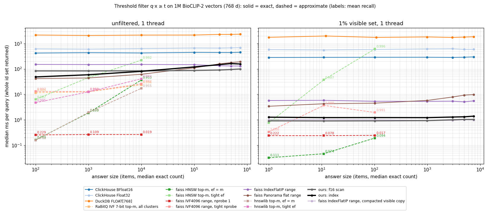
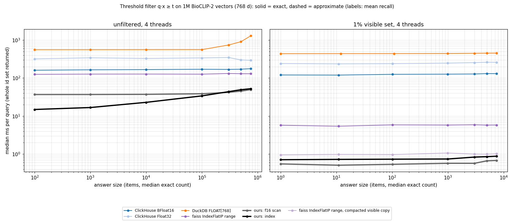

# Exact threshold filter: databases, ANN libraries and our index





Solid lines are exact methods and dashed lines approximate ones; each approximate point is labelled with its mean recall.
The data behind both plots is in [results/plot_data.csv](results/plot_data.csv).

## The question

The query is: given a unit query q and a threshold t, return the ids of every item with q·x ≥ t, together with
their count. It is run over the whole corpus, and within a viewer's visible set (visible ∩ {q·x ≥ t}). Every time below
covers the whole query, from the call to holding the full id set, so returning 750k ids is counted.

## Setup

- **Corpus.** 999,950 BioCLIP-2 image embeddings (768 d), from 20 random row groups of
  `imageomics/TreeOfLife-200M-Embeddings/bioclip-2_float16` (seed 7, the same picks as `../../fetch.py`), normalised in
  f64. 50 further rows were held out as image queries.
- **Queries.** 150 queries: 50 held-out images, 50 from `text_q.npy` and 50 from `text_insample.npy`. Timing used
  every 10th query, which gives 15 queries (5 of each kind). DuckDB used every 30th query (5 queries) because each of its
  queries takes about 2 s.
- **Thresholds.** For each query there are seven thresholds, with answers of 0.01%, 0.1%, 1%, 10%, 30%, 50% and 75% of
  the corpus. Each is the midpoint between the k-th and (k+1)-th f64 similarity, so the exact answer has exactly k items.
  Answer sizes run from 100 to 749,962.
- **Visible sets.** Random sets of 50%, 10% and 1% of the ids. The databases and the ANN libraries ran unfiltered and at
  1%. Ours ran at all four.
- **Machine.** Ryzen 9 5900X (AVX2, no AVX-512) under WSL2. Every run was pinned to cores 8–11 (taskset; ClickHouse with
  `--cpuset-cpus 8-11`). Another agent was timing on cores 0–7 throughout, which shares memory bandwidth, so expect up to
  35% run-to-run variation.
- **Repetitions.** Each (query, threshold, visible set) ran 5 times. A system's figure is the median over queries of each
  query's median, and the p90 is over the same per-query medians.
- **Cache state.** All figures are warm. Cold runs needed `sudo` to drop the page cache, which was not available.

## Versions and the forms used

- **ClickHouse 26.10.4.207**, official image `clickhouse/clickhouse-server:26.10.4.207` (sha256:4f491abc…035), 16 GB
  limit. Tables were `MergeTree ORDER BY id`, with `vec Array(Float32) CODEC(NONE)` and `Array(BFloat16) CODEC(NONE)`.
  BFloat16 is supported and not experimental. The query that ran is `SELECT id FROM t WHERE dotProduct(vec, q) >= t`
  with `optimize_move_to_prewhere = 0` (0.54 s against 0.7–0.9 s with automatic PREWHERE),
  `use_query_cache = 0` and `use_query_condition_cache = 0`, returning RowBinary over HTTP.
  - Also tried: `cosineDistance` (15–20% slower), `L2SquaredDistance` (slower), mmap reads and the uncompressed cache
    (no gain).
  - For the visible set, `PREWHERE id IN s_vis`, where `s_vis` is a Set-engine table built once at load, was the
    fastest correct form. `bitmapContains` on a stored `groupBitmap` state was about the same. An IN subquery was
    slightly slower, and a JOIN was slower again.
  - A 1% visible set saves little, because every 8192-row granule holds visible rows, so the whole `vec` column is still
    read.
  - The vector-similarity (HNSW) index is not used for a WHERE threshold in 26.10. On a test table, `EXPLAIN
    indexes = 1` shows the skip index on `ORDER BY cosineDistance … LIMIT 10` (2 of 20 granules) and no skip index on
    `WHERE cosineDistance(...) <= r` (20 of 20 granules).
- **DuckDB 1.5.6** (pip), with `FLOAT[768]` and `memory_limit = 12GB`. The query was `array_inner_product(vec,
  q::FLOAT[768]) >= t`. `array_cosine_similarity` ran at the same speed.
  - DuckDB is bound by reading the column: `SELECT sum(vec[1])` alone takes 1.6 s on one thread.
  - For the visible set, an `IN` subquery or a SEMI JOIN still computed every product (2.1 s). The fastest form was
    `WITH v AS MATERIALIZED (SELECT id, vec FROM t SEMI JOIN v_vis USING (id)) SELECT id FROM v WHERE …`, at 1.6–1.8 s.
- **Ours.** The `research/vector-bench` prototype (`--v2`), with a new `dbcmp` mode in `rust/src/run2.rs`. It takes
  explicit thresholds and visible-set files. It times query preparation, the query, and the entity-id answer as a
  Roaring bitmap.
  - `index` is `threshold2` through the planner. Its cost model was calibrated on core 8.
  - `flat` is the plain f16 scan of the same stored vectors.
  - The visible set is permuted into row order once per session, in 0.5 ms for 1% and 10 ms for 50%. That step is
    outside the timed query.
- **faiss 1.16.0** (pip `faiss-cpu`) provided:
  - `IndexFlatIP.range_search` (exact). Single-query range search does not use more than one thread, so its 4-thread
    figures equal its 1-thread ones.
  - `IndexFlatIPPanorama` (exact, 8 levels, after an orthogonal PCA rotation of data and queries; faiss's `PCAMatrix`
    centres the data, which changes inner products).
  - `IndexIVFFlat` IVF4096 (range search).
  - `IndexHNSWFlat` (M 16, efConstruction 200).
  - Filtering in faiss used `IDSelectorBitmap`. For the flat index it was also measured over a compacted copy of the
    visible rows, which took 30 ms to build per visible set and was the faster of the two (1.0 ms against 5.4 ms).
- **hnswlib 0.8.0** (M 16, ef_construction 200). It ran unfiltered only, because its Python binding filters only through
  a Python callback. faiss HNSW covers the filtered case.
- **RaBitQ: rabitqlib 0.2.0**, the authors' library, as `IvfIndex` with the IVF4096 centres, 7 bits and every cluster
  probed (nprobe 4096), run as top-m with `high_accuracy = True`.
  - The library uses its built-in error bound (ε₀ = 1.9) to choose which candidates are refined with the extra-bit code.
    Final distances come from the 7-bit code, and no full-precision re-rank is done.
  - The bound is a probabilistic heuristic, not a certificate.
  - faiss 1.16's RaBitQ indexes re-rank only by a fixed factor (IndexRefine), so they were not used.
  - rabitqlib has no filter, so RaBitQ ran unfiltered only.
- **Panorama PR.** [faiss PR 4970](https://github.com/facebookresearch/faiss/pull/4970) (head fa834bf3ea04) was not
  built. It adds `IndexIVFPQPanorama`, which is approximate because it uses PQ codes. The exact Panorama variants
  (`IndexFlatPanorama`, `IndexIVFFlatPanorama`) are already in the faiss 1.16.0 release, and the flat one is measured
  here.

## Approximate settings

- **Top-m methods.** These ask for m = the exact answer size. "Default" is ef = m. "Tight" is the smallest rung on
  m × {1, 1.5, 2, 3, 4, 6, 8, 12, 16, 24, 32} with mean recall ≥ 0.99. For filtered faiss HNSW the ladder continued
  to 1024 × m.
- **IVF range search.** "Default" is nprobe 1, faiss's default. "Tight" is the smallest power of two with mean
  recall ≥ 0.99.
- **Tuning.** The tight settings were tuned on the timed queries themselves, so they are optimistic.
- **Recall cases that need a note:**
  - The unfiltered hnswlib and HNSW runs at 0.01% hit the top of the ladder (32 m) at a recall of 0.985–0.987, short
    of 0.99.
  - Unfiltered, IVF needed nprobe 512–1024.
  - Filtered HNSW needed ef = 256–1024 × m, which took 614 ms at 1% of the visible set.

## Median ms per query (whole id set returned)

Answer sizes are 100, 10k, 300k and 750k items unfiltered. At 1% visible they are about 1, 100, 3k and 7.5k items.
`r` is mean recall.

| system | unfiltered, 1 thread | 1% visible, 1 thread | unfiltered, 4 threads |
|---|---|---|---|
| **ours: index** | 48.7 / 80.6 / 148 / 157 | 1.27 / 1.23 / 1.29 / 1.40 | 14.9 / 23.0 / 43.9 / 52.5 |
| ours: f16 scan | 84.0 / 84.5 / 90.8 / 99.6 | 0.92 / 0.92 / 1.01 / 1.03 | 36.9 / 37.3 / 42.1 / 49.7 |
| faiss Panorama flat (exact) | 42.0 / 61.7 / 159 / 191 | 3.4 / 4.5 / 7.9 / 9.9 | – |
| faiss IndexFlatIP range (exact) | 151 / 151 / 134 / 131 | 1.0 (compacted) / 5.4 (selector) | 125–132 |
| ClickHouse BFloat16 | 423 / 426 / 444 / 451 | 283 / 288 / 284 / 298 | 161 / 168 / 169 / 177 |
| ClickHouse Float32 | 619 / 631 / 657 / 688 | 575 / 580 / 624 / 590 | 320 / 329 / 349 / 294 |
| DuckDB FLOAT[768] | 2155 / 2142 / 2281 / 2326 | 1750 / 1735 / 1727 / 1842 | 558 / 560 / 743 / 1298 |
| hnswlib ef = m (100 / 1k / 10k) | 0.16 r .77 / 1.95 r .90 / 17.3 r .95 | – | – |
| hnswlib tight | 4.7 r .985 / 12.6 r .990 / 41.1 r .992 | – | – |
| faiss HNSW tight | 6.4 r .987 / 45.7 r .994 / 222 r .992 | 0.76 r 1 / 37 r .987 / 614 r .996 | – |
| faiss IVF4096 range, nprobe 1 | 0.26 r .23 / 0.27 r .11 / 0.27 r .02 | 0.24 r .22 / 0.24 r .08 / 0.25 r .02 | – |
| faiss IVF4096 range, tight | 13.2 r .997 / 12.9 r .992 / 26.2 r .992 | 0.34 r 1 / 3.7 r 1 / 1.95 r .991 | – |
| RaBitQ 7-bit, all clusters | 11.6 r .989 / 12.7 r .994 / 23.9 r .996 | – | – |

The CSVs are in `results/` (`summary.md` has p90s and the 10% and 50% visible sets for ours).

## Correctness against the f64 brute force

Differing items are counted over all checked answers. "Beyond rounding" counts items whose |s − t| exceeds the
rounding bound of the stored type.

- **Ours, index and f16 scan.** Both returned identical sets. Unfiltered, 6, 30, 122, 690, 1271, 1378 and 1143
  items differed across the seven sizes. At 1% visible, 0–20 items differed. Every one lay within f16 rounding: the
  largest |s − t| was 6.7e-5, and none was beyond rounding.
- **ClickHouse Float32.** 0–8 items differed per size, with |s − t| ≤ 5.4e-8.
- **DuckDB.** 0–16 items differed per size, with |s − t| ≤ 6.2e-7.
- **faiss flat and Panorama.** Recall was 1.0000 with at most 2 extra items, within f32 rounding.
- **ClickHouse BFloat16.** 334 of 1,500 items differed at 0.01%, and 187k of 7.5M at 50%. The largest |s − t| was
  2.8e-3, within the bf16 bound. bf16 has 8 mantissa bits, so it is exact only to its rounding.

## Storage and memory

| system | on disk | resident |
|---|---|---|
| ClickHouse | Float32 table 2.87 GiB, BFloat16 table 1.44 GiB | server RSS peak 5.5 GiB (both tables loaded) |
| DuckDB | 4.5 GiB file | 4.8 GiB process RSS |
| ours | 1.5 GiB of f16 vectors and 0.1 GiB of parameters; codes are rebuilt at open (about 100 s on 4 cores) | 6.4 GB peak RSS, including the build |
| faiss flat | – (3.0 GB in RAM) | – |
| faiss IVF4096 | 2.9 GiB, built in 58 s | – |
| faiss HNSW | 3.0 GiB, built in 204 s | – |
| hnswlib | 3.0 GiB, built in 107 s | – |
| Panorama | 2.9 GiB, built in 12 s | – |
| RaBitQ | 0.67 GiB, built in 53 s | 0.7 GiB |

All builds ran on 4 threads.

## Conclusion

At 1 thread our index answers 3–9× faster than ClickHouse BFloat16, 4–13× faster than ClickHouse Float32 and 15–44×
faster than DuckDB. The gap is largest at small answers and smallest at 300k–750k items. At a 1% visible set the gap grows to 200–1400×, because both databases read the whole
vector column whatever the filter.

Our index is not the fastest exact method, though:

- **Against faiss Panorama.** At 1 thread and answers of 0.01–1%, Panorama is level with it or slightly faster (42 against 49 ms
  at 100 items, 62 against 81 ms at 10k).
- **Against our own f16 scan.** The scan is faster than the index from about 1% of the corpus upwards (85 against 81
  ms at 10k, and 100 against 157 ms at 750k). The planner should switch to the scan there and does not.
- **At 1% visible.** The plain scan of the visible rows (0.9 ms) and faiss over a compacted copy (1.0 ms) beat the index
  (1.2–1.4 ms).

The approximate methods reaching recall 0.99 (IVF, RaBitQ and hnswlib) take 5–40 ms, faster than our exact index at
1 thread up to about 1%. They are not exact, and HNSW under a 1% filter collapses: 614 ms at 0.996 recall.

## Reproducing

```bash
V=venv-with: numpy 2.2.6, duckdb 1.5.6, pyarrow 21.0.0, scipy, faiss-cpu 1.16.0, hnswlib 0.8.0, rabitqlib 0.2.0, matplotlib
D=/home/joe/code/vexact-data/bioclip2-1m
python3 -I fetch.py $D; python3 -I prep.py $D ../../../vexact-data/bioclip2-text $D/prep
python3 -I ../../rust/tools/fit.py $D/prep/corpus16.npy $D/index
vexact --v2 --index $D/index --queries $D/prep/queries.npy --results results/ours --core 8 --pseudo 20 dbcmp \
  --thr $D/prep/thresholds.npy --vis $D/prep/vis_50.npy,$D/prep/vis_10.npy,$D/prep/vis_1.npy --step 10 --dump $D/dump_ours --tag main
python3 -I load.py parquet $D/prep $D/corpus.parquet; bash clickhouse.sh start; bash clickhouse.sh load
python3 -I dbrun.py clickhouse $D/prep results/clickhouse.csv --table t32|tbf --vis all|vis_1 --step 10 --dump DIR
python3 -I load.py duckdb $D/prep $D/corpus.parquet $D/duck.db
python3 -I dbrun.py duckdb $D/prep results/duckdb.csv --db $D/duck.db --form dot (dot+mat for vis_1) --step 30 --dump DIR
python3 -I ann.py build|query ivf|rabitq|hnswlib|faiss_hnsw|panorama|flat $D/prep $D/ann results/ann.csv
python3 -I check.py $D/prep DUMP_DIR results/correct_X.csv; python3 -I plot.py results $D/prep
```

All commands ran under `taskset -c 8-11`.
