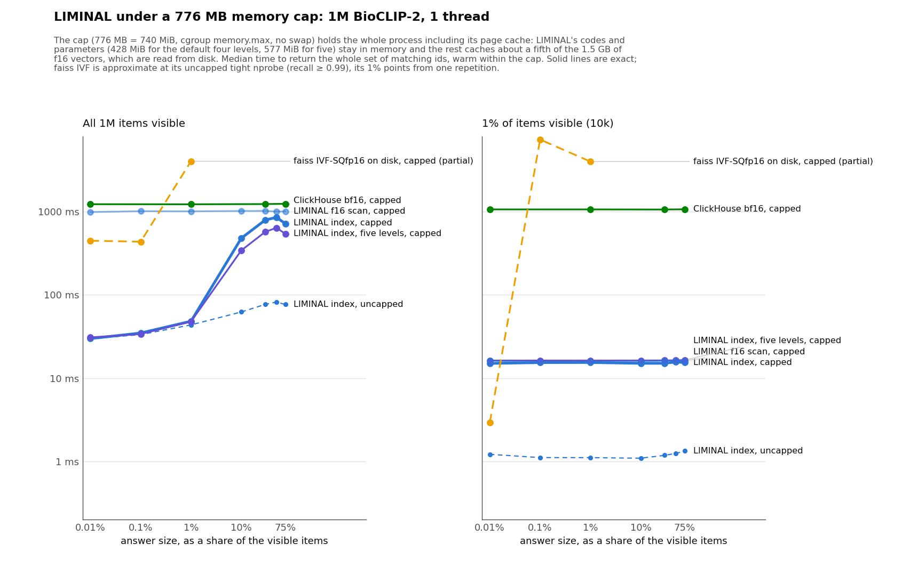

# Exact threshold filter under a memory cap: LIMINAL with most of its vectors on disk



This is a partial report. The owner paused the comparison after LIMINAL's runs, ClickHouse and part of faiss had
finished; DiskANN and the faiss flat scan have no figures yet, and nothing ran at 4 threads. The data behind the plot
and the tables is in [results/capped/](results/capped/): `summary.md` and `plot_data.csv` are made by
`capped/summarise_capped.py`, and the plot by `capped/plot_capped.py`.

## The cap

The cap is **775,946,240 bytes (740 MiB, 776 MB)** for the whole process, page cache included. It is made of:

- **428 MiB** of anonymous memory: LIMINAL's codes, its parameters and the process, measured after the build with the
  build-only f32 bases dropped and the heap trimmed. The codes are 265 MiB (`lcode` 245 + `lscal` 20.5); the int8 group
  bases are 36 MiB, the centre tables 17 MiB, and the rest is small. About 50 MiB is the process itself.
- **20 MiB** for what queries allocate.
- **293 MiB** of page cache, a fifth of the 1.5 GB of f16 vectors.

The owner's estimate of about 600 MB assumed 0.3 GB for the codes and parameters; the measured 428 MiB sets the cap
instead. The deeper schedules ran under the same cap, so their larger codes leave less room for cache: 499 MiB of anon
at 320 B (about 220 MiB of cache) and 577 MiB with five levels (about 150 MiB).

**How it is enforced.** Each run is a `systemd-run --user --scope -p MemoryMax=9G -p MemorySwapMax=0` scope.
LIMINAL builds its codes at open, which needs 6.4 GB, so the process first builds inside the loose scope. It then
writes its row-ordered f16 vectors to a file, maps that file and frees the in-memory copy (`--full-file`). Before the
first query it calls `malloc_trim`, writes the cap to its own cgroup's `memory.max` and writes `memory.reclaim` to empty
the page cache (`--cap`, in `rust/src/v2/disk.rs`). There is no swap, so the cap squeezes only the page cache.

**Evidence that it held.** After every block of queries the run logs `memory.current`, `anon` and `file` from inside the
scope (in `results/capped/*.out`):

- `memory.current` stayed at 739.8–740.0 MiB and `memory.events max` counted 190k–2.4M reclaims per run. There were no
  OOM kills.
- `file` (vectors plus binary) was 220 MiB for the default schedule, 191 MiB at 320 B and 73 MiB with five levels.
  Anon rose by 15–80 MiB during queries, which ate into the cache.
- **No hidden cache.** The vector file is written fresh by the run, and its pages are dropped (`madvise(DONTNEED)` and
  `posix_fadvise(DONTNEED)`) before any query, so no page charged to another cgroup can serve it. `mincore` showed
  0 MiB resident after eviction. faiss drops its index files the same way at start, and ClickHouse's data files are
  dropped (`dd iflag=nocache`) before the container starts.
- ClickHouse ran in its own container with `--memory` and `--memory-swap` both equal to the cap, and started at 155 MB.
  `memory.current` stayed at 760 MB (anon 220–250 MB) with 245k–484k reclaims.

## The disk

The disk is the WSL2 virtual disk `/dev/sdd` (ext4, `read_ahead_kb` 8192), measured with O_DIRECT preads on a 1.5 GB
file not in cache (`capped/diskbench.c`, `results/capped/disk.txt`):

| access | queue depth | throughput | latency p50 / p99 |
|---|---|---|---|
| random 4 KiB | 1 | 6.1k IOPS, 25 MB/s | 160 / 227 µs |
| random 4 KiB | 4 | 22.6k IOPS, 93 MB/s | 174 / 253 µs |
| random 4 KiB | 16 | 80k IOPS, 329 MB/s | 192 / 332 µs |
| random 4 KiB | 64 | 176k IOPS, 720 MB/s | 331 / 790 µs |
| random 64 KiB | 1 | 4.8k IOPS, 314 MB/s | 207 / 278 µs |
| random 64 KiB | 16 | 50k IOPS, 3.3 GB/s | 307 / 495 µs |
| sequential 1 MiB | 1 | 1.77 GB/s | 574 / 894 µs |
| sequential 1 MiB | 4 | 3.33 GB/s | 1256 / 1886 µs |

A single read costs about 160 µs, but the disk scales almost linearly with queue depth up to 16. A reader that keeps
many reads in flight gets 13× the throughput of one that waits for each.

## How LIMINAL reads full vectors, and the option added

Before this work, the build copied all 1.5 GB of f16 vectors into anonymous memory in index row order, so they could
not be paged out. Under the cap, they are now read from a mapped file in the same row order. How the mapping is read
matters a great deal, as smoke runs at 50k rows showed:

- **Default advice (`MADV_NORMAL`)** reads 8 MiB around every fault, because this disk's `read_ahead_kb` is 8192. A
  query needing 636 rows read 67 MB; a random 1% visible set of 471 rows read the whole 69 MB file.
- **`MADV_RANDOM`** reads only the 4 KiB page or pages a row touches. That is right for the index, but each fault waits
  about 160 µs, and a scan through faults ran at 42 MB/s.
- **`MADV_RANDOM` plus `--willneed`** (the option added, and used for every capped run here). Before deciding a list of
  rows from full vectors, the run calls `madvise(MADV_WILLNEED)` on each row's pages, merging adjacent rows, and the
  scan does the same four 1,024-row chunks ahead. The reads are then in flight together. The cold 636-row query fell
  from 30 ms to 5.4 ms, the 471 random rows from 85 ms to 4.4 ms, and a scan ran at 2.5 GB/s, as fast as kernel
  readahead.

## LIMINAL under the cap: median and cold ms, 1 thread

Each cell is capped median / cold / uncapped median, in ms. Medians are taken over the 15 timed queries of each
query's median of 5 repetitions; the f16 scan unfiltered used 3 repetitions. Cold is one query (query 0) run once after
the vectors are dropped from the page cache, with the codes still in memory. It is a single query, so it can fall
below the median: at 10% and above, query 0 needs fewer full vectors than the median query. The uncapped figures are
`results/ours/dbcmp_r4_1t.csv` (research/bench-update); that run covered only the default schedule and the scan.

**All 1M items visible** (answer sizes 100, 1k, 10k, 100k, 300k, 500k, 750k)

| | 0.01% | 0.1% | 1% | 10% | 30% | 50% | 75% |
|---|---|---|---|---|---|---|---|
| index, 56/96/160/256 (default) | 29.8 / 80 / 29.7 | 34.8 / 76 / 33.4 | 48.2 / 75 / 43.6 | 479 / 239 / 62.3 | 794 / 654 / 76.9 | 852 / 434 / 82.0 | 716 / 694 / 76.6 |
| index, last level 320 B | 29.0 / 67 | 33.1 / 69 | 47.6 / 62 | 86.7 / 217 | 627 / 367 | 702 / 484 | 608 / 474 |
| index, five levels to 384 B | 30.9 / 69 | 33.9 / 78 | 47.8 / 55 | 342 / 143 | 572 / 221 | 639 / 274 | 541 / 315 |
| f16 scan | 986 / 832 / 80.9 | 1012 / 821 / 80.1 | 1008 / 852 / 83.0 | 1017 / 835 / 83.7 | 1019 / 825 / 90.7 | 1000 / 866 / 92.9 | 1005 / 826 / 98.9 |

**1% visible** (about 1, 10, 100, 1k, 3k, 5k and 7.5k items)

| | 0.01% | 0.1% | 1% | 10% | 30% | 50% | 75% |
|---|---|---|---|---|---|---|---|
| index (planner), default | 15.0 / 72 / 1.22 | 15.4 / 73 / 1.11 | 15.4 / 76 / 1.11 | 15.1 / 76 / 1.09 | 15.1 / 73 / 1.18 | 15.7 / 65 / 1.25 | 15.4 / 64 / 1.33 |
| index (planner), 320 B | 14.0 / 73 | 14.4 / 75 | 14.2 / 75 | 14.3 / 70 | 14.1 / 68 | 14.0 / 72 | 13.9 / 76 |
| index (planner), five levels | 16.3 / 81 | 16.3 / 79 | 16.3 / 76 | 16.3 / 76 | 16.3 / 76 | 16.4 / 83 | 16.5 / 82 |
| index path forced, default | 14.8 / 20 | 16.5 / 15 | 18.4 / 22 | 22.8 / 55 | 25.6 / 66 | 26.5 / 70 | 25.3 / 73 |
| f16 scan | 16.2 / 91 / 0.91 | 15.6 / 97 / 0.75 | 15.8 / 83 / 0.75 | 15.8 / 79 / 0.75 | 16.2 / 78 / 0.85 | 16.3 / 73 / 0.84 | 16.2 / 85 / 0.86 |

**Full-vector reads per query, and KiB read from storage per warm query** (medians over queries)

| | 0.01% | 0.1% | 1% | 10% | 30% | 50% | 75% |
|---|---|---|---|---|---|---|---|
| default, all | 2,030 / 523 | 3,323 / 1,211 | 9,159 / 5,834 | 62,324 / 162,847 | 106,122 / 409,010 | 123,568 / 481,896 | 111,729 / 431,486 |
| 320 B, all | 1,517 / 531 | 2,533 / 973 | 6,117 / 4,180 | 35,633 / 28,295 | 69,242 / 287,638 | 78,608 / 331,019 | 64,449 / 278,262 |
| five levels, all | 1,266 / 526 | 1,945 / 782 | 5,079 / 3,165 | 22,672 / 100,339 | 47,102 / 207,996 | 51,976 / 233,320 | 41,311 / 186,499 |
| index path forced, 1% visible | 2 / 0 | 10 / 2 | 90 / 6 | 615 / 53 | 1,046 / 66 | 1,213 / 70 | 1,096 / 101 |

The f16 scan reads all 999,950 vectors (1.46 GB from storage) per unfiltered query. At 1% visible, the planner and the
scan both read the 10,000 visible vectors, which stay cached (0 KiB from storage).

**Correctness.** Each schedule's answers under the cap (one repetition, a `--dump` run) are byte-identical to the
uncapped dumps in `vexact-benchup-data/dump_ours`, which `check.py` had checked against the f64 brute force. That holds
for the index at all three schedules and for the f16 scan, unfiltered and at 1% visible. The five-level schedule ran
without a crash. No run used `bail`.

## Competitors under the same cap (partial)

| system | unfiltered: 100 / 10k / 300k / 750k items | 1% visible: about 1 / 100 / 3k / 7.5k items |
|---|---|---|
| ClickHouse BFloat16, capped (median / cold) | 1227 / 1602, 1224 / 1259, 1231 / 1254, 1240 / 1228 | 1062 / 1221, 1062 / 1260, 1059 / 1211, 1066 / 1194 |
| ClickHouse BFloat16, uncapped | 423 / 426 / 444 / 451 | 283 / 288 / 284 / 298 |

- **ClickHouse** ran with `--memory` and `--memory-swap` at 740m. It started at that cap, so no larger cap was needed.
  The runs covered 15 queries × 4 sizes × 5 repetitions per panel. Each query reads the 1.44 GiB column at about
  1.2 GB/s.
- **faiss IVF4096 with QT_fp16 and on-disk inverted lists** ran at the tight nprobe of the uncapped f32 run, and is
  approximate. Unfiltered: 447 ms (recall 0.997) at 100 items and 435 ms (0.992) at 1k with nprobe 512, and 4,023 ms
  (0.992) at 10k with nprobe 1,024. At 1% visible: 2.9 ms (1.000) at nprobe 64, 7,326 ms (1.000) at nprobe 2,048, and
  3,988 ms (0.991) at nprobe 1,024. The last three cells are from one repetition each.
  - Uncapped, the same settings take 13–26 ms unfiltered and 0.3–3.7 ms at 1% visible.
  - At nprobe 1 it answers in 0.4–0.6 ms with recall 0.02–0.53.
  - The on-disk lists are read through faiss's own `mmap` with default advice, so each fault reads 8 MiB. At nprobe
    512 a query read 1.8 GB for 190 MB of lists.
  - `IO_FLAG_MMAP` on an on-disk IVF-SQ index crashed the first search in faiss 1.16.0, so the index is opened without
    that flag; the lists are still mapped.
- **faiss IndexScalarQuantizer(QT_fp16) flat**, memory-mapped (`IO_FLAG_MMAP_IFC`), took about 39 s per unfiltered
  query in a 3-query smoke test. It read about 1.1 GB per query at about 28 MB/s, which is the pattern of 4 KiB faults
  once read-around switches off under reclaim. The timed run was stopped when the comparison paused, so it has no row.
- **DiskANN** (diskannpy 0.7.0 in its own venv; R 64, L 100, mips, 53-byte PQ codes from a 0.05 GB search budget) did
  not finish building. The build hit the 10-minute command limit at 60% of the graph on 2 threads, after 4 minutes of
  PQ. It needs 4 threads on a quiet machine, and has no figures yet.
- **DuckDB** was dropped from the capped comparison by the owner.

## What dominates LIMINAL's time under the cap

- **Up to 1% of the corpus the cap costs almost nothing.** The capped index is within 0–10% of the uncapped one
  (29.8 against 29.7 ms at 100 items, 48 against 44 at 10k). It reads 2k–9k full vectors per query, and most of them
  are already in the 220 MiB cache, which holds a seventh of the vectors. Storage reads are 0.5–6 MB per query. Here
  LIMINAL is 25–40× faster than capped ClickHouse and 12–83× faster than capped faiss IVF at recall 0.99.
- **From 10% upwards, reading full vectors dominates.** The default schedule reads 62k–124k vectors, 160–480 MB from
  storage per query at about 3.5× read amplification (4 KiB pages for 1.5 KiB rows), and takes 0.5–0.85 s. That is
  6–10× its uncapped time, and close to the 1.0 s plain scan, which streams 1.46 GB per query at 1.5 GB/s. The
  planner's cost model was calibrated in memory, so it never switches to the scan here; with these numbers it should
  not.
- **Deeper schedules pay for their memory.** Five levels read 42–64% fewer vectors, and despite having less cache they
  are 20–29% faster from 10% upwards (342 against 479 ms at 100k, 541 against 716 ms at 750k). 320 B is best at 10%
  (87 ms, because its reads drop to 28 MB), but no better than five levels above that. At small answers all three
  schedules are the same.
- **At 1% visible the capped figure is 15 ms against 1.1–1.3 ms uncapped, while reading nothing from storage.** The
  10,000 visible vectors (about 50 MB) stay cached, so the time is not I/O. The likely cost is one `madvise(WILLNEED)`
  per row (10k system calls) plus minor faults remapping cached pages, but this is not confirmed: a run without
  `--willneed` is owed. Forcing the index path reads only 2–1,213 vectors, but is no faster warm (15–26 ms). Cold, it
  is 3–5× faster than the planner's scan at small answers (15–22 ms against 72–76 ms), because the planner's choice
  ignores disk.

## Surprises

- The kernel's 8 MiB read-around on this disk makes default-advice `mmap` the wrong read path under a cap, for LIMINAL
  and for faiss alike. faiss's flat scan through a mapping collapsed to 4 KiB synchronous faults (28 MB/s). faiss IVF
  at nprobe 1,024 read about 6 GB per query and took 4 s, against 0.44 s at nprobe 512.
- Anonymous memory grows by 15–80 MiB over a run (from 428 to 442–511 MiB for the default schedule), probably allocator
  retention of per-query buffers. That comes out of the cache.
- The machine was not fully quiet. A constants benchmark held cores 6–7 (2 threads) for every timed run after the
  first; all timed runs here were pinned to cores 8–11. LIMINAL's default-schedule index run started on a quiet machine.

## Reproducing

```bash
CAP=775946240; D=/home/joe/code/vexact-data/bioclip2-1m/prep; R=results/capped   # in bench/threshold-db/capped
bash run_ours.sh r4_index_1t $R $CAP "--vis $D/vis_1.npy --step 10 --reps 5 --threads 1 --what index --cold"
bash run_ours.sh r4_flatvis_1t $R $CAP "--vis $D/vis_1.npy --sets vis_1 --step 10 --reps 5 --threads 1 --what flat,forced --cold"
bash run_ours.sh r4_flatall_1t $R $CAP "--sets all --step 10 --reps 3 --threads 1 --what flat --cold"
RLV=56,96,160,320 bash run_ours.sh r320_index_1t ...; RLV=56,96,160,256,384 bash run_ours.sh r384_index_1t ...
bash clickhouse_capped.sh load; bash clickhouse_capped.sh start 740m
python3 -I ../dbrun.py clickhouse $D clickhouse.csv --table tbf --url 127.0.0.1:18124 --vis all|vis_1 --threads 1 \
  --step 10 --reps 5 --shares 0,2,4,6 --cold --evict-cmd "bash capped/clickhouse_capped.sh evict"
python3 -I faiss_capped.py build sqivf $D DIR; systemd-run --user --scope -p MemoryMax=$CAP -p MemorySwapMax=0 -- \
  python3 -I faiss_capped.py query sqivf $D DIR faiss.csv --cold --vis V --shares S --nprobe P
python3 -I summarise_capped.py results/capped results $D; python3 -I plot_capped.py results
```
