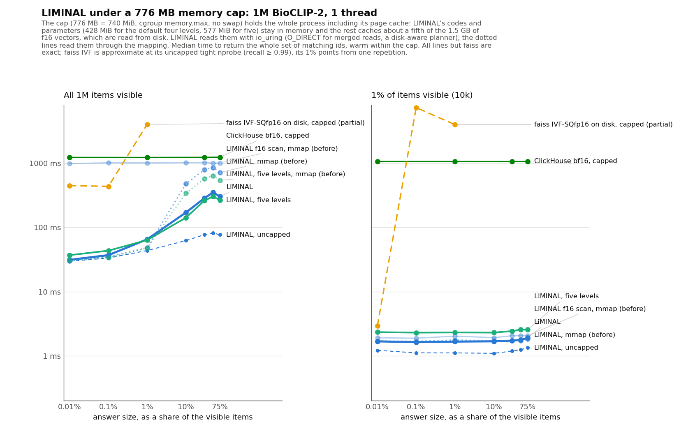

# LIMINAL with its full vectors on disk: io_uring reads, merged reads and a disk-aware planner



Under the 776 MB cap of [REPORT_CAPPED.md](REPORT_CAPPED.md), LIMINAL read its full vectors through faults on a
mapping and took 479–852 ms at 10–75% answers, against 62–82 ms uncapped. It now reads them with io_uring, 64 reads in
flight. A cluster's rows share one read when the gap between them costs less than another read, and those merged reads
use O_DIRECT. The planner counts the reads when it chooses, per cluster, between the index path and full vectors. At
10–75% the default schedule now takes **170–350 ms warm and 113–186 ms cold**, and five levels **142–303 ms warm and
84–126 ms cold**. The answers are unchanged.

## The result

The cap (775,946,240 bytes, `MemoryMax` with `MemorySwapMax=0`), method and queries are those of REPORT_CAPPED.md:
1M BioCLIP-2, 1 thread pinned to cores 8–9, 15 queries per answer size, the median over queries of each query's
median of 5 repetitions, and cold as query 0 run once after the vectors are dropped from the page cache. Each cell is
warm median / cold, in ms. "Before" is REPORT_CAPPED.md's run. "mmap, same run" is the old read path timed in one
process with the new one, under the same machine load, and is the fairer comparison.

**All 1M items visible** (answer sizes 100, 1k, 10k, 100k, 300k, 500k, 750k)

| | 0.01% | 0.1% | 1% | 10% | 30% | 50% | 75% |
|---|---|---|---|---|---|---|---|
| **LIMINAL, default** | 31.2 / 17 | 37.0 / 20 | 65.2 / 36 | 170 / 113 | 285 / 159 | 350 / 180 | 303 / 186 |
| LIMINAL, default, before (mmap) | 29.8 / 80 | 34.8 / 76 | 48.2 / 75 | 479 / 238 | 794 / 654 | 852 / 434 | 716 / 694 |
| LIMINAL, default, mmap, same run | 33.5 / 77 | 34.4 / 79 | 50.3 / 75 | 93.4 / 279 | 902 / 415 | 938 / 497 | 814 / 534 |
| **LIMINAL, five levels** | 36.9 / 19 | 43.4 / 18 | 63.5 / 35 | 142 / 84 | 262 / 112 | 303 / 122 | 266 / 126 |
| LIMINAL, five levels, before (mmap) | 30.9 / 69 | 33.9 / 78 | 47.8 / 54 | 342 / 143 | 572 / 220 | 639 / 274 | 541 / 315 |
| LIMINAL, uncapped | 29.7 | 33.4 | 43.6 | 62.3 | 76.9 | 82.0 | 76.6 |

**1% visible** (about 1, 10, 100, 1k, 3k, 5k and 7.5k items)

| | 0.01% | 0.1% | 1% | 10% | 30% | 50% | 75% |
|---|---|---|---|---|---|---|---|
| **LIMINAL, default** | 1.68 / 85 | 1.63 / 74 | 1.67 / 80 | 1.68 / 70 | 1.72 / 81 | 1.77 / 65 | 1.90 / 67 |
| LIMINAL, default, before (mmap, residency-checked) | 1.69 / 76 | 1.68 / 88 | 1.76 / 79 | 1.72 / 72 | 1.73 / 71 | 1.73 / 72 | 1.82 / 66 |
| **LIMINAL, five levels** | 2.34 / 111 | 2.30 / 105 | 2.31 / 102 | 2.30 / 100 | 2.43 / 108 | 2.56 / 106 | 2.55 / 81 |
| LIMINAL, five levels, before (mmap, a madvise per batch) | 16.3 / 81 | 16.3 / 78 | 16.3 / 75 | 16.3 / 76 | 16.3 / 76 | 16.4 / 83 | 16.5 / 82 |
| LIMINAL, uncapped | 1.22 | 1.11 | 1.11 | 1.09 | 1.18 | 1.25 | 1.33 |

At 1% visible the planner scans the 10,000 visible vectors, which stay cached (0 MB from storage warm), as before. The
filtered scan still reads through the mapping (see below), so this panel changes little; five levels gained from the
smaller read buffers, which leave the cache room for the visible rows.

**Full-vector reads per query / MB read from storage per warm query** (medians over queries, all visible)

| | 0.01% | 0.1% | 1% | 10% | 30% | 50% | 75% |
|---|---|---|---|---|---|---|---|
| default | 264 / 1.6 | 1,272 / 7.9 | 8,377 / 63 | 61,564 / 395 | 105,380 / 733 | 122,896 / 871 | 110,991 / 767 |
| default, before | 2,030 / 0.5 | 3,323 / 1.2 | 9,159 / 6.0 | 62,324 / 167 | 106,122 / 419 | 123,568 / 493 | 111,729 / 442 |
| five levels | 103 / 0.4 | 575 / 4.2 | 3,615 / 28 | 21,858 / 203 | 46,297 / 437 | 51,199 / 497 | 40,520 / 390 |
| five levels, before | 1,266 / 0.5 | 1,945 / 0.8 | 5,079 / 3.2 | 22,672 / 103 | 47,102 / 213 | 51,976 / 239 | 41,311 / 191 |

More bytes come from storage than before, by design: merged reads carry the rows between the wanted ones, and O_DIRECT
reads are not cached for the next repetition. They cost less time because they are fewer, larger and in flight
together.

**Correctness.** The capped answers (one repetition, a `--dump` run on the final build) are byte-identical to the
uncapped dumps in `vexact-benchup-data/dump_ours`, unfiltered and at 1% visible, for the default schedule and for five levels. The 50k check (`verify
oracle` on `c50k_r4`, 200 item and 200 text queries, run with `--full-file` so that the reader and the disk-aware
planner answer) found 0 wrong in 400 queries × 7 sizes and 0 interval violations, and the f64 oracle found 0 wrong of
360 threshold and 80 k-NN results. Every read mode tried during the work gave identical dumps on a 50-cluster smoke
(index, index path forced and f16 scan; mmap, buffered and O_DIRECT). No run crashed or was OOM-killed.

## What changed, step by step

The development runs below are shorter (5 queries per size, 3 repetitions, all visible), and the same configuration
moved by up to ±20% between runs on this machine. Each comparison is between modes timed in one process, one after
the other, each from an emptied cache (`--read-modes`). Cells are warm medians at 10 / 30 / 50 / 75% answers.

### Many reads in flight (step 2)

`rust/src/v2/disk.rs` has a `Reader`: a per-thread io_uring of 256 entries that keeps up to 64 reads in flight. The
index path hands it each cluster's rows that need full vectors as one batch and goes on to the next clusters while
they are read. A batch is decided once its reads are done, when 8 MiB of buffers are held, or when reads wait for a
slot. io_uring works in this WSL2 kernel (6.18).

| | 10% | 30% | 50% | 75% |
|---|---|---|---|---|
| mmap with `madvise(WILLNEED)` (before) | 224 | 744 | 839 | 764 |
| reader, buffered preads, 64 in flight | 301 | 473 | 587 | 503 |
| reader, 1 in flight | 1,852 | 2,235 | 2,246 | 2,240 |

Queue depth is the gain: one read at a time is four times slower than the mapping. Buffered reads still cost the
kernel nearly as much as faults did. In this run 18.5 s of the 26.2 s were system time, most of it reclaiming page
cache at the cgroup limit for each page read in. 128 reads in flight gained nothing over 64.

### Reads planned per cluster (step 1)

Rows are stored in cluster order, so a cluster's candidates lie in one span. The reader merges rows into one read
while the gap to the next row is at most `io_us × io_gbps` bytes, the bytes that a read's fixed cost would carry (up to
256 KiB per read). `io_us` is the time per read of single rows with 64 in flight, and `io_gbps` the bandwidth of long
reads. Both are timed at the start of a run, under the cap, through the reader on the file itself: 4,096 rows spread
over the file and 32 MiB of consecutive rows, each the fastest of three timings. They come out at 11–16 µs and
1.9–2.7 GB/s, so rows up to 22–40 KB apart share a read. A dense cluster is then read in one sequential read and a
sparse one row by row.

The planner (`plan2` in `rust/src/v2/q.rs`) adds that cost to a cluster's full-vector path,
`min(ncand × io_us, io_us + span bytes / io_gbps)`, and adds a sequential read of the file to the cost of a scan.

| | 10% | 30% | 50% | 75% |
|---|---|---|---|---|
| merge gap 3 KB (rows rarely merge) | 296 | 717 | 780 | 704 |
| merge gap 12 KB | 221 | 342 | 365 | 334 |
| merge gap from the cost model (22 KB) | 200 | 302 | 300 | 296 |
| buffered reads, planner without read costs | 446 | 603 | 684 | 642 |
| buffered reads, planner with read costs | 314 | 494 | 608 | 551 |

The planner's read costs move the smallest answers off full vectors (at 0.01%, from 2,030 reads to 264) and save
10–30% at the large ones. They hardly change the large answers' reads: 62k–123k full vectors are the index path's own
survivors, which no per-cluster choice removes.

### O_DIRECT for merged reads

A read of 8 KiB or more uses O_DIRECT, past the page cache, into a page-aligned buffer (the file is padded to whole
pages). Shorter reads stay buffered, so a row read alone is cached for the next query. This removes most of the
kernel's reclaim work.

| | 10% | 30% | 50% | 75% | system time |
|---|---|---|---|---|---|
| buffered | 314 | 494 | 608 | 551 | 17.9 s |
| O_DIRECT from 8 KiB | 190 | 297 | 312 | 287 | 6.2 s |
| O_DIRECT from 4 KiB | 239 | 288 | 332 | 304 | 4.8 s |
| O_DIRECT for every read (12 KB gap) | 256 | 385 | 441 | 393 | 5.9 s |

### Page-aligned rows (step 3): not kept

`--full-pad` stored two 1,536-byte rows per 4 KiB page so that no row straddles a page. The file grew from 1.5 to
2.0 GB, and merged reads carried the padding:

| | 10% | 30% | 50% | 75% |
|---|---|---|---|---|
| packed rows | 161 | 261 | 291 | 283 |
| page-aligned rows | 217 | 316 | 343 | 324 |

The option was removed.

### Keeping what the cache holds

Three changes stopped the reader from losing the cache's help:

- A batch whose rows are already cached (a sample of eight, checked with `mincore`) is decided from the mapping
  without reads. A filtered scan keeps the old path, `madvise(WILLNEED)` on the mapping. Through the reader, 1%
  visible took 12.9 ms warm, because each of its 10,000 scattered rows was a read even when cached, and the old path's
  cold reads were faster too. An unfiltered scan reads through the reader.
- Read buffers are anonymous mappings rather than heap. The heap kept the 64 MiB timing buffer and a growing set of
  batch buffers, 67 MiB that the cache lost; with five levels only 38 MiB of cache was left, and 1% visible took
  117 ms warm.
- The reader keeps up to 16 MiB of free buffers in power-of-two sizes, so that later batches reuse them. Keeping only
  4 MiB raised system time from 22 to 62 s per run, because each fresh page under the cap costs a reclaim.

### Uncached buffered reads for merged spans (RWF_DONTCACHE): not the default

`--dontcache-min BYTES` (and `:dontcache=BYTES` in `--read-modes`) reads extents of at least that many bytes, below
`--direct-min`, as buffered reads with RWF_DONTCACHE set per read through io_uring; shorter extents stay ordinary
buffered reads. The aim was the cache's reuse for small reads and O_DIRECT's low cost for merged spans. The kernel
(6.18) and ext4 honour the flag: a 64 MiB `preadv2` with it, and 64 io_uring reads of 256 KiB with it, left none of
their pages resident (`mincore`), where plain reads left them all, and io_uring did not return EOPNOTSUPP. Pages
already cached stay cached and serve such a read.

Under the cap it costs the kernel nearly as much as plain buffered reads, because each page is still put into the
cache and then removed. Each cell is warm median ms / cold ms / system ms per warm query / MB from storage per warm
query, all 1M visible, default schedule. The DONTCACHE rows each ran in one process with the O_DIRECT row (`splitA`,
`splitB`), plain buffered on its own (`splitC`); the O_DIRECT row reran in `splitB` at 34 / 38 / 68 / 181 / 370 /
317 ms.

| | 0.01% | 0.1% | 1% | 10% | 50% | 75% |
|---|---|---|---|---|---|---|
| **O_DIRECT from 8 KiB (default)** | 31.0 / 17 / 0.0 / 2.0 | 36.0 / 19 / 2.4 / 8.2 | 66.0 / 36 / 9.8 / 70 | 175 / 119 / 42 / 408 | 335 / 173 / 83 / 877 | 312 / 191 / 70 / 771 |
| DONTCACHE from 8 KiB | 34.1 / 13 / 1.6 / 1.4 | 42.7 / 18 / 5.7 / 6.7 | 93.4 / 38 / 42 / 52 | 280 / 145 / 210 / 326 | 560 / 255 / 468 / 703 | 497 / 282 / 416 / 630 |
| DONTCACHE from 32 KiB | 33.2 / 16 / 1.6 / 1.3 | 44.4 / 25 / 4.2 / 5.8 | 88.5 / 43 / 37 / 45 | 293 / 163 / 213 / 308 | 583 / 261 / 456 / 692 | 524 / 297 / 413 / 618 |
| DONTCACHE from 128 KiB | 30.5 / 16 / 0.8 / 0.4 | 40.7 / 17 / 4.9 / 3.5 | 68.9 / 37 / 28 / 23 | 232 / 139 / 174 / 229 | 523 / 219 / 447 / 664 | 431 / 254 / 341 / 541 |
| buffered | 33.4 / 17 / 0.8 / 0.2 | 43.4 / 19 / 3.3 / 1.1 | 54.0 / 40 / 13 / 9.0 | 326 / 142 / 243 / 309 | 662 / 228 / 547 / 773 | 600 / 248 / 498 / 667 |

DONTCACHE reads fewer bytes from storage than O_DIRECT, since cached pages serve it, but at 10–75% answers it took
four to six times the system time and 1.3–1.7 times the wall time. At small answers it gained nothing: only plain
buffered reads keep a 1% answer's merged spans for the next repetition (54 against 66 ms), at twice the time at
10–75%. At 1% visible every mode took 1.7–2.2 ms warm with nothing read from storage, as the visible rows stay cached.
O_DIRECT from 8 KiB stays the default; `--dontcache-min` defaults to `none`. The answers of DONTCACHE from 8 and
128 KiB were byte-identical to the uncapped dumps, unfiltered and at 1% visible. The CSVs and logs are in
[results/split/](results/split/).

## What is on by default

With `--full-file` (vectors on file):

- `--full-read uring`: the reader with 64 reads in flight. `--full-read mmap` restores the mapping.
- `--direct-min 8192`: O_DIRECT for reads of 8 KiB or more. `none` turns it off; `0` uses it for every read.
- `--dontcache-min none`: no RWF_DONTCACHE reads. A byte count reads extents of at least that size, below
  `--direct-min`, as buffered reads that do not stay cached.
- The planner counts disk reads in every command, with `io_us` and `io_gbps` timed at the start of `dbcmp` under the
  cap. `--no-calib-disk` takes them from the plan file instead (default 5.7 µs and 3.3 GB/s, the disk benchmark's).
- An unfiltered scan reads through the reader; a filtered scan uses `madvise(WILLNEED)` on the mapping.

`--read-modes` times several of these in one run (`uring`, `mmap`, `:qd=N`, `:gap=BYTES`, `:direct=BYTES|none`, `:dontcache=BYTES|none`,
`:plan=disk|mem`), each from an emptied cache. Nothing changes for an index whose vectors are in memory.

## The next bottleneck

At 50% answers the default schedule reads 123k full vectors per query, which with merging is 871 MB from storage. At
the disk's 3.3 GB/s for long reads that is about 260 ms of transfer alone, so these queries are now bound by the
disk's bandwidth more than by its latency: a smaller merge gap reads fewer bytes but makes more reads, and timed no
better. Of the final run's wall time, 41% was user time (codes and decisions), 25% system time and 38% waiting for
reads.

The next gains are in reading fewer full vectors rather than reading them faster. Five levels leave 41k–51k survivors
instead of 105k–123k and read 40–45% fewer bytes, but their larger codes leave less cache, and they timed only 8–17%
faster at 10–75%. A deeper last level, or a layout that keeps a cluster's likely survivors together so that merged
reads carry fewer unwanted rows, would cut the bytes further.

Two costs remain:

- **Repeats at small answers.** O_DIRECT reads are not cached, so repeating a query reads its merged rows again. At
  1% answers the warm median is 65 ms against 48–50 ms through the mapping, which kept those rows cached between
  repetitions (0.1%: 37 against 34–35 ms). Cold, the same queries are 2–4× faster than before. `--direct-min none`
  restores caching at the price of the large answers.
- **A busy machine.** Other agents' jobs ran throughout (load average 5–8), and the same configuration varied by up
  to ±20% between runs. The "mmap, same run" row shows the 10% answer at 93 ms through the mapping when its 62k rows
  stayed cached across the repetitions; REPORT_CAPPED.md measured 479 ms for the same cell.

## Reproducing

```bash
CAP=775946240; D=/home/joe/code/vexact-data/bioclip2-1m/prep; R=../results/disk   # in bench/threshold-db/capped
export BIN=/home/joe/code/vexact-disk-target/release/vexact FULL=/home/joe/code/vexact-disk-data/full.f16 CORES=8-9 THREADS=2
bash run_ours.sh r4_index_1t $R $CAP "--vis $D/vis_1.npy --step 10 --reps 5 --threads 1 --what index --cold"
RLV=56,96,160,256,384 bash run_ours.sh r384_index_1t $R $CAP "--vis $D/vis_1.npy --step 10 --reps 5 --threads 1 --what index --cold"
bash run_ours.sh r4_all_1t $R $CAP "--sets all --step 10 --reps 5 --threads 1 --what index --cold --read-modes uring,mmap"
bash run_ours.sh r4_dump DIR $CAP "--vis $D/vis_1.npy --step 10 --reps 1 --threads 1 --what index --dump DUMPDIR"
python3 -I plot_capped.py ../results
```

The CSVs (written as `dbcmp_TAG.csv`, renamed `ours_*.csv`) and logs are in [results/disk/](results/disk/).
`mmap_r4_all_1t.csv` is the mmap half of the side-by-side run. Its reader half, from a build before the last two
buffer changes, took 171 / 296 / 312 / 294 ms at 10–75%, within the variation of the final build's 170 / 285 / 350 /
303 ms in `ours_r4_index_1t.csv`.
