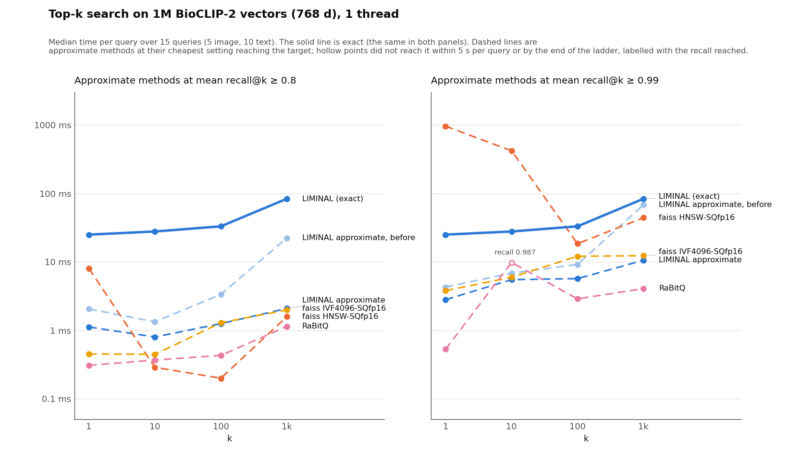

# Top-k search at 1M BioCLIP-2, 1 thread



## Method

- **Data and queries.** The 999,950 BioCLIP-2 vectors and the 15 timing queries of `../threshold-db` (every 10th of
  the 150: 5 held-out images, 10 text prompts). Unfiltered, one thread, warm.
- **Recall@k** is the share of the true top k returned. The true top k is the first k of `prep/order.npy` (ids by f64
  similarity). The figure is the mean over the queries; time is the median over queries of each query's median of 5
  repetitions.
- **Targets.** Each approximate method is shown at the cheapest setting on its ladder whose mean recall reaches 0.80,
  and the cheapest reaching 0.99. The ladder is walked at one repetition and the first rung reaching a target is timed
  at 5. HNSW: ef = ⌈k × mult⌉, mult over ann.py's {1, 1.5, 2, 3, 4, 6, 8, 12, 16, 24, 32, 64, …, 1024}, then doubling up
  to N (k = 1 and 10 needed ef well past 1024 k). IVF and RaBitQ: nprobe 1, 2, 4, …, 4096. A ladder stops at the
  first rung slower than 5 s per query. A target not reached is plotted hollow at the last rung, with its recall.
  Settings were tuned on the timed queries, so they are optimistic.
- **LIMINAL (exact)** is `knn2`, the planner's exact k-NN path, through the new `dbtopk` mode in `rust/src/run2.rs`,
  on the `index_r4` index (`--v2 --int --gtab --flags repack`). Its recall is just below 1 at k = 100 and 1,000
  because it is exact over the stored f16 vectors, and the truth is f64.
- **LIMINAL approximate** is `knn2_fast` (`rust/src/v2/q.rs`), the best-first mode described [below](#the-best-first-approximate-mode):
  nprobe doubling from 1 to all 1,000 clusters, for each of five dials (off, and the dials fitted for this k at miss
  rates 0.001, 0.01, 0.03 and 0.1 per level). The fastest first rung reaching a target is kept; the param column is
  `nprobe:dial`. The dials are fitted on the 135 queries that are not timed. **LIMINAL approximate, before** is
  `knn2_dial`, the mode `dbknn` uses in the threshold-db work, with the dial off and fitted for 0.99; its rows are the
  ones committed with this report.
- **Libraries.** rabitqlib 0.2.0 (IVF4096, 7 bits, `high_accuracy`), faiss 1.16.0 `IndexHNSWSQ` QT_fp16 (M 16,
  efConstruction 200) and `IndexIVFScalarQuantizer` IVF4096 QT_fp16, as top-k `search`. These reuse the indexes in
  `vexact-benchup-data/ann`. **hnswlib, faiss HNSW f32 and faiss IVF4096 f32 are missing** because their index files
  are not there and were not rebuilt. The SQfp16 variants stand in for the faiss ones, which the threshold-db report
  found the same speed as f32.
- **Machine.** Ryzen 9 5900X under WSL2. LIMINAL ran on cores 4–5 and was pinned to core 4. The libraries ran at the
  same time on cores 6 and 7, and other agents were using cores 8–11. LIMINAL's cost model was calibrated during this
  run, with the other jobs running, and its per-item constants came out about 1.7 times those measured on core 10.

## Results

Median ms, with the mean recall in brackets.

| method | target | k = 1 | k = 10 | k = 100 | k = 1,000 |
|---|---|---|---|---|---|
| LIMINAL (exact) | exact | 25.0 (1) | 27.8 (1) | 33.1 (.999) | 83.7 (.999) |
| LIMINAL approximate | 0.80 | 1.12 (.80) | 0.80 (.85) | 1.25 (.87) | 2.09 (.80) |
| LIMINAL approximate | 0.99 | 2.80 (1) | 5.51 (.993) | 5.70 (.991) | 10.6 (.995) |
| LIMINAL approximate, before | 0.80 | 2.06 (.80) | 1.33 (.86) | 3.35 (.87) | 22.4 (.81) |
| LIMINAL approximate, before | 0.99 | 4.29 (1) | 6.86 (1) | 9.18 (.991) | 68.4 (.996) |
| faiss HNSW-SQfp16 | 0.80 | 8.02 (.80) | 0.29 (.83) | 0.20 (.81) | 1.59 (.90) |
| faiss HNSW-SQfp16 | 0.99 | 961 (1) | 420 (1) | 18.4 (.991) | 44.2 (.994) |
| faiss IVF4096-SQfp16 | 0.80 | 0.45 (.87) | 0.45 (.85) | 1.29 (.81) | 1.99 (.81) |
| faiss IVF4096-SQfp16 | 0.99 | 3.80 (1) | 5.96 (1) | 12.1 (.997) | 12.3 (.992) |
| RaBitQ | 0.80 | 0.31 (.87) | 0.37 (.85) | 0.43 (.81) | 1.14 (.81) |
| RaBitQ | 0.99 | 0.53 (1) | 9.80 (.987), not reached | 2.88 (.992) | 4.07 (.993) |

`results/plot_data.csv` has the settings (ef, nprobe, `nprobe:dial`), p90s and query counts. The per-query rows are in
`results/liminal_topk.csv` and `results/ann_*.csv`, and every ladder rung is in the logs.

- HNSW at k = 1 and 10 needs ef 65,536 and 40,960 to reach 0.99, because the graph reaches a few text queries'
  nearest items only late. At k = 1, recall stays at 0.73 from ef 256 to 2,048.
- RaBitQ at k = 10 reaches 0.987 with every cluster probed. Its final distances come from the 7-bit code with no
  full-precision re-rank, so it goes no higher.
- LIMINAL approximate before, at k = 1 with the dial fitted for 0.99, stopped at recall 0.87 even with all 1,000
  clusters; with the dial off it reached 1 at nprobe 64.
- LIMINAL's p90 at k = 1,000 is 377 ms exact against a median of 84: a few queries are far slower. The approximate
  mode's p90 there was 272 ms before and is 13.6 ms now.

## The best-first approximate mode

Rerun on 14 Nov for LIMINAL approximate only; every other row is as committed. It follows ideas 1 and 2 of the
approximate-mode research report (the dial at every level, and the overheads), on the existing 1,000 clusters, with
nothing stored changed and the exact path untouched.

**What changed.**

- *The dial at every level.* The dial's fit runs a verified threshold query whose deterministic levels 0–5 are decided
  on the integer path, and that path's checker recorded no errors, so those levels got factor 1 and pruned by the
  certified half-width. The checker now records (true − estimate) / half-width for the items in the answer, so every
  level gets a factor. On the integer levels the out-margin per norm code already took the factor; the fixed term of
  the per-item out-threshold now takes the largest deterministic factor in place of at least 1. The fit is per k: the
  threshold is the max(k, 10)-th best score, and each level's factor is the (1 − eps) quantile of that ratio. It runs
  on the 135 queries that are not timed (`--dial-from queries`), at eps 0.001, 0.01, 0.03 and 0.1.
- *Best-first probing with a heap.* `knn2_fast` takes the clusters in the approximate order and runs each as a
  threshold query at the running k-th best score: the key range, then the levels on the integer path, each level
  dropping an item once its estimate plus the level's factor times the half-width falls below that score. Survivors,
  and items taken in by a certified lower bound, are scored from their stored vectors (f32 products) into a heap of
  the k best. This replaces the seed, the restricted visible set and the interval selection (61–75 ms at k = 1,000).
  Until k items are held, the first cluster's k items nearest the centre direction are scored outright.
- *Filter.* The probed cluster list is passed directly and only visible rows are read: each cluster's visible rows come
  from the sorted visible list. A cluster with too few visible items to pay for the index path's per-cluster setup
  (by the plan's costs) has them scored outright, batched with other such clusters in row order. At 1% visible every
  cluster is of that kind (about 10 visible items each), so at 1% the dial does nothing and the mode is a scan of the
  probed clusters' visible rows, as the old mode's planner chose too.
- *Overheads found on the way.* Charging a group's setup (76 µs) to the first cluster that needs it sent most clusters
  to their full vectors (12,000 per query at k = 10, 0.99) for no gain in time, so the group cost is left out of the
  per-cluster choice. q.m of every cluster is taken once and serves the order, each probed cluster and the anchor (the
  anchors are the centre directions), which removes `prep2`'s second pass over the 1,000 anchors (a few tenths of a millisecond, by the 1% timings).

**Before and after, unfiltered.** Median ms (mean recall) and the setting; before is the committed row.

| k | target | before | after | before setting | after setting |
|---|---|---|---|---|---|
| 1 | 0.8 | 2.06 (.80) | 1.12 (.80) | 16:off | 16:e0.03 |
| 1 | 0.99 | 4.29 (1) | 2.80 (1) | 64:off | 64:e0.03 |
| 10 | 0.8 | 1.33 (.86) | 0.80 (.85) | 8:fit0.99 | 8:e0.03 |
| 10 | 0.99 | 6.86 (1) | 5.51 (.993) | 128:fit0.99 | 128:e0.01 |
| 100 | 0.8 | 3.35 (.87) | 1.25 (.87) | 16:fit0.99 | 16:e0.01 |
| 100 | 0.99 | 9.18 (.991) | 5.70 (.991) | 128:fit0.99 | 128:e0.01 |
| 1,000 | 0.8 | 22.4 (.81) | 2.09 (.80) | 16:fit0.99 | 16:e0.1 |
| 1,000 | 0.99 | 68.4 (.996) | 10.6 (.995) | 256:fit0.99 | 256:e0.01 |

**What a query reads, unfiltered.** Means per query at the chosen settings, from one untimed run each (the before
column reruns `knn2_dial` at the committed settings with the same dial, and reproduces the committed recalls). Items
entering levels 0 to 9 are in thousands; the levels end at 6.5, 11, 15.5, 20, 28.5, 37, 66.5, 107, 177 and 276 bytes.
Bytes read count each level's codes for the items entering it and 1,536 bytes per full vector.

| k | target | | items entering levels 0–9 (thousands) | full vectors | MB read | groups |
|---|---|---|---|---|---|---|
| 1 | 0.99 | before | 47.4 / 42.1 / 38.7 / 36.0 / 31.7 / 28.8 / 26.6 / 17.8 / 2.9 / 0.2 | 1,703 | 5.7 | 9.8 |
| 1 | 0.99 | after | 45.6 / 14.9 / 8.5 / 5.2 / 4.1 / 2.6 / 1.9 / 0.7 / 0.3 / 0.2 | 282 | 1.0 | 13.6 |
| 10 | 0.8 | before | 9.0 / 9.0 / 8.8 / 8.6 / 6.1 / 5.6 / 5.1 / 0.6 / 0.2 / 0.1 | 831 | 1.8 | 2.3 |
| 10 | 0.8 | after | 7.6 / 4.6 / 3.9 / 3.2 / 2.9 / 2.3 / 1.9 / 1.1 / 0.6 / 0.4 | 492 | 1.1 | 2.9 |
| 10 | 0.99 | before | 90.3 / 79.2 / 72.8 / 68.1 / 62.2 / 57.3 / 53.5 / 1.3 / 0.4 / 0.1 | 3,013 | 8.9 | 17.4 |
| 10 | 0.99 | after | 88.7 / 42.8 / 30.1 / 20.5 / 14.8 / 9.7 / 6.3 / 1.8 / 0.7 / 0.4 | 573 | 2.4 | 23.8 |
| 100 | 0.8 | before | 16.4 / 16.3 / 16.1 / 15.7 / 12.9 / 12.1 / 11.5 / 2.6 / 1.3 / 0.6 | 1,223 | 3.0 | 3.9 |
| 100 | 0.8 | after | 14.4 / 9.4 / 8.0 / 6.9 / 6.1 / 4.9 / 3.9 / 2.0 / 1.1 / 0.5 | 980 | 2.1 | 5.1 |
| 100 | 0.99 | before | 94.3 / 86.7 / 81.7 / 77.5 / 71.9 / 66.7 / 62.9 / 4.8 / 2.2 / 0.9 | 3,697 | 10.9 | 17.7 |
| 100 | 0.99 | after | 94.0 / 43.7 / 30.4 / 20.8 / 15.5 / 10.0 / 6.9 / 2.5 / 1.2 / 0.6 | 1,056 | 3.3 | 23.8 |
| 1,000 | 0.8 | before | 19.5 / 19.5 / 19.5 / 19.4 / 17.0 / 16.6 / 16.1 / 11.2 / 8.6 / 4.9 | 5,517 | 11.2 | 3.9 |
| 1,000 | 0.8 | after | 13.5 / 7.6 / 6.4 / 5.6 / 5.0 / 4.3 / 3.8 / 2.8 / 2.0 / 1.2 | 3,259 | 5.7 | 5.0 |
| 1,000 | 0.99 | before | 192.4 / 175.6 / 166.9 / 160.1 / 152.4 / 144.7 / 139.4 / 44.0 / 28.7 / 14.7 | 13,746 | 36.5 | 31.7 |
| 1,000 | 0.99 | after | 183.6 / 58.2 / 36.3 / 25.7 / 19.8 / 14.0 / 10.7 / 5.7 / 3.6 / 1.9 | 3,819 | 8.9 | 38.7 |

k = 1 at 0.8 is in `results/liminal_topk_stats.csv` with every other row. The before counts include the seed's
probe. Level 0 now drops 52–68% of the items at 0.99, close to the research report's simulation (55–70%), and the
full vectors fall 3.5–6 times. More groups are opened after than before because the old mode sent small clusters to their
full vectors.

**Dial factors per level** (levels 0–9), fitted on the 135 untimed queries. k = 1 uses the 10th best score and so has
k = 10's factors.

| k | eps | factors |
|---|---|---|
| 1, 10 | 0.01 | 0.49, 0.45, 0.42, 0.40, 0.39, 0.37, 0.33, 0.24, 0.25, 0.25 |
| 1, 10 | 0.03 | 0.43, 0.39, 0.35, 0.35, 0.33, 0.32, 0.27, 0.18, 0.19, 0.20 |
| 100 | 0.01 | 0.40, 0.37, 0.34, 0.33, 0.31, 0.29, 0.24, 0.24, 0.24, 0.25 |
| 1,000 | 0.01 | 0.30, 0.27, 0.26, 0.24, 0.23, 0.22, 0.19, 0.25, 0.24, 0.25 |
| 1,000 | 0.1 | 0.20, 0.18, 0.16, 0.16, 0.14, 0.13, 0.11, 0.14, 0.14, 0.14 |
| before (any k) | 0.003 | 1, 1, 1, 1, 1, 1, 0.25, 0.29, 0.28, 0.29 |

Every fitted grid is in `results/liminal_approx_run.log`. Fitted on the setup's corpus pseudo-queries instead, level
0's factor at k = 10 came out at 0.78 for eps 0.01, against 0.49 on the held-out queries: a pseudo-query's nearest
items are near-duplicates whose errors sit further in the upper tail, so pseudo-queries prune little for text queries.

**Where the time goes now** (share of the query's cycles, one untimed run, `VEXACT_PROF`). At 0.99: group setup 30–39%,
the levels 33–47% (item work 25–34%, tables 5–8%), cluster setup 7–8%, the order 4–14%, full vectors 1–5%. At 0.8,
the order over 1,000 centres is 18–35%.

**At 1% visible** (`prep/vis_1.npy`; truth is the first k visible entries of `order.npy`). Both modes read the same
rows, the visible rows of the probed clusters; there are no committed rows, so the before column is `knn2_dial`
rerun on this machine the same day. The figure is `latency_topk_vis1_1t.png`.

| k | target | before | after | setting before / after |
|---|---|---|---|---|
| 1 | 0.8 | 0.37 (.87) | 0.35 (.87) | 16 / 16 |
| 1 | 0.99 | 0.43 (1) | 0.43 (1) | 128 / 128 |
| 10 | 0.8 | 0.37 (.80) | 0.37 (.80) | 16 / 16 |
| 10 | 0.99 | 0.58 (.993) | 0.51 (.993) | 256 / 256 |
| 100 | 0.8 | 0.52 (.85) | 0.39 (.85) | 64 / 64 |
| 100 | 0.99 | 0.96 (.998) | 0.75 (.998) | 512 / 512 |
| 1,000 | 0.8 | 1.98 (.86) | 0.61 (.86) | 256 / 256 |
| 1,000 | 0.99 | 3.56 (1) | 1.87 (1) | 1,000 / 1,000 |

The dial named in each setting there has no effect, since no cluster takes the index path.

**The exact path is unchanged.** The 50k check (`rust/results/const/check.sh` on `research/constants`: verify and the
float64 oracle, 400 queries, threshold and k-NN, filtered and unfiltered) passed before the change, during it and
after it: 0 wrong in or out, 0 k-NN mismatches, 0 oracle differences. With the plan constants fixed
(`--plan-default`), the binaries before and after give identical counts (44,039,687 interval checks, the same items
entering every level and the same decisions).

**Next bottleneck.** Group setup: 24 groups at k = 10 and 100 and 39 at k = 1,000, at about 76 µs each, are a third of
a 0.99 query. Only the basis rows that levels 0–6 use would need to be multiplied (idea 4 of the research report).
After that, item work at the first levels (183,000 items at level 0 at k = 1,000), which sub-clusters (idea 3) cut by
2–3 times, and, at 0.8, the order's 1,000 f64 centre products.

**Caveats.** Probe counts and the dial's eps were chosen on the timed queries, as for every other method here; the
dial's factors were not. Another agent's job ran setup threads on cores 4–7 at times during these runs; each run
waited for the cores to be idle before starting, but not during it.

## Reproduce

```bash
P=<venv as in ../threshold-db/REPORT.md>; D=/home/joe/code/vexact-data/bioclip2-1m; I=/home/joe/code/vexact-benchup-data/index_r4
A=/home/joe/code/vexact-benchup-data/ann; V="vexact --v2 --int --gtab --flags repack --index $I --queries $D/prep/queries.npy"
# exact and the old approximate mode (the committed rows)
taskset -c 4-5 $V --results results --core 4 --pin 4 --fit-dial dbtopk --order $D/prep/order.npy --ks 1,10,100,1000 \
  --targets 0.8,0.99 --step 10 --reps 5 --approx-mode old
# the best-first mode, unfiltered and at 1% visible (one run per k list, each under ten minutes)
taskset -c 4-7 $V --results R --plan-file results/plan.txt --core 4 --pin 4 --pseudo 300 dbtopk --order $D/prep/order.npy \
  --ks 1,10 --targets 0.8,0.99 --step 10 --reps 5 --no-exact --dial-from queries --dial-eps 0.001,0.01,0.03,0.1 \
  [--vis-sets $D/prep/vis_1.npy]
# old-mode counts at the committed settings: ... --approx-mode old --fit-dial --no-exact --params results/liminal_topk.csv
taskset -c 6 $P -I ann_topk.py rabitq|hnsw_sq16|ivf_sq16 $D/prep $A results/ann_METHOD.csv
$P -I plot.py results
```

`results/liminal_topk.csv` holds the exact rows, the committed approximate rows as `liminal_approx_before` and the new
ones as `liminal_approx`; `results/liminal_topk_vis_1.csv` the same at 1% visible; `results/liminal_topk_stats.csv` the
per-query counts.
