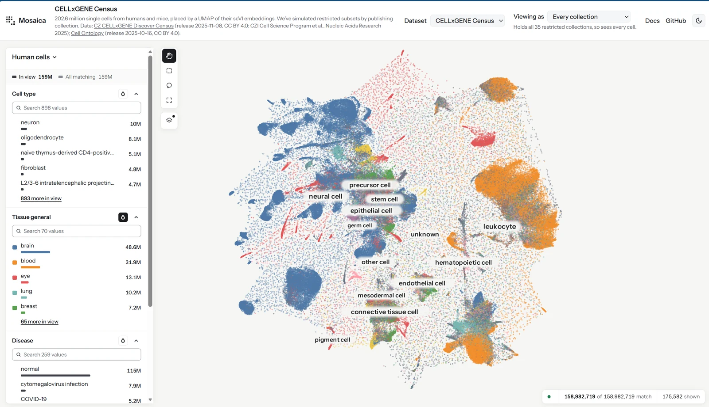

# Mosaica

**A database and visualiser for interactive maps of billions of points.**

*Try the demo: [demo.mosaicadb.com](https://demo.mosaicadb.com/)*

Mosaica is a database for serving interactive maps over billions of spatial data points with granular access control on every point. It takes records with a position, such as locations in geo datasets, specimens in a biodiversity archive or millions of papers laid out by their embeddings, and it serves a map that users can pan, zoom, filter and search, in a browser or a notebook.

This package is Mosaica for Python. It turns a pandas or polars data frame into a Mosaica database, draws its map in Jupyter or marimo, and answers counts, filters and searches as Arrow tables. It brings the Mosaica server with it, so `pip install` is all you need on Linux and macOS.



## Why Mosaica

- **Nothing is thrown away.** Tile pipelines drop points to keep tiles small, so a filter can only narrow what survived. Mosaica answers each view from the full data, so a filter down to ten points shows those ten points.
- **Big data, small hardware.** It is built to serve billions of points from a single machine to many viewers at once. It gracefully handles datasets that don't fit in system memory.
- **Live data.** Insert, delete and hide records while it serves, with no rebuild.
- **A map per viewer.** Give records access labels, and each viewer's map, its points and every count, is computed only from what they may see.
- **Use it from anywhere.** Build and explore in a notebook, then serve the same database to a browser, your own UI, the command line or the HTTP API.
- **Secure enrichments.** Serve layered enrichments over your data, such as clusters, groupings, and hierarchies, with access control applied to each artifact, or served only to viewers who can see the points it was made from.
- **Powerful filters.** Combine spatial filtering such as tiles or polygons with metadata and text search to build exactly the view you need.
- **Multiple views.** Build multiple views over the same data, across geospatial and abstract spaces, or visualise your data at different times.

At a billion GBIF species records on a machine with 24 GB of RAM, a viewer panning and zooming waited 35 ms for a typical frame and 0.36 s for the slowest with Mosaica, against 234 ms and 6.6 s with ClickHouse, the fastest of the three other databases tested. [Compared with other databases](https://docs.mosaicadb.com/system/comparison/) gives the method and each system's setup.

## Install

```bash
pip install 'mosaica[widget]'
```

Mosaica needs Python 3.12 or later. The `widget` extra adds the notebook map, and the `demo` extra adds what the demo datasets are prepared with. Leave both out for the SDK alone.

On Linux and macOS, on x86_64 or ARM64, the package depends on `mosaica-native==0.4.1`, a companion wheel that carries the `mosaica` server and command-line program, so you need no Rust toolchain. On any other platform, Windows included, `mosaica` installs without it and still reads a database someone else runs; to make or serve one there, point `MOSAICA_BIN` at a `mosaica` binary from a [release archive](https://github.com/mosaicadb/mosaica/releases/latest).

## See a map in one command

```bash
pip install 'mosaica[demo]' && mosaica demo places
```

This builds 150,000 GeoNames places into a database and opens its map in your browser, with a picker for whom to view it as. `mosaica demo --list` lists the other datasets, up to GBIF's 3.5 billion occurrences. With [uv](https://docs.astral.sh/uv/), `uvx --from 'mosaica[demo]' mosaica demo places` does the same in a temporary environment.

## Your first map in a notebook

```bash
pip install 'mosaica[widget]' pandas jupyterlab
jupyter lab
```

In a notebook, read the same 150,000 places into pandas and make a database from them:

```python
import mosaica
import pandas as pd
from mosaica import datasets

# Downloaded once into your user cache.
places = pd.read_parquet(datasets.prepared("places").parent / "points.parquet",
                         dtype_backend="numpy_nullable")

db = mosaica.create()
db.declare_view("world", projection="web_mercator")
db.declare_columns(places, category=["feature_class"], render=["feature_class"],
                   index=["name", "population"])
db.insert("world", places, lon="lon", lat="lat")
db.commit()
db.map(colour_by="feature_class")
```

A Mosaica database is made in three steps, each of which returns a short report of what it did:

- **Declare** what the database holds. A view is one layout of the items, here longitude and latitude drawn as a web map; without a projection a view takes plain `x` and `y`, such as a UMAP of your embeddings. `declare_columns` declares every column of the frame from its type. A **rendered** column travels with every point, so the map can colour by it; an **indexed** column can be filtered and searched without travelling; every other column is stored and shown when a point is opened.
- **Insert** a table into something declared, naming the columns it reads.
- **Commit** what was inserted. The first commit builds the database and starts its server on this machine; every later commit adds its rows to the running server without a rebuild.

The last line draws the map in the notebook, where you can pan, zoom, filter and pick points.

## Ask it questions

The same database answers from Python. Every table comes back as a pyarrow table, and `.to_pandas()` turns it into a data frame:

```python
world = db.view("world")
cities = world.filter({"population": {"range": {"gte": 1_000_000}}})

cities.count()                                    # 613
world.filter({"name": {"match": "san"}}).count()  # places with "San" in their name
cities.map(colour_by="feature_class")             # the map of just those places
cities.items(["name", "population"]).to_pandas()  # every row, as a data frame

(by_class,) = db.aggregate("world", [{"by": {"field": "feature_class", "top": 9}, "count": True}])
by_class.to_pandas()                              # how many places of each of the nine kinds
```

The filter, the count and the map are computed by the server over every item, so a filter down to ten points draws those ten points.

## A map per viewer

Give each row the access labels that may see it, and every map, count and table is computed over only what the viewer holding those labels may see:

```python
notes = pd.DataFrame({
    "x": [0.1, 0.4, 0.8],
    "y": [0.2, 0.9, 0.5],
    "title": ["Shared plan", "Team A draft", "Team B draft"],
    "access": [["everyone"], ["team-a"], ["team-b"]],
})

db = mosaica.create()
db.declare_view("notes")
db.declare_columns(notes, skip=["x", "y", "access"], index=["title"])
db.insert("notes", notes, x="x", y="y", access="access")
db.commit()

team_a = db.viewer(["everyone", "team-a"])
team_a.view("notes").count()    # 2: Team B's draft is not there to count
team_a.map()                    # and not there to draw
```

`db` itself reads as the database's operator and sees every item. Rows inserted after the first commit join the running database, and `db.remove(...)` and `db.suppress(...)` take items out of every viewer's map without a rebuild.

## A database somebody else runs

```python
viewer = mosaica.connect("https://mosaica.example/viewer", token=my_token)
viewer.view("s0").count()
viewer.map()
```

The token decides what you may see, so you read the same database as any other viewer does. `mosaica.login` makes a token from a password, an API key or an OIDC access token.

## When to use something else

- Your data fits in the browser: draw it there, with deck.gl or a plotting library.
- It never changes and has no access rules: static tiles such as PMTiles are cheaper to host.
- You need ad hoc SQL: use a columnar database such as ClickHouse.

Mosaica runs on one machine, with no replication yet, and search filters rather than ranks.

## Learn more

- [Python notebooks](https://docs.mosaicadb.com/start/python/): two tutorials, your first map in Python and analysing a map with your own clusters.
- [Python client reference](https://docs.mosaicadb.com/reference/python/): every call, from `create()` to the notebook map.
- [Documentation](https://docs.mosaicadb.com/): how Mosaica works, serving it to a browser, Docker, and the HTTP API.
- [Hosted demo](https://demo.mosaicadb.com/): 88.4 million places, 20.7 million PubMed papers and 50,000 arXiv papers, each viewable as different viewers.
- [Source](https://github.com/mosaicadb/mosaica), [issues](https://github.com/mosaicadb/mosaica/issues) and the [changelog](https://github.com/mosaicadb/mosaica/blob/main/CHANGELOG.md).

## Status

Mosaica is an alpha. Expect formats and APIs to change before 1.0.

Apache License 2.0.
