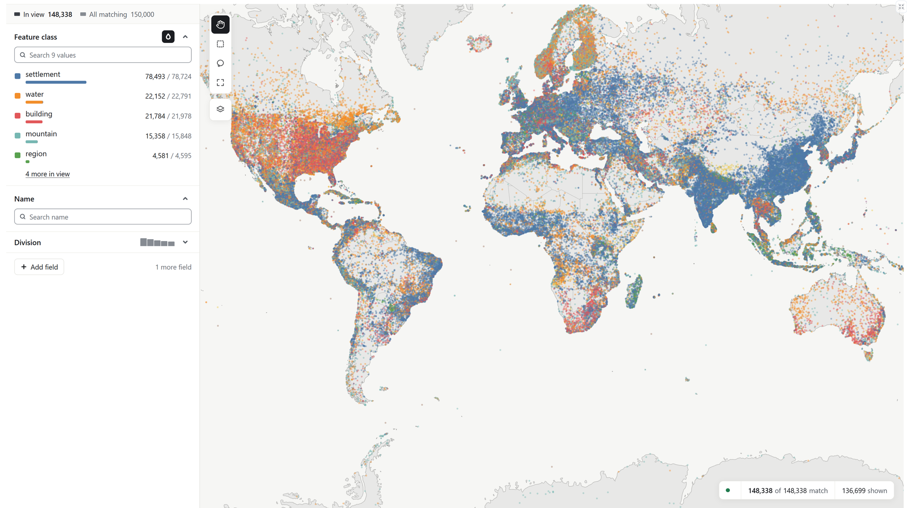

<h1>
  
</h1>

**Interactive maps of billions of points, in a notebook or a browser.**

Mosaica is a database for serving interactive maps over billions of points, with access control on every point. Give it records with a position, such as places on a world map, specimens in a biodiversity archive or papers laid out by their embeddings, and it serves a map you can pan, zoom, filter and search. This package makes a Mosaica database from your data frames, draws its map in Jupyter or marimo, and queries it from Python.



## See a map in one command

```bash
pip install 'mosaica[demo]' && mosaica demo places
```

This builds 150,000 GeoNames places into a database and opens its map in your browser. `mosaica demo --list` lists the other datasets, up to GBIF's 3.5 billion occurrences.

## Your first map in a notebook

```bash
pip install 'mosaica[widget]' pandas jupyterlab
```

In a notebook cell, load the same places into a data frame, declare what the database holds, insert the rows and draw the map:

```python
import mosaica
import pandas as pd
from mosaica import datasets

places = pd.read_parquet(datasets.prepared("places").parent / "points.parquet",
                         dtype_backend="numpy_nullable")

db = mosaica.create()
db.declare_view("world", projection="web_mercator")
db.declare_columns(places, category=["feature_class"], render=["feature_class"], index=["name"])
db.insert("world", places, lon="lon", lat="lat")
db.commit()
db.map(colour_by="feature_class")
```

`mosaica.create()` makes the database in a temporary directory and `commit()` starts a server for it on this machine. The map reads from that server, so it stays fast at any size. From here, `db.view("world")` filters, searches and counts, and `db.save(path)` keeps the database. The [Python tutorials](https://docs.mosaicadb.com/start/python/) carry on from this point, in Jupyter or marimo.

## Why Mosaica

- **Nothing is thrown away.** Tile pipelines drop points to keep tiles small, so a filter can only narrow what survived. Mosaica answers each view from the full data, so a filter down to ten points shows those ten points.
- **Big data, small hardware.** One machine serves billions of points to many viewers, including datasets that do not fit in memory.
- **Live data.** Insert, delete and hide records while the map is open, with no rebuild.
- **A map per viewer.** Give records access labels, and each viewer's map, its points and every count, is computed only from what they may see. `db.viewer(["cs.LG"]).map()` shows what someone holding only that label sees.
- **Your own analysis on the map.** Add clusters, groupings and hierarchies as layers, with access control applied to each.
- **Filters that combine.** Combine tiles or polygons with metadata and text search to get exactly the view you need.

## Connect to a server someone else runs

```python
token = mosaica.login("https://mosaica.example/viewer", api_key=my_key)
v = mosaica.connect("https://mosaica.example/viewer", token=token)
v.map()
```

## Install

`pip install mosaica` needs Python 3.12 or later. On Linux and macOS it brings the `mosaica` server with it, through the `mosaica-native` wheel. On other platforms, Windows included, the package installs without it and connects to a running server. Every table it returns is a pyarrow table, and `.to_pandas()` turns one into a data frame.

| Extra | Adds |
|---|---|
| `mosaica[widget]` | the notebook map, for Jupyter and marimo |
| `mosaica[demo]` | `mosaica demo` and `mosaica.datasets` |

## Status

Mosaica is an alpha. Expect formats and APIs to change before 1.0.

## Learn more

- [Documentation](https://docs.mosaicadb.com/): tutorials, how it works, guides and the reference.
- A [hosted demo](https://demo.mosaicadb.com/) of 73.6 million places and 50,000 arXiv papers.
- [Python examples](https://github.com/mosaicadb/mosaica/tree/main/clients/py/examples) and the [source](https://github.com/mosaicadb/mosaica).

Apache License 2.0.
