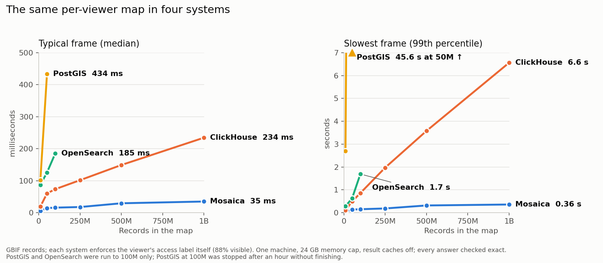

# Mosaica

**Interactive maps of billions of points.**

Mosaica is a database for serving interactive maps over billions of points, with access control on every point. It takes records with a position, such as locations in geo datasets, specimens in a biodiversity archive or millions of papers laid out by their embeddings, and it serves a map that people can pan, zoom, filter and search, in a browser or a notebook.

## Why Mosaica

-   **Nothing is thrown away**

    Tile pipelines drop points to keep tiles small, so a filter can only narrow what survived. Mosaica answers each view from the full data, so a filter down to ten points shows those ten points.

-   **Big data, small hardware**

    Built to serve billions of points from a single machine to many viewers at once, and it gracefully handles datasets that don't fit in memory. In the comparison below it serves a billion records, 37 GiB on disk, under a 24 GB memory cap.

-   **Live data**

    Insert, delete and hide records while it serves, with no rebuild. New records appear on the map within 90 seconds by default, and a deletion applies to every request after the server accepts it.

-   **A map per viewer**

    Give records access labels, and each viewer's map is computed only from what they may see: every point, every count and every cluster. The [security](system/security.md) chapter lists what response times can still reveal.

-   **Use it from anywhere**

    Deploy it as a server with the bundled explorer, put the map inside your own UI, run it in a Python notebook, or script it from the command line or the HTTP API.

-   **Secure enrichments**

    Layer clusters, regions and hierarchies over your data as [annotations](system/annotations.md), each with access control of its own, or shown only to viewers who can see enough of the points it was made from.

-   **Powerful filters**

    Combine a box or a polygon on the map with ranges, categories, keywords and free-text search, using and, or and not. Every count and breakdown follows the filters.

-   **Multiple views**

    Lay the same records out in several ways, on a world map and by an embedding, or one layout per year, and let viewers switch between them without losing their filters.

## Compared with other databases

We served the same map of GBIF's species records from Mosaica and from three other databases, each tuned for the map's queries and enforcing the same access rules, in a container capped at 24 GB of memory. At a billion records, a viewer panning and zooming waited 35 ms for a typical frame and 0.36 s for the slowest with Mosaica, and 234 ms and 6.6 s with ClickHouse, the fastest of the others. [Compared with other databases](system/comparison.md) gives the method, each system's setup and more detailed measurements.

## Try it in your browser

[demo.mosaicadb.com](https://demo.mosaicadb.com/) serves four maps from one machine: 88.4 million places from Overture Maps on a world map, 20.7 million PubMed papers laid out by their abstracts, 50,000 arXiv papers laid out by their topics, and the 202.6 million human and mouse cells of the CELLxGENE Census placed by their gene expression. Pick whom to view the map as, such as a viewer who may see only the places Foursquare contributed or only the cancer papers, and every point, count and cluster changes to what that viewer may see.

## Where to start

- **See a map on your own machine.** `pip install 'mosaica[demo]' && mosaica demo places`, or `uvx --from 'mosaica[demo]' mosaica demo places` with [uv](https://docs.astral.sh/uv/), builds 150,000 GeoNames places into a database and opens its map in your browser. [Datasets to try](start/datasets.md) lists the other datasets, up to GBIF's 3.5 billion occurrences.
- **Explore your own data in a notebook.** The Python client turns a pandas or polars data frame into a map in Jupyter, and answers counts and filters from code. It runs the database on your own machine, or connects to a shared server. Start with the [Python client](reference/python/index.md).
- **Run a map that other people open in a browser.** Describe your Parquet files, build them with the `mosaica` command, and serve the result. [Your first map from files](start/first-map.md) walks through it, and the [Docker](guides/docker.md) and [systemd](guides/systemd.md) guides cover running it for real.
- **Put a map inside your own web application.** The TypeScript client and its web components add a map, filters and record cards to a page, in any framework, or a layer to your own deck.gl scene. See the [TypeScript client](reference/typescript.md) and the [components](reference/components.md).
- **Work with it from another language.** A running server answers an HTTP API, which both clients are built on. The [HTTP API reference](reference/http.md) describes every route.

## When to use something else

- Your data fits in the browser: draw it there, with deck.gl or a plotting library.
- It never changes and has no access rules: static tiles such as PMTiles are cheaper to host.
- You need ad hoc SQL: use a columnar database such as ClickHouse.

Mosaica runs on one machine, and search filters rather than ranks. It is an alpha, so expect formats and APIs to change before 1.0.

## About these pages

- [Start](start/index.md) covers installing and configuring Mosaica, and has tutorials, which take you from nothing to a working map.
- [How it works](system/overview.md) explains the design: how data is stored, how a map is answered, how changes reach a running server, and how each viewer's map is kept to what they may see.
- [Guides](guides/index.md) cover particular jobs, such as running Mosaica under Docker or behind TLS.
- [Reference](reference/index.md) lists every route, command, setting and client call.
