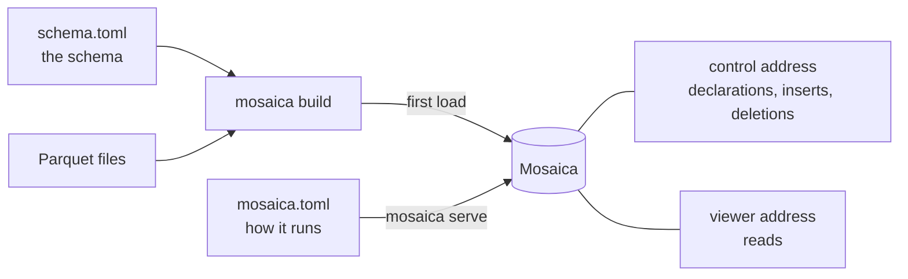

# Install and configure

This page shows how to install Mosaica as a standalone database and configure it. Once it is running, you can reach it over its HTTP API, with the `mosaica` command line, or from the TypeScript and Python clients.

!!! tip "Prototyping in Python"
    For local prototyping and analysis, you don't need a separate database. The Python client can run one itself, privately, for your notebook or script. [Your first map in Python](python.md) shows how.

## Install Mosaica

Release binaries and a Docker image will come with the first release. Until then, build Mosaica from source. You'll need Rust and a C compiler (`build-essential` on Debian and Ubuntu).

```bash
git clone https://github.com/mosaicadb/mosaica ~/mosaica
cd ~/mosaica
cargo install --locked --path crates/mosaica-cli
```

This installs the `mosaica` command, which creates databases and runs them. To run a database as a service, see [Run Mosaica under systemd](../guides/systemd.md) or [Run Mosaica with Docker](../guides/docker.md).

Mosaica runs on Linux and macOS, but not yet on Windows.

??? info "Supported platforms"
    Release builds are made for Linux on x86_64 and aarch64 (glibc 2.28 or later, or musl 1.2 or later), macOS 11 or later on Apple silicon, and macOS 10.12 or later on Intel. The tests run on Linux x86_64.

## Install a client

The clients aren't on PyPI or npm yet either, so install them from the same clone.

=== "Python"

    You'll need Python 3.10 or later, Rust, a C compiler and Node.js 22.15 or later. The first package carries Mosaica itself, which the client uses when it runs a database of its own.

    ```bash
    cd ~/mosaica
    pip install -e clients/py-native
    pip install -e 'clients/py[widget]'
    ```

    On Windows, the Python client installs without the database itself, and connects to a database running on another machine.

=== "TypeScript"

    You'll need Node.js 22.15 or later. Pack the packages from `clients/ts` and install the packed files in your project, as the [TypeScript client's README](https://github.com/mosaicadb/mosaica/blob/main/clients/ts/README.md#using-the-packages-in-another-project) describes.

    The npm registry holds empty placeholders under the `@mosaicajs` names, so `npm install @mosaicajs/client` succeeds but installs no code.

## Configure

You configure a deployment with two files. In `schema.toml` you describe the database's schema: its views, its fields and whether each is rendered or indexed, its vocabularies and annotation layers, and who may see what. Its `[sources]` table also names the files to load first. In `mosaica.toml` you set up how the database runs: where it keeps its files, which schema it starts from, the addresses it listens on, the operator credential and its limits.



`mosaica build` creates the database from the schema. If `[sources]` names files, the build loads them in the same pass, which is the fastest way to load a lot of data at once. Without them, you get an empty database, ready to take its data through the control address. `mosaica serve` starts it, and from then on it takes every change: you can declare new fields, views and layers, and insert or delete items. It reads `mosaica.toml` when it starts, so restart it after you change a setting.

!!! tip "Working on your own machine"
    For development and prototyping, start the database in open mode, with `mosaica serve --open` or `open = true` under `[serve]`. It then answers every request without signing in, from any client: the HTTP API, the command line, a web page or Python. It listens only on this machine, needs no operator credential, and refuses to start once you've set up users. [Your first map in a web page](typescript.md) uses it.

??? info "Where Mosaica looks for the two files"
    Mosaica looks for `mosaica.toml` in the directory you run it from, then in each directory above, unless you name one with `--deployment`. It reads the schema from `schema.toml` in the same directory, unless `[build] schema` or `--config` names another file. A relative path in either file is read from that file's own directory.

    If you'd rather declare a schema to a running database, `mosaica check --payloads` prints it as the requests to send.

## Try it

The repository has 150,000 GeoNames places in `examples/data/geonames`. Make a directory beside the clone:

```bash
mkdir ~/places && cd ~/places
```

Save this as `schema.toml`:

```toml
[sources]
points = "../mosaica/examples/data/geonames/points.parquet"

[defaults]
source = "points"

# A world map, from the file's lon and lat columns. Every place is public.
[[view]]
name             = "world"
projection       = "web_mercator"
extent           = { lon = [-180.0, 180.0], lat = [-85.0511287798066, 85.0511287798066] }
point_visibility = { default = "public" }

# Searchable names.
[[attribute]]
name  = "name"
type  = "text"
index = true

# Sent with every point, to colour by.
[[attribute]]
name   = "population"
type   = "i64"
render = true
```

Save this as `mosaica.toml`:

```toml
# Where the database keeps its data, its cache and its write-ahead log.
[bundle]
path  = "bundle"
cache = "cache"
wal   = "wal.log"

# A viewer's session lasts at most an hour.
[disclosure]
token_max_lifetime = 3600

[serve]
viewer                   = "127.0.0.1:9141"
session                  = "127.0.0.1:9142"
control                  = "127.0.0.1:9143"
operator_credential_file = "operator.secret"

# Users, keys and grants.
[catalogue]
dir = "catalogue"
```

Check that the schema matches the file, then build the database:

```bash
mosaica check 2>&1 | tail -n 1
```

```
check OK: 2 source(s), 1 view(s), 0 view group(s) over 0 declared view(s), 0 vocabulary(ies), 2 attribute(s), 0 layer(s), 0 warning(s)
```

```bash
mosaica build 2>&1 | tail -n 2
```

```
built /home/you/places/bundle (v00000): 150000 items, 1 terms, 150000 pairs, 11676070 bytes on disk, 0 artifact(s) minted, 0 unclustered member row(s), 0 row(s) refused
  view world: 150000 row(s)
```

Make the operator credential and start the database:

```bash
openssl rand -hex 16 > operator.secret; chmod 600 operator.secret
mosaica serve
```

```
...
{"event":"listening","viewer":"127.0.0.1:9141","session":"127.0.0.1:9142","control":"127.0.0.1:9143"}
```

You now have a running database with 150,000 places in it. To see them on a map, follow the tutorial's [Open the map](first-map.md#open-the-map) step, using `~/places` where it says `~/ireland`.

### Start from an empty database

If your data arrives through your own code rather than as files, start with an empty database instead. Stop the server, and in a new directory save a `schema.toml` with no `[sources]`. A view with no data to fit needs its frame stated, as this one is:

```toml
[[view]]
name             = "world"
projection       = "web_mercator"
extent           = { lon = [-180.0, 180.0], lat = [-85.0511287798066, 85.0511287798066] }
point_visibility = { default = "public" }

[[attribute]]
name  = "name"
type  = "text"
index = true

[[attribute]]
name   = "population"
type   = "i64"
render = true
```

Copy `mosaica.toml` and `operator.secret` beside it, then build and serve as before. The build writes an empty database:

```bash
mosaica build 2>&1 | tail -n 2
mosaica serve
```

```
OUTPUT-PENDING
```

In another shell, send it some places. The control address takes rows as JSON, one object per item, keyed by field name, with the position in `lon` and `lat`:

```bash
curl -sS http://127.0.0.1:9143/control/ingest \
  -H "authorization: Bearer $(cat operator.secret)" \
  -H 'content-type: application/json' \
  -d '[{"lon": -6.26, "lat": 53.35, "name": "Dublin", "population": 1173179},
       {"lon": -8.47, "lat": 51.90, "name": "Cork", "population": 190384}]'
```

```json
OUTPUT-PENDING
```

New items appear at the next flush, within 90 seconds. [Changing data](../system/write-path.md) covers every write, and how to wait until one is visible. You can declare more views, fields and layers the same way, except that a rendered field must be in the schema the database is built from.

Every key this example leaves out is in the [schema.toml](../reference/corpus-toml.md) and [mosaica.toml](../reference/mosaica-toml.md) references, and [Operate a deployment](../guides/operating.md#what-the-server-keeps-on-disc) explains what the database keeps on disc and how to back it up.

## From Python

In Python you don't write either file yourself. `mosaica.create("~/maps/places")` makes a database in that directory and writes both files there, and its first commit builds the database and starts it. Because everything lives in that one directory, you can serve the database later without Python, with `mosaica serve --deployment ~/maps/places/mosaica.toml`.

Leave out the path and you get a temporary database, which is deleted when Python exits. The [Python reference](../reference/python/connecting.md) has the details of `create()`, `open()` and `save()`.

## Next

- [Your first map from files](first-map.md) walks through a map of Ireland, from downloading the data to filtering it in the browser.
- [Your first map in Python](python.md), if you'd rather start from a data frame.
- Before other people use your database, read [Users and roles](../system/users-and-roles.md) to set up who can sign in and what each of them may see.
