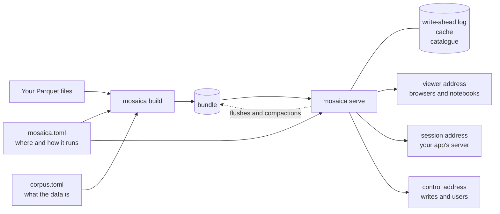

# Install and configure

Mosaica is one program, `mosaica`, which builds a database from your files and serves it. Beside it are a Python client and a set of TypeScript packages for the browser. A deployment is configured with two files, one describing your data and one describing the deployment.

## What to install

| To | Install |
|---|---|
| Build a database from files, serve it, and manage its users | The `mosaica` binary |
| Run it as a service | The `mosaica` binary under systemd, or the Docker image |
| Explore data in a notebook, or script a database from Python | The Python package, `mosaica`, which brings the binary with it on Linux and macOS |
| Put a map in a web page or app | The `@mosaicajs` packages, and a server to read from |

!!! note ""
    Not published yet: release binaries, the Docker image, the Python package on PyPI and the `@mosaicajs` packages on npm. Until they are, install each from a clone of the repository, as below. The npm registry holds an empty placeholder under each `@mosaicajs` name, so `npm install @mosaicajs/client` reports no error and installs no code.

**The binary.** Build it with cargo. You need Rust, installed with rustup, and a C compiler and its build tools (`build-essential` on Debian and Ubuntu), because Mosaica links C libraries such as CRoaring, zstd and SQLite.

```bash
git clone https://github.com/mosaicadb/mosaica ~/mosaica
cd ~/mosaica
cargo install --locked --path crates/mosaica-cli
mosaica --version
```

[Your first map from files](first-map.md) starts here, and shows what each step prints.

**The Docker image.** Build it from the `Dockerfile` at the root of the clone. [Run Mosaica with Docker](../guides/docker.md) covers building it and running it with Compose.

**The Python package.** It needs Python 3.10 or later. Install the companion package that carries the binary first, then the client, from the clone. Both build from source: the first compiles Mosaica, so it needs what the binary needs, and the second bundles the map's browser code, so it needs Node.js 22.15 or later. The [Python client's README](https://github.com/mosaicadb/mosaica/blob/main/clients/py/README.md) gives the details.

```bash
cd ~/mosaica
pip install -e clients/py-native
pip install -e 'clients/py[widget]'
```

**The TypeScript packages.** Build and pack them from `clients/ts`, then install the packed files in your own project, as the [TypeScript client's README](https://github.com/mosaicadb/mosaica/blob/main/clients/ts/README.md#using-the-packages-in-another-project) describes. They need Node.js 22.15 or later.

## Platforms

Mosaica's release builds, and the Python package that carries the binary, are made for:

- Linux on x86_64 and aarch64, with glibc 2.28 or later, or musl 1.2 or later;
- macOS 11 or later on Apple silicon (arm64);
- macOS 10.12 or later on Intel (x86_64).

The test suite runs on Linux x86_64. The release builds for Linux x86_64 and macOS arm64 are also started once each to check they run.

There is no Windows build. On Windows, the Python package installs without the binary. It connects to a server running elsewhere, but cannot build or serve a database itself.

## How a deployment fits together

A deployment is a directory holding two files you write, and the files Mosaica makes from them.



*`mosaica build` reads both files and your data, and writes the bundle. `mosaica serve` reads `mosaica.toml`, the bundle and its own files, and never the declaration or your data.*

- **The declaration**, `corpus.toml` on these pages, describes your data. It names the files to read, the views that place each item on a map, the fields each item carries and what each is for, the vocabularies of category fields, and the annotation layers over the items.
- **The deployment file**, `mosaica.toml`, describes one running deployment: where the bundle and the server's own files go, which declaration to build, the three addresses, the operator's credential, how long a viewer's session lasts, and the limits on requests and writes.
- **The bundle** is the database itself, which the build writes from your files. From then on the server reads the bundle, and never your files.

| | `corpus.toml` | `mosaica.toml` |
|---|---|---|
| Describes | The data: what each column means and how it is used | One deployment: where it keeps its files and how it serves |
| Read by | `mosaica check` and `mosaica build` | `mosaica check`, `mosaica build`, `mosaica serve` and `mosaica health` |
| Found | Where `[build] schema` in `mosaica.toml` points, `schema.toml` if it says nothing. `--config` names another | In the directory the command runs in, or the nearest directory above it that has one. `--deployment` names another |
| Relative paths are read from | The declaration's own directory. An absolute path in `[sources]` is refused | The directory `mosaica.toml` is in |
| After the build | Not read again. Declare new fields, views, vocabularies and layers at the running server through the control address | Read each time the server starts, so a change takes effect at the next restart |

The declaration's file can have any name, since `mosaica.toml` names it. The examples in the repository and the Python client call it `schema.toml`.

What the declaration holds is also what a running server can be told: `mosaica check --payloads` prints the declaration as the requests that would declare it at a running service. The [data model](../system/data-model.md#what-can-change-while-it-runs) lists what can change after the build.

## A small deployment

The repository carries 150,000 GeoNames places in `examples/data/geonames`. Here is the least you need to put them on a map, with a name to search by and a population to colour by. Make a directory beside the clone.

```bash
mkdir ~/places && cd ~/places
```

Save this as `corpus.toml`.

```toml
[sources]
points = "../mosaica/examples/data/geonames/points.parquet"

[defaults]
source = "points"

[[view]]
name             = "world"
projection       = "web_mercator"
extent           = { lon = [-180.0, 180.0], lat = [-85.0511287798066, 85.0511287798066] }
point_visibility = { default = "public" }

[[attribute]]
name  = "name"
type  = "text"
index = true

[[attribute]]
name   = "population"
type   = "i64"
render = true
```

`[sources]` names the file, and `[defaults]` makes it the source of everything below. The view places each row on a Web Mercator world map from its `lon` and `lat` columns, and gives every place the access label `public`, which every viewer holds. `index = true` makes the names searchable, and `render = true` sends each place's population with every point drawn. The [tutorial](first-map.md#describe-the-data) explains each of these choices, and the [corpus.toml reference](../reference/corpus-toml.md) lists every key.

Save this as `mosaica.toml`. `mosaica serve` refuses to start without each of these keys, apart from `[build]`, which the build reads and the server does not. It is there because the declaration is not called `schema.toml`. The operator credential can come from an environment variable instead of a file, with `operator_credential_env`.

```toml
[bundle]
path  = "bundle"
cache = "cache"
wal   = "wal.log"

[build]
schema = "corpus.toml"

[disclosure]
token_max_lifetime = 3600

[serve]
viewer                   = "127.0.0.1:9141"
session                  = "127.0.0.1:9142"
control                  = "127.0.0.1:9143"
operator_credential_file = "operator.secret"

[catalogue]
dir = "catalogue"
```

- `[bundle]` names the bundle's directory, a cache of work the server can redo, and the write-ahead log, where every write is recorded before it is applied.
- `[build] schema` names the declaration.
- `token_max_lifetime` is the longest a viewer's session lasts, in seconds.
- `[serve]` gives the three addresses, and a file holding the operator credential, which holds every permission.
- `[catalogue] dir` is where the server keeps its users, their passwords and keys, and what each may see and do. [Users and roles](../system/users-and-roles.md) explains them.

The [mosaica.toml reference](../reference/mosaica-toml.md) lists every other key, with its default.

Check the declaration against the file, build, make the operator credential and serve.

```bash
mosaica check 2>&1 | tail -n 1
```

```
check OK: 2 source(s), 1 view(s), 0 view group(s) over 0 declared view(s), 0 vocabulary(ies), 2 attribute(s), 0 layer(s), 0 warning(s)
```

It counts two sources because the view and the attributes each read the file.

```bash
mosaica build 2>&1 | tail -n 2
```

```
built /home/you/places/bundle (v00000): 150000 items, 1 terms, 150000 pairs, 11676070 bytes on disk, 0 artifact(s) minted, 0 unclustered member row(s), 0 row(s) refused
  view world: 150000 row(s)
```

```bash
openssl rand -hex 16 > operator.secret; chmod 600 operator.secret
mosaica serve
```

```
...
{"event":"listening","viewer":"127.0.0.1:9141","session":"127.0.0.1:9142","control":"127.0.0.1:9143"}
```

In a second terminal, look at what the build and the server made beside your two files.

```bash
cd ~/places
ls
```

```
bundle
cache
catalogue
corpus.toml
mosaica.toml
operator.secret
wal-000001.log
wal-000001.sync
```

| Path | Holds | Made by |
|---|---|---|
| `bundle` | The database: every item, its positions, its fields, the indexes and the key that scrambles `mosaica_id`s | `mosaica build`, then added to by the server as writes are flushed and compacted |
| `wal-*.log`, `wal-*.sync` | Every change accepted since the last flush | The server |
| `cache` | Work the server can redo, such as each grant's set of visible items | The server |
| `catalogue` | The users, groups, keys, passwords and grants. It lives outside the bundle, so it survives a rebuild | The server, when it first starts |

[Operate a deployment](../guides/operating.md#what-the-server-keeps-on-disc) says what makes each grow and what to back up. To see the map in a browser, follow [Open the map](first-map.md#open-the-map) in the tutorial, writing `~/places` where it writes `~/ireland`. It makes the principals the example page signs in with.

## From Python

The Python client writes both files for you. `mosaica.create("~/maps/places")` makes a database in that directory. The client writes the declaration, `schema.toml`, from what you declare and insert, and a `mosaica.toml` of its own, which keeps the cache, the write-ahead log, the catalogue and the operator credential under `.mosaica/` and the tables you insert under `sources/`. The first commit builds the bundle and starts a server on that directory, listening on free ports on this machine only. Call `write()` to see the two files before then.

Since the directory holds everything, `mosaica serve --deployment ~/maps/places/mosaica.toml` serves the same database without Python, on new free ports each time, which it prints when it starts. `mosaica.create()` with no path puts the database in a temporary directory and deletes it when the database is closed or Python exits. `save(path)` copies it somewhere lasting. The [Python reference](../reference/python/connecting.md) covers `create()`, `open()` and `save()`.

## Next

- [Your first map from files](first-map.md) builds a map of Ireland step by step, from download to a filtered map in the browser.
- [Run Mosaica under systemd](../guides/systemd.md) and [Run Mosaica with Docker](../guides/docker.md) run a deployment as a service.
- [Users and roles](../system/users-and-roles.md) covers who can sign in, and what each may see and do.
