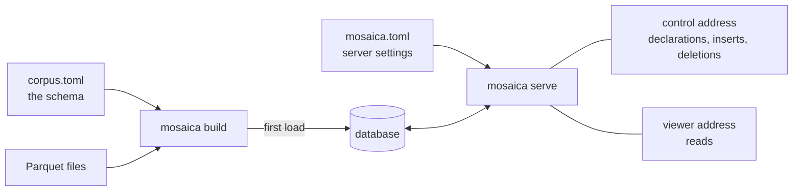

# Install and configure

This page shows how to install Mosaica as a standalone database server and configure it. Once it is running, you can reach it over its HTTP API, with the `mosaica` command line, or from the TypeScript and Python clients.

!!! tip "Prototyping in Python"
    For local prototyping and analysis, you don't need a separate server. The Python client can run Mosaica itself, starting a private server for your notebook or script. [Your first map in Python](python.md) shows how.

## Install the server

Release binaries and a Docker image will come with the first release. Until then, build the server from source. You'll need Rust and a C compiler (`build-essential` on Debian and Ubuntu).

```bash
git clone https://github.com/mosaicadb/mosaica ~/mosaica
cd ~/mosaica
cargo install --locked --path crates/mosaica-cli
```

This installs the `mosaica` command, which both builds databases and serves them. To run the server as a service, see [Run Mosaica under systemd](../guides/systemd.md) or [Run Mosaica with Docker](../guides/docker.md).

Mosaica runs on Linux and macOS. It doesn't run on Windows yet.

??? info "Supported platforms"
    Release builds are made for Linux on x86_64 and aarch64 (glibc 2.28 or later, or musl 1.2 or later), macOS 11 or later on Apple silicon, and macOS 10.12 or later on Intel. The tests run on Linux x86_64.

## Install a client

The clients aren't on PyPI or npm yet either, so install them from the same clone.

=== "Python"

    You'll need Python 3.10 or later, Rust, a C compiler and Node.js 22.15 or later. The first package carries the server, which the client uses when it runs Mosaica itself.

    ```bash
    cd ~/mosaica
    pip install -e clients/py-native
    pip install -e 'clients/py[widget]'
    ```

    On Windows, the Python client installs without the server, and connects to one running on another machine.

=== "TypeScript"

    You'll need Node.js 22.15 or later. Pack the packages from `clients/ts` and install the packed files in your project, as the [TypeScript client's README](https://github.com/mosaicadb/mosaica/blob/main/clients/ts/README.md#using-the-packages-in-another-project) describes.

    The npm registry holds empty placeholders under the `@mosaicajs` names, so `npm install @mosaicajs/client` succeeds but installs no code.

## Configure

You configure a deployment with two files. In `corpus.toml` you describe the database's schema: its views, its fields and whether each is rendered or indexed, its vocabularies and annotation layers, and who may see what. Its `[sources]` table also names the files to load first. In `mosaica.toml` you set up the server: where it keeps its files, which schema it starts from, the addresses it listens on, the operator credential and its limits.



`mosaica build` creates the database and loads your files into it in one pass, which is the fastest way to load a lot of data at once. From then on, the server takes every change: you can declare new fields, views and layers, and insert or delete items, through its control address. The server reads `mosaica.toml` when it starts, so restart it after you change a setting.

!!! note ""
    Not built yet: starting from an empty database. For now, a database starts with a build that loads at least one view's data.

??? info "Where Mosaica looks for the two files"
    Mosaica reads `mosaica.toml` from the directory you run it in, or the nearest directory above it that has one, and `--deployment` names another. The schema is the file `[build] schema` names, `schema.toml` by default, and `--config` names another. Relative paths are read from the directory of the file they're in.

    The examples in the repository and the Python client call the schema `schema.toml`. `mosaica check --payloads` prints a schema as the requests that would declare it at a running server.

## Try it

The repository has 150,000 GeoNames places in `examples/data/geonames`. Make a directory beside the clone:

```bash
mkdir ~/places && cd ~/places
```

Save this as `corpus.toml`:

```toml
[sources]
points = "../mosaica/examples/data/geonames/points.parquet"

[defaults]
source = "points"

# A world map, from the file's lon and lat columns. Every place is public.
[[view]]
name             = "world"
projection       = "web_mercator"
extent           = { lon = [-180.0, 180.0], lat = [-85.0511287798066, 85.0511287798066] }
point_visibility = { default = "public" }

# Searchable names.
[[attribute]]
name  = "name"
type  = "text"
index = true

# Sent with every point, to colour by.
[[attribute]]
name   = "population"
type   = "i64"
render = true
```

Save this as `mosaica.toml`:

```toml
# The database, the server's cache and its write-ahead log.
[bundle]
path  = "bundle"
cache = "cache"
wal   = "wal.log"

[build]
schema = "corpus.toml"

# A viewer's session lasts at most an hour.
[disclosure]
token_max_lifetime = 3600

[serve]
viewer                   = "127.0.0.1:9141"
session                  = "127.0.0.1:9142"
control                  = "127.0.0.1:9143"
operator_credential_file = "operator.secret"

# Users, keys and grants.
[catalogue]
dir = "catalogue"
```

Check, build and serve:

```bash
mosaica check 2>&1 | tail -n 1
```

```
check OK: 2 source(s), 1 view(s), 0 view group(s) over 0 declared view(s), 0 vocabulary(ies), 2 attribute(s), 0 layer(s), 0 warning(s)
```

```bash
mosaica build 2>&1 | tail -n 2
```

```
built /home/you/places/bundle (v00000): 150000 items, 1 terms, 150000 pairs, 11676070 bytes on disk, 0 artifact(s) minted, 0 unclustered member row(s), 0 row(s) refused
  view world: 150000 row(s)
```

```bash
openssl rand -hex 16 > operator.secret; chmod 600 operator.secret
mosaica serve
```

```
...
{"event":"listening","viewer":"127.0.0.1:9141","session":"127.0.0.1:9142","control":"127.0.0.1:9143"}
```

The server is running. To open the map in a browser, follow [Open the map](first-map.md#open-the-map) in the tutorial, with `~/places` in place of `~/ireland`.

The [corpus.toml](../reference/corpus-toml.md) and [mosaica.toml](../reference/mosaica-toml.md) references list every key. [Operate a deployment](../guides/operating.md#what-the-server-keeps-on-disc) covers what the server keeps on disc.

## From Python

The Python client writes both files for you. `mosaica.create("~/maps/places")` makes a database in that directory, and its first commit builds the database and starts a server. `mosaica serve --deployment ~/maps/places/mosaica.toml` serves it again later, without Python.

`mosaica.create()` with no path makes a temporary database, deleted when Python exits. The [Python reference](../reference/python/connecting.md) covers `create()`, `open()` and `save()`.

## Next

- [Your first map from files](first-map.md) builds a map of Ireland step by step.
- [Your first map in Python](python.md) does the same from a data frame.
- [Users and roles](../system/users-and-roles.md) covers who can sign in, and what each may see and do.
