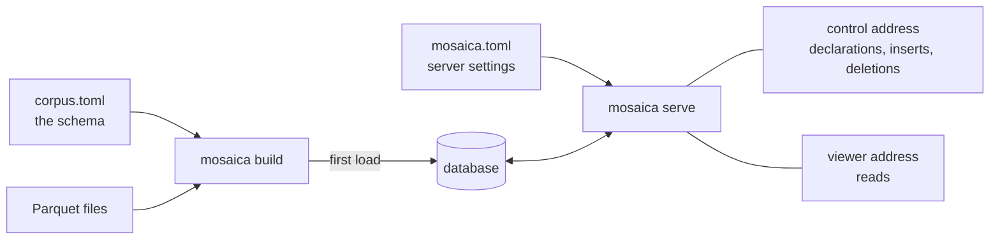

# Install and configure

## Install

!!! note "Not published yet"
    Release binaries, the Docker image and the packages on PyPI and npm come with the first release. Until then, install from a clone of the repository:

    ```bash
    git clone https://github.com/mosaicadb/mosaica ~/mosaica
    ```

=== "Server"

    The `mosaica` binary builds a database and serves it. It needs Rust and a C compiler (`build-essential` on Debian and Ubuntu).

    ```bash
    cd ~/mosaica
    cargo install --locked --path crates/mosaica-cli
    ```

    To run it as a service, see [systemd](../guides/systemd.md) or [Docker](../guides/docker.md).

=== "Python"

    The Python package runs a database in your notebook or connects to a server. It brings the binary with it, and needs Python 3.10 or later, Rust, a C compiler and Node.js 22.15 or later.

    ```bash
    cd ~/mosaica
    pip install -e clients/py-native
    pip install -e 'clients/py[widget]'
    ```

=== "TypeScript"

    The `@mosaicajs` packages put a map in a web page or app. Pack them from `clients/ts` and install the packed files, as the [TypeScript client's README](https://github.com/mosaicadb/mosaica/blob/main/clients/ts/README.md#using-the-packages-in-another-project) describes. They need Node.js 22.15 or later.

    `npm install @mosaicajs/client` currently installs an empty placeholder without an error.

Mosaica runs on Linux and macOS. It doesn't run on Windows yet, though the Python client installs there and connects to a server on another machine.

??? info "Platform details"
    Release builds are made for Linux on x86_64 and aarch64 (glibc 2.28 or later, or musl 1.2 or later), macOS 11 or later on Apple silicon, and macOS 10.12 or later on Intel. The tests run on Linux x86_64.

## Configure

Two files configure a database:

- **`corpus.toml` is the schema.** It declares the views, the fields and whether each is rendered or indexed, the vocabularies, the annotation layers, and who may see what. Its `[sources]` table names the files for the first load. A running server accepts the same declarations, so the schema can grow while it serves.
- **`mosaica.toml` holds the server's settings**: where its files live, which schema to start from, its three addresses, the operator credential, and its limits. The server reads it at start.



`mosaica build` creates the database and loads the first data in one pass, which is the quick way to load a lot at once. After that, every change goes through the server's control address, from the clients, the command line or the HTTP API.

!!! note ""
    Not built yet: an empty database. A database starts with a build of at least one view's data.

??? info "Where Mosaica looks for the two files"
    - `mosaica.toml`: the current directory, or the nearest one above it. `--deployment` names another. Its relative paths are read from its own directory.
    - The schema: the file `[build] schema` names, or `schema.toml`. `--config` names another. Paths in `[sources]` are read from the schema's directory.

    The examples in the repository and the Python client name the schema `schema.toml`. `mosaica check --payloads` prints a schema as the requests that declare it at a running server.

## Try it

The repository has 150,000 GeoNames places in `examples/data/geonames`. Make a directory beside the clone:

```bash
mkdir ~/places && cd ~/places
```

Save this as `corpus.toml`:

```toml
[sources]
points = "../mosaica/examples/data/geonames/points.parquet"

[defaults]
source = "points"

# A world map, from the file's lon and lat columns. Every place is public.
[[view]]
name             = "world"
projection       = "web_mercator"
extent           = { lon = [-180.0, 180.0], lat = [-85.0511287798066, 85.0511287798066] }
point_visibility = { default = "public" }

# Searchable names.
[[attribute]]
name  = "name"
type  = "text"
index = true

# Sent with every point, to colour by.
[[attribute]]
name   = "population"
type   = "i64"
render = true
```

Save this as `mosaica.toml`:

```toml
# The database, the server's cache and its write-ahead log.
[bundle]
path  = "bundle"
cache = "cache"
wal   = "wal.log"

[build]
schema = "corpus.toml"

# A viewer's session lasts at most an hour.
[disclosure]
token_max_lifetime = 3600

[serve]
viewer                   = "127.0.0.1:9141"
session                  = "127.0.0.1:9142"
control                  = "127.0.0.1:9143"
operator_credential_file = "operator.secret"

# Users, keys and grants.
[catalogue]
dir = "catalogue"
```

Check, build and serve:

```bash
mosaica check 2>&1 | tail -n 1
```

```
check OK: 2 source(s), 1 view(s), 0 view group(s) over 0 declared view(s), 0 vocabulary(ies), 2 attribute(s), 0 layer(s), 0 warning(s)
```

```bash
mosaica build 2>&1 | tail -n 2
```

```
built /home/you/places/bundle (v00000): 150000 items, 1 terms, 150000 pairs, 11676070 bytes on disk, 0 artifact(s) minted, 0 unclustered member row(s), 0 row(s) refused
  view world: 150000 row(s)
```

```bash
openssl rand -hex 16 > operator.secret; chmod 600 operator.secret
mosaica serve
```

```
...
{"event":"listening","viewer":"127.0.0.1:9141","session":"127.0.0.1:9142","control":"127.0.0.1:9143"}
```

The server is running. To open the map in a browser, follow [Open the map](first-map.md#open-the-map) in the tutorial, with `~/places` in place of `~/ireland`.

The [corpus.toml](../reference/corpus-toml.md) and [mosaica.toml](../reference/mosaica-toml.md) references list every key. [Operate a deployment](../guides/operating.md#what-the-server-keeps-on-disc) covers what the server keeps on disc.

## From Python

The Python client writes both files for you. `mosaica.create("~/maps/places")` makes a database in that directory, and its first commit builds the database and starts a server. `mosaica serve --deployment ~/maps/places/mosaica.toml` serves it again later, without Python.

`mosaica.create()` with no path makes a temporary database, deleted when Python exits. The [Python reference](../reference/python/connecting.md) covers `create()`, `open()` and `save()`.

## Next

- [Your first map from files](first-map.md) builds a map of Ireland step by step.
- [Users and roles](../system/users-and-roles.md) covers who can sign in, and what each may see and do.
