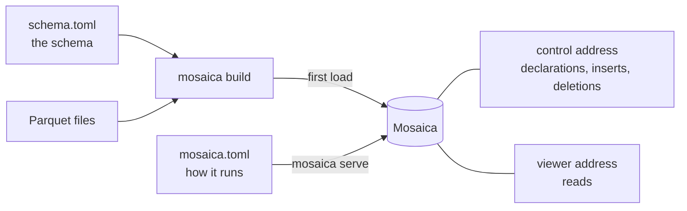

# Install and configure

Your programs reach a Mosaica database over its HTTP API, with the `mosaica` command line, or from the TypeScript and Python clients. Install the database first, on a machine of its own or beside your code, and then the client you'll use.

!!! tip "Working in Python"
    For prototyping and analysis in a notebook or script, you can skip the database install. On Linux and macOS the Python client brings `mosaica` with it and can run a private database of its own, as [Install a client](#install-a-client) and [Your first map in Python](python.md) show.

## Install Mosaica

Each release has an archive for each platform Mosaica runs on, named after the platform's target. Find the target for your machine:

| Platform | Target |
|---|---|
| Linux on x86_64, glibc 2.28 or later | `x86_64-unknown-linux-gnu` |
| Linux on x86_64, musl 1.2 or later, as on Alpine | `x86_64-unknown-linux-musl` |
| Linux on aarch64, glibc 2.28 or later | `aarch64-unknown-linux-gnu` |
| Linux on aarch64, musl 1.2 or later | `aarch64-unknown-linux-musl` |
| macOS 11 or later on Apple silicon | `aarch64-apple-darwin` |
| macOS 10.12 or later on Intel | `x86_64-apple-darwin` |

Then download the newest archive for that target with curl, unpack it and put `mosaica` on your `PATH`. For Linux on x86_64:

```bash
curl -LO https://github.com/mosaicadb/mosaica/releases/latest/download/mosaica-x86_64-unknown-linux-gnu.tar.gz
tar xzf mosaica-x86_64-unknown-linux-gnu.tar.gz
sudo install -m 0755 mosaica-x86_64-unknown-linux-gnu/mosaica /usr/local/bin/mosaica
```

Check that it runs:

```bash
mosaica --version
```

```
mosaica 0.1.0-rc.4 (135216816)
```

That's the version you installed, with the commit it was built from in brackets. Beside `mosaica`, the archive holds `README.md`, `CHANGELOG.md`, `LICENSE` and `THIRD_PARTY_LICENSES`. Every release, with its archives, is on the [releases page](https://github.com/mosaicadb/mosaica/releases).

??? info "Checking the download"
    `SHA256SUMS`, on the same release, lists the SHA-256 digest of every archive. Download it beside the archive and check the archive against it:

    ```bash
    curl -LO https://github.com/mosaicadb/mosaica/releases/latest/download/SHA256SUMS
    sha256sum -c SHA256SUMS --ignore-missing
    ```

    On macOS, `shasum -a 256 mosaica-*.tar.gz` prints the digest to compare with the archive's line in `SHA256SUMS`.

??? info "Downloading with a browser on macOS"
    curl downloads the archive without the quarantine attribute a browser adds. If macOS blocks a `mosaica` you downloaded with a browser, remove the attribute with `xattr -d com.apple.quarantine ./mosaica`.

To run the database as a service, follow [Run Mosaica under systemd](../guides/systemd.md), or [Run Mosaica with Docker](../guides/docker.md), which uses Mosaica's published image in place of an archive.

??? info "Building from source"
    To work on Mosaica, or to run a build of your own, compile it with cargo. You'll need Rust and a C compiler (`build-essential` on Debian and Ubuntu), which builds the C libraries Mosaica links in. If you have already cloned the repository to `~/mosaica`, run `git pull` in it instead of cloning.

    ```bash
    git clone https://github.com/mosaicadb/mosaica ~/mosaica
    cd ~/mosaica
    cargo install --locked --path crates/mosaica-cli
    ```

    Cargo puts `mosaica` in `~/.cargo/bin`. The crates are on crates.io too. To build a release from there, write its version without the leading `v`:

    ```bash
    cargo install --locked mosaica --version VERSION
    ```

!!! note "Release candidates"
    Every release so far is a release candidate, and cargo builds one only when `--version` names it. Once there is a full release, `cargo install --locked mosaica` builds the newest without it.

## Platforms

The archives above cover the platforms `mosaica` runs on. There is no Windows build. The test suite runs on Linux on x86_64.

| Part | Runs on |
|---|---|
| The Docker image | `linux/amd64` and `linux/arm64` |
| The Python client | Python 3.12 or later, anywhere. It includes `mosaica` on the platforms in the [table of targets](#install-mosaica), so it can make and serve a database there. Elsewhere, Windows included, it connects to a database running on another machine. |
| The TypeScript client | Browsers, from an npm project |

## Install a client

=== "Python"

    You'll need Python 3.12 or later. Make a virtual environment for the client, then install it:

    ```bash
    python3 -m venv .venv && . .venv/bin/activate
    pip install 'mosaica[widget]'
    ```

    You get two packages from PyPI. `mosaica` is the client. `mosaica-native` carries the `mosaica` program, which the client runs when it makes a database of its own, and puts it on your `PATH`. The `widget` extra adds the map for Jupyter and marimo notebooks. Leave it out if you only read and write data.

    On Linux with a glibc older than 2.28, there is no `mosaica-native` for your machine. Install the client with `pip install --no-deps mosaica`, then `pip install pyarrow`, and `anywidget` for the map. The client then connects to a database running elsewhere.

=== "TypeScript"

    You'll need Node.js 22.15 or later. In your project, install the elements:

    ```bash
    npm install @mosaicajs/components
    ```

    npm installs `@mosaicajs/client` and `@mosaicajs/deck` with them, and the Lit and deck.gl packages they draw with. A page that draws the map itself needs only `@mosaicajs/client`, and a React app adds `@mosaicajs/react`. The [TypeScript client reference](../reference/typescript.md) says what each package holds.

## Configure

You configure a deployment with two files. In `schema.toml` you describe the database's schema: its views, its fields and whether each is rendered or indexed, its vocabularies and annotation layers, and who may see what. Its `[sources]` table also names the files to load first. In `mosaica.toml` you set up how the database runs: where it keeps its files, which schema it starts from, the addresses it listens on, the operator credential and its limits.



`mosaica build` creates the database from the schema. If `[sources]` names files, the build loads them in the same pass, which is the fastest way to load a lot of data at once. Without them, you get an empty database, ready to take its data through the control address. `mosaica serve` starts it, and from then on it takes every change: you can declare new fields, views and layers, and insert or delete items. It reads `mosaica.toml` when it starts, so restart it after you change a setting.

!!! tip "Working on your own machine"
    For development and prototyping, start the database in open mode, with `mosaica serve --open` or `open = true` under `[serve]`. It then answers every request without signing in, from any client: the HTTP API, the command line, a web page or Python. It listens only on this machine, needs no operator credential, and refuses to start once you've set up users. [Your first map in a web page](typescript.md) uses it.

??? info "Where Mosaica looks for the two files"
    Mosaica looks for `mosaica.toml` in the directory you run it from, then in each directory above, unless you name one with `--deployment`. It reads the schema from `schema.toml` in the same directory, unless `[build] schema` or `--config` names another file. A relative path in either file is read from that file's own directory.

    If you'd rather declare a schema to a running database, `mosaica check --payloads` prints it as the requests to send.

## Try it

The repository has 150,000 GeoNames places in `examples/data/geonames`. Clone it, and make a directory beside the clone. If you have already cloned it to `~/mosaica`, skip the `git clone`.

```bash
git clone https://github.com/mosaicadb/mosaica ~/mosaica
mkdir ~/places && cd ~/places
```

Save this as `schema.toml`:

```toml
[sources]
points = "../mosaica/examples/data/geonames/points.parquet"

[defaults]
source = "points"

# A world map, from the file's lon and lat columns. Every place is public.
[[view]]
name             = "world"
projection       = "web_mercator"
extent           = { lon = [-180.0, 180.0], lat = [-85.0511287798066, 85.0511287798066] }
point_visibility = { default = "public" }

# Searchable names.
[[attribute]]
name  = "name"
type  = "text"
index = true

# Sent with every point, to colour by.
[[attribute]]
name   = "population"
type   = "i64"
render = true
```

Save this as `mosaica.toml`:

```toml
# Where the database keeps its data, its cache and its write-ahead log.
[bundle]
path  = "bundle"
cache = "cache"
wal   = "wal.log"

# A viewer's session lasts at most an hour.
[disclosure]
token_max_lifetime = 3600

[serve]
viewer                   = "127.0.0.1:9141"
session                  = "127.0.0.1:9142"
control                  = "127.0.0.1:9143"
operator_credential_file = "operator.secret"

# Users, keys and grants.
[catalogue]
dir = "catalogue"
```

Check that the schema matches the file, then build the database:

```bash
mosaica check 2>&1 | tail -n 1
```

```
check OK: 2 source(s), 1 view(s), 0 view group(s) over 0 declared view(s), 0 vocabulary(ies), 2 attribute(s), 0 layer(s), 0 warning(s)
```

```bash
mosaica build 2>&1 | tail -n 2
```

```
built /home/you/places/bundle (v00000): 150000 items, 1 terms, 150000 pairs, 11684262 bytes on disk, 0 artifact(s) minted, 0 unclustered member row(s), 0 row(s) refused
  view world: 150000 row(s)
```

Make the operator credential and start the database:

```bash
openssl rand -hex 16 > operator.secret; chmod 600 operator.secret
mosaica serve
```

```
...
{"event":"listening","viewer":"127.0.0.1:9141","session":"127.0.0.1:9142","control":"127.0.0.1:9143"}
```

You now have a running database with 150,000 places in it. To see them on a map, follow the tutorial's [Open the map](first-map.md#open-the-map) step, using `~/places` where it says `~/ireland`.

### Start from an empty database

If your data arrives through your own code rather than as files, start with an empty database instead. Stop the server, make a directory `~/empty` beside `~/places`, and save in it a `schema.toml` with no `[sources]`. A view with no data to fit needs its frame stated, as this one is:

```toml
[[view]]
name             = "world"
projection       = "web_mercator"
extent           = { lon = [-180.0, 180.0], lat = [-85.0511287798066, 85.0511287798066] }
point_visibility = { default = "public" }

[[attribute]]
name  = "name"
type  = "text"
index = true

[[attribute]]
name   = "population"
type   = "i64"
render = true
```

Copy `mosaica.toml` and `operator.secret` beside it, then build and serve as before. The build writes an empty database:

```bash
mosaica build 2>&1 | tail -n 2
mosaica serve
```

```
built /home/you/empty/bundle (v00000): 0 items, 1 terms, 0 pairs, 12120 bytes on disk, 0 artifact(s) minted, 0 unclustered member row(s), 0 row(s) refused
  view world: 0 row(s)
...
{"event":"listening","viewer":"127.0.0.1:9141","session":"127.0.0.1:9142","control":"127.0.0.1:9143"}
```

In another shell, send it some places with `mosaica insert`. It reads Parquet, Arrow or NDJSON, from a file or, as here, from stdin: one object per item, keyed by field name, with the position in `lon` and `lat`. It sends them to the control address, with the credential from `MOSAICA_CREDENTIAL`:

```bash
export MOSAICA_CREDENTIAL=$(cat operator.secret)
mosaica insert --control http://127.0.0.1:9143 --format ndjson - <<'END'
{"lon": -6.26, "lat": 53.35, "name": "Dublin", "population": 1173179}
{"lon": -8.47, "lat": 51.90, "name": "Cork", "population": 190384}
END
```

```json
{"added":0,"clamped":0,"clipped":0,"created":2,"edited":0,"ignored_columns":[],"joined":0,"minted":0,"over_bound":0,"pages":1,"publication":1,"refused":[],"refused_pages":[],"replayed":0,"rows":2,"unchanged":0}
```

Both rows created a place. Each new item gets a `mosaica_id`, which you use to edit or delete it later, and `--ids-out` writes them to a file.

??? info "The same over HTTP"
    The control address takes rows as JSON at `POST /control/ingest`. Each batch carries an id you choose, so that sending it again after a dropped connection doesn't add the places twice:

    ```bash
    curl -sS http://127.0.0.1:9143/control/ingest \
      -H "authorization: Bearer $(cat operator.secret)" \
      -H 'content-type: application/json' \
      -H 'x-mosaica-batch-id: first-places' \
      -d '[{"lon": -6.26, "lat": 53.35, "name": "Dublin", "population": 1173179},
           {"lon": -8.47, "lat": 51.90, "name": "Cork", "population": 190384}]'
    ```

    The answer counts what each row did and gives each new item's `mosaica_id`.

New items appear at the next flush, within 90 seconds, or at once with `--wait`. [Changing data](../system/write-path.md) covers every write. `mosaica declare` adds views, fields and layers the same way, except that a rendered field must be in the schema the database is built from.

Every key this example leaves out is in the [schema.toml](../reference/schema-toml.md) and [mosaica.toml](../reference/mosaica-toml.md) references, and [Operate a deployment](../guides/operating.md#what-the-server-keeps-on-disc) explains what the database keeps on disc and how to back it up.

## From Python

In Python you don't write either file yourself. `mosaica.create("~/maps/places")` makes a database in that directory and writes both files there, and its first commit builds the database and starts it. Because everything lives in that one directory, you can serve the database later without Python, with `mosaica serve --deployment ~/maps/places/mosaica.toml`.

Leave out the path and you get a temporary database, which is deleted when Python exits. The [Python reference](../reference/python/connecting.md) has the details of `create()`, `open()` and `save()`.

## Next

- [Your first map from files](first-map.md) walks through a map of Ireland, from downloading the data to filtering it in the browser.
- [Your first map in Python](python.md), if you'd rather start from a data frame.
- Before other people use your database, read [Users and roles](../system/users-and-roles.md) to set up who can sign in and what each of them may see.
