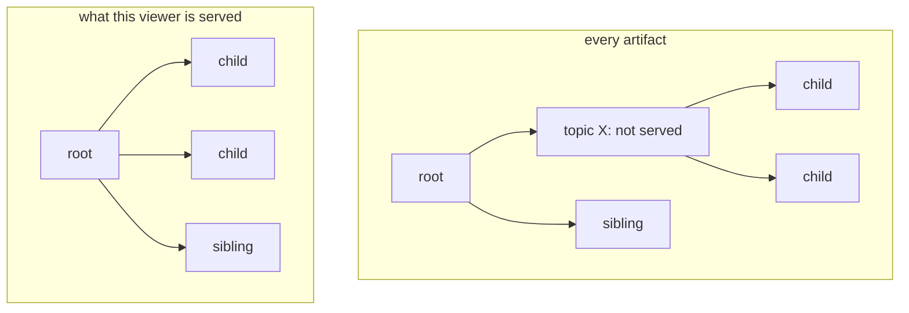

# Annotations

Annotation layers let you put structure over your items: clusters, a hierarchy of topics, regions such as country borders, and the names that label them. The examples use a collection of research papers with a `topics` layer over them.

Each annotation in a layer, such as one cluster or one region, is an **artifact**, and its members are the items it covers. Like an item, an artifact has a `mosaica_id`, which clients use to name it.

## Declaring a layer

When you declare a layer, you decide how its members are found, how its artifacts relate to each other, what each one carries, and who may see it.

### How members are found

| Membership | Members are | Use it for |
|---|---|---|
| `enumerated` | the items a table lists for each artifact | the output of a clustering or topic model, one row per item and artifact |
| `spatial` | the items whose positions fall inside the artifact's shape: a box, circle, ellipse or polygon | regions such as country borders, or areas someone drew |
| by a field, `{ attribute = "archive" }` | the items carrying each value of an indexed category, `u8`, `u16` or `u32` field | turning a field such as `archive` into a layer of its own |

An `enumerated` membership is fixed at what its table says: an item inserted later belongs to an artifact only when an insert or a publication names it there. The other two are worked out from each item's own position or value, so a new item belongs to the right region or value from the flush that places it.

### How artifacts relate

| Kind | Structure | Use it for |
|---|---|---|
| `flat` | one set of artifacts, no relations | a single clustering |
| `nested` | a tree: each artifact names one parent | a topic tree of any depth |
| `dag` | like `nested`, but an artifact can have several parents | a taxonomy where a topic sits under two fields |
| `tiered` | levels, each artifact naming a parent at a coarser level | field, subfield and topic; country, region and district |
| `stacked` | levels with no relations between them | the same data clustered at three resolutions |

A tiered or stacked layer declares its levels, each with an optional title and an optional zoom range, which picks the level a request that names none is answered at. A nested or dag layer has no levels: the map cuts through the tree as it zooms, as described [below](#on-the-map).

### What each artifact carries

Every artifact carries a count of the members the viewer may see. Beyond that, you can ask Mosaica to compute a `centroid`, a bounding `box` and a `hull` from those same members, where the hull follows the outline of the members and has one ring for each separate group of them. You can also supply content of your own: text such as a name or description, a polygon, a box or a point.

A layer draws one shape, whether that's a computed hull, a spatial layer's own shape or a supplied polygon. A field layer is the exception to most of this. Its artifacts are made from the field's values, so nothing is published into it, and it's flat and carries only each value's key and count.

### Names from a label layer

You can keep names in a layer of their own, attached to another layer's artifacts: a `topics` layer's clusters might be named by a `topic_names` label layer, with each label attached to one cluster. The point of a label layer is that you control who sees a name separately from who sees the cluster. That matters when a name was generated from the members, because on the cluster's own layer, a name a viewer may not read hides the whole cluster from them, as [who sees an annotation](#who-sees-an-annotation) explains.

### Who may see it

A layer has an access label of its own, can give each artifact a label too, and says how much of an artifact's membership a viewer must see before it's served. [Who sees an annotation](#who-sees-an-annotation) covers all three.

A shortened declaration:

```toml
[[layer]]
name       = "topics"
views      = ["map"]
membership = "enumerated"
source     = "topics"          # one row per topic: its key, level and parent
fields     = { key = "topic", parent = "parent_topic" }
hierarchy  = { kind = "tiered" }
visibility = "public"
artifact_visibility       = { default = "inherited" }
require_member_visibility = "any"

[layer.members]
source = "topic_members"
fields = { key = "topic", doi = "paper_doi" }

[layer.content]
computed = ["centroid", "hull"]

[[layer.levels]]
level = 0
title = "Fields"

[[layer.levels]]
level = 1
title = "Topics"
```

The [`schema.toml` reference](../reference/corpus-toml.md) lists every key.

## On the map

A client asks for the artifacts in each map tile, as described under [annotations by tile](queries.md#annotations-on-the-map), and Mosaica chooses which to send so the map stays readable at every zoom:

- **The largest first.** On a flat, stacked or tiered layer, each tile returns at most `per_tile` artifacts of each level, the largest first by how many members the viewer may see. A small cluster in a crowded tile is left out there, and appears where it is among the largest, or when the viewer zooms in.
- **The same figures everywhere.** An artifact's count, centre and box cover all the members the viewer may see, wherever they are, so an artifact that spans several tiles has the same figures in each.
- **Trees are cut to a budget.** A nested or dag layer is cut across the whole area on screen: where too many fine topics would show, their parent stands in for them. Zooming in moves the cut deeper. With `prune_children = true`, only the finest topic that qualifies on each branch is drawn. The default, `false`, draws its ancestors too.
- **Filters mark matches.** Filtering the map does not change which artifacts are served or their counts. Each artifact carries a flag saying whether any of its members in the tile match the filter, and another for the highlight, so a client can dull the topics with no matches.
- **Colours.** A request can ask for a colour slot for each artifact, from a palette of 2 to 32 colours. Mosaica tries to give neighbouring artifacts different slots, keeps a viewer's slot for an artifact the same at every zoom, and gives the largest child of a topic its parent's colour where it can, so a cluster usually keeps its colour as the viewer zooms into it. Two viewers with different access may see one cluster in different colours.

An artifact deep in a large tree, or a small one in tiles crowded with larger ones, may not be drawn at any zoom a viewer reaches. `POST /v1/artifacts/browse` lists a layer's artifacts without a map: a page of its top-level artifacts, one artifact's children, or a search by name, each with the count the map would show.

## Who sees an annotation

A viewer is served an artifact only if it passes three tests.

1. **The layer's access label.** A viewer who does not satisfy it cannot learn the layer exists. A request naming the layer is answered as if it had never been declared.
2. **The artifact's own label**, if the layer names a field for it in `artifact_visibility.field`. It can only narrow what the layer's label allows. `artifact_visibility.default` decides an artifact with no label of its own: `"inherited"` leaves it to the layer's label, and a label gives it that label.
3. **The membership requirement**: how much of the artifact's membership the viewer must be able to see.

| `require_member_visibility` | The artifact is served when the viewer can see |
|---|---|
| `"all"` | every member (not on a shape or field layer) |
| `"any"` | at least one member |
| `{ fraction = f }` | at least that share of the members (not on a shape or field layer) |
| `{ count = n }` | at least that many members |
| `"none"` | anything or nothing: only the labels decide |

Use `"none"` for a region that exists whether or not a viewer can see anything in it, such as a country. Such a region is served by its `mosaica_id`, in browse and in bulk reads, but the map's tiles draw only artifacts with a member the viewer can see in that tile. Use a stricter requirement where the artifact itself says something about its members, such as a cluster of confidential documents.

An artifact a viewer is not served does not exist for them: no row, no count, no gap in a list, no parent naming it, and a 404 when named directly. On the map, its children attach to its nearest ancestor the viewer is served. In browse and bulk reads they show no parent, as roots.



*Topic X is withheld. On the map its children attach to the root, so the viewer sees a whole tree with no gap.*

### Names generated from the members

A name generated from a cluster's members, such as one a language model wrote from their titles, can reveal what those members are about. Declare such content with `require_member_visibility = "all"` on the content's own declaration (`[[layer.content.supplied]]`, or `[layer.labels.content]` for a label layer), which is separate from the layer's own `require_member_visibility`. It is then served only to a viewer who may see every member it was made from. An authored name that is true whatever the members, such as "Graph Neural Networks" chosen by an editor, can be declared `"inherited"`, and is served to anyone who may see the artifact.

You can supply several ranked versions of a name: a specific one generated from all the members, and a general one for viewers who see only some of them. Each viewer gets the first version whose members they can see in full. They never get a shortened or partly hidden version.

!!! warning "Generated content can hide the whole artifact"
    If a viewer cannot see every member of any version of an artifact's content, the artifact itself is not served to them, not just its name. Deleting one member a version was made from therefore hides the artifact from everyone until you publish its content again. To keep the cluster visible and gate only its name, put the name in a label layer.

The computed hull follows only the members the viewer may see, so it reveals nothing about the others.

## Publishing and changing annotations

You can declare a layer and its artifacts in your first load, from the schema and its files, or at any time while the database runs:

=== "HTTP"

    | To | Route |
    |---|---|
    | Declare a new layer | `PUT /control/layers` |
    | Publish artifacts and their members | `PUT /control/layers/{name}/artifacts` |
    | Add members to existing artifacts | `PATCH /control/layers/{name}/artifacts` |
    | Put new items into artifacts as they are inserted | on an `enumerated` layer, a column named after the layer in the insert batch |
    | Delete or suppress an artifact, or suppress a whole layer | `POST /control/changes`, naming it by `mosaica_id` |
    | Drop a layer | `DELETE /control/layers/{name}` |

=== "Python"

    On a shared database, `Control` has the TypeScript client's calls: `declare_layer`, `publish`, `grow`, `changes` and `drop_layer`.

    | To | Call |
    |---|---|
    | Declare a new layer | `Database.declare_layer`, or `declare_labels` for a label layer, then `commit` |
    | Publish artifacts and their members | `Database.insert` into the layer with `artifacts=`, and again with `members=`, then `commit` |
    | Add members to existing artifacts | `Database.insert` into the layer, with `members=`, then `commit` |
    | Put new items into artifacts as they are inserted | `Database.insert` into the layer with the items' table and `key=` naming the column, then `commit` |
    | Delete or suppress an artifact, or suppress a whole layer | `Database.remove`, `Database.suppress`, naming it by `mosaica_id` |
    | Drop a layer | `Database.drop_layer` |

=== "TypeScript"

    | To | Call |
    |---|---|
    | Declare a new layer | `Control.declareLayer` |
    | Publish artifacts and their members | `Control.publish` |
    | Add members to existing artifacts | `Control.grow` |
    | Put new items into artifacts as they are inserted | on an `enumerated` layer, a column named after the layer in `Control.ingest` |
    | Delete or suppress an artifact, or suppress a whole layer | `Control.changes`, naming it by `mosaica_id` |
    | Drop a layer | `Control.dropLayer` |

=== "CLI"

    The `mosaica` command builds layers into a new database, and can't yet change a running database's layers.

    | To | Command |
    |---|---|
    | Declare a new layer | `[[layer]]` in the declaration file, built by `mosaica build` |
    | Publish artifacts and their members | The layer's source files, built by `mosaica build` |
    | Add members to existing artifacts | Not built yet |
    | Put new items into artifacts as they are inserted | Not built yet |
    | Delete or suppress an artifact, or suppress a whole layer | Not built yet |
    | Drop a layer | Not built yet |

As your items change, the annotations follow them:

| When | What happens to the annotations |
|---|---|
| An item is inserted | It joins every shape or field artifact it matches, and every artifact its insert names, when the flush places it. Counts and hulls grow from then. On a layer requiring `all` or a fraction, a new member the viewer cannot see can withhold the artifact from them |
| A member is deleted | Its artifacts' counts fall on the next request. Content generated from it stops being served at once, and is withdrawn for good at the next compaction. Where that was an artifact's only version, the artifact disappears too until you publish its content again |
| A member is edited | It keeps its memberships. Like any edited item, it leaves the counts until the next flush |
| An artifact is suppressed | It disappears on the next request, with the labels attached to it, until the suppression is lifted |
| An artifact is deleted | It disappears on the next request, for good, with the labels attached to it. Its key is free at once for a new artifact |
| A view of a group is dropped | The artifacts that belong to that view, in layers declared for the group, are deleted with it |
| A layer is dropped | Nothing of it is served from the next request. Its name can be declared again, as a new layer with new identifiers |

!!! note "Changing an artifact means publishing it again"
    There is no way to edit an artifact. To change one, delete it and publish it again, which gives it a new `mosaica_id`. Each part of an artifact, such as its parent, content, shape or access label, is set once: a part it lacks can be filled later, but a different value is refused.

## Not built yet

- **Saving a selection as an artifact.** A viewer cannot save their own selection as an artifact and share it. Build it into a layer ahead of time instead.
- **Editing an artifact.** Delete it and publish it again.
- **A fractional or `all` membership requirement on a shape or field layer.** Such a layer has no declared list of members to take a share of, so it takes `any`, a count or `none`.
- **Withdrawing an artifact when one of its members is deleted.** A deleted member leaves the artifact, and the artifact stays, unless its only content was generated from that member.
- **Changing a running database's layers from the command line.** Use the HTTP API or a client.
