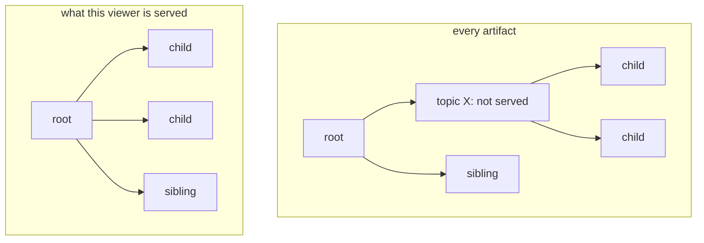

# Annotations

Annotation layers add structure on top of the items: clusters, a hierarchy of topics, regions such as country borders, and the names that label them. This chapter describes what you declare for a layer, how its annotations appear on the map, who sees which of them, and how they change as the data changes. The examples continue with the research papers of the [data model](data-model.md), with a `topics` layer over them.

Each annotation in a layer is an **artifact**: a named thing with a set of member items. A topic is an artifact, and its members are the papers on that topic. Like an item, an artifact has a `mosaica_id`, which clients use to name it.

## Declaring a layer

A layer's declaration makes five choices.

### How members are found

| Membership | Members are | Use it for |
|---|---|---|
| `enumerated` | the items a table lists for each artifact | the output of a clustering or topic model, one row per item and artifact |
| `spatial` | the items whose positions fall inside the artifact's shape: a box, circle, ellipse or polygon | regions such as country borders, or areas someone drew |
| by a field | the items carrying each value of an indexed category or unsigned integer field | turning a field such as `archive` into a layer of its own |

A listed membership is fixed at what its table says: a paper inserted later belongs to a topic only when an insert or a publication names it there. The other two are worked out from each item's own position or value, so a new item belongs to the right region or value from the flush that places it.

### How artifacts relate

| Kind | Structure | Use it for |
|---|---|---|
| `flat` | one set of artifacts, no relations | a single clustering |
| `nested` | a tree: each artifact names one parent | a topic tree of any depth |
| `dag` | like `nested`, but an artifact can have several parents | a taxonomy where a topic sits under two fields |
| `tiered` | levels, each artifact naming a parent at a coarser level | field, subfield and topic; country, region and district |
| `stacked` | levels with no relations between them | the same data clustered at three resolutions |

A tiered or stacked layer declares its levels, each with an optional title and the zoom range it is drawn at. A nested or dag layer has no levels: the map cuts through the tree as it zooms, as described [below](#on-the-map).

### What each artifact carries

- **Computed by the server** from the members each viewer may see: a `centroid`, a bounding `box`, and a `hull`, a shape that follows the outline of the members. Where the members fall into separate groups, the hull has one ring per group.
- **Supplied by you**: text such as a name or description, a polygon, a box or a point.
- **A count** of the members the viewer may see, always.

### Names from a label layer

Names can live in a layer of their own, attached to another layer's artifacts. A `topics` layer's clusters might be named by a `topic_names` label layer, each label attached to one cluster. Label layers let you control who sees a name separately from who sees the cluster, which matters when a name was generated from the members. See [who sees what](#who-sees-an-annotation).

### Who may see it

Each layer has its own access label, can give each artifact its own label, and states how much of an artifact's membership a viewer must see before it is served. These are described [below](#who-sees-an-annotation).

A shortened declaration:

```toml
[[layer]]
name       = "topics"
views      = ["map"]
membership = "enumerated"
hierarchy  = { kind = "tiered" }
visibility = "public"
artifact_visibility       = { default = "inherited" }
require_member_visibility = "any"

[layer.members]
source = "topic_members"
fields = { key = "topic", doi = "paper_doi" }

[layer.content]
computed = ["centroid", "hull"]

[[layer.levels]]
level = 0
title = "Fields"

[[layer.levels]]
level = 1
title = "Topics"
```

The [`corpus.toml` reference](../reference/corpus-toml.md) lists every key.

## On the map

A client asks for the artifacts in each map tile, as described under [annotations by tile](queries.md#annotations-on-the-map).

- **The largest first.** Each tile returns at most `per_tile` artifacts of each level, the largest first by how many members the viewer may see. A small cluster in a crowded tile is left out there, and appears where it is among the largest, or when the viewer zooms in.
- **The same figures everywhere.** An artifact's count, centre and box cover all the members the viewer may see, wherever they are, so an artifact that spans several tiles has the same figures in each.
- **Trees are cut to a budget.** A nested or dag layer is cut across the whole area on screen: where too many fine topics would show, their parent stands in for them. Zooming in moves the cut deeper. `prune_children` on the layer decides whether a parent and its children may be drawn together.
- **Filters mark, they do not hide.** Filtering the map does not change which artifacts are served or their counts. Each artifact carries a flag saying whether any of its members in the tile match the filter, and another for the highlight, so a client can dull the topics with no matches.
- **Colours.** A request can ask for a colour slot for each artifact, from a palette of 2 to 32 colours. Mosaica gives neighbouring artifacts different slots, keeps an artifact's slot the same at every zoom, and gives the largest child of a topic its parent's colour where a neighbour does not already hold it, so a cluster usually keeps its colour as the viewer zooms into it.

An artifact whose members are spread thinly across the whole map may never be large enough to show in any tile. `POST /v1/artifacts/browse` lists a layer's artifacts without a map: a page of its top-level artifacts, one artifact's children, or a search by name, each with the count the map would show.

## Who sees an annotation

Three tests decide whether a viewer is served an artifact. It must pass all three.

1. **The layer's access label.** A viewer who does not satisfy it cannot learn the layer exists. A request naming the layer is answered as if it had never been declared.
2. **The artifact's own label**, if the layer gives artifacts labels. It can only narrow what the layer's label allows. With `default = "inherited"`, an artifact with no label of its own is left to the layer's label.
3. **The membership requirement**: how much of the artifact's membership the viewer must be able to see.

| `require_member_visibility` | The artifact is served when the viewer can see |
|---|---|
| `"all"` | every member |
| `"any"` | at least one member |
| `{ fraction = f }` | at least that share of the members |
| `{ count = n }` | at least that many members |
| `"none"` | anything or nothing: only the labels decide |

Use `"none"` for a region that exists whether or not a viewer can see anything in it, such as a country. Use a stricter requirement where the artifact itself says something about its members, such as a cluster of confidential documents.

An artifact a viewer is not served does not exist for them: no row, no count, no gap in a list, no parent naming it, and a 404 when named directly. In a tree, its children attach to its nearest ancestor the viewer is served:



*Topic X is withheld. Its children attach to the root, so the viewer sees a whole tree with no gap.*

### Names generated from the members

A name generated from a cluster's members, such as one a language model wrote from their titles, can reveal what those members are about. Declare such content with `require_member_visibility = "all"`, and it is served only to a viewer who may see every member it was made from. An authored name that is true whatever the members, such as "Graph Neural Networks" chosen by an editor, can be declared `"inherited"`, and is served to anyone who may see the artifact.

You can supply several ranked versions of a name: a specific one generated from all the members, and a general one for viewers who see only some of them. Each viewer gets the first version whose members they can see in full. They never get a shortened or partly hidden version.

The computed hull follows only the members the viewer may see, so it reveals nothing about the others.

## Publishing and changing annotations

At a build, a layer and its artifacts come from the declaration and its files. At a running server:

| To | Use |
|---|---|
| Declare a new layer | `PUT /control/layers` |
| Publish artifacts and their members | `PUT /control/layers/{name}/artifacts` |
| Add members to existing artifacts | `PATCH /control/layers/{name}/artifacts` |
| Put new items into artifacts as they are inserted | a column named after the layer in the insert batch |
| Delete or suppress an artifact, or a whole layer | `POST /control/changes`, naming it by `mosaica_id` |
| Drop a layer | `DELETE /control/layers/{name}` |

The Python client does the same with `declare_layer` and `insert` into the layer, and the TypeScript client with `Control.declareLayer`, `Control.publish` and `Control.grow`.

As the items change, the annotations follow:

| When | What happens to the annotations |
|---|---|
| An item is inserted | It joins every shape or field artifact it matches, and every artifact its insert names, when the flush places it. Counts and hulls grow from then |
| A member is deleted | Its artifacts' counts fall on the next request. Content generated from it stops being served at once, and is withdrawn for good at the next compaction |
| A member is edited | It keeps its memberships. Like any edited item, it leaves the counts until the next flush |
| An artifact is suppressed | It disappears on the next request, until the suppression is lifted |
| An artifact is deleted | It disappears on the next request, for good. Its key is free at once for a new artifact |
| A view of a group is dropped | The artifacts of that view's layers are deleted with it |
| A layer is dropped | Nothing of it is served from the next request. Its name can be declared again, as a new layer with new identifiers |

!!! note "Changing an artifact means publishing it again"
    There is no way to edit an artifact. To change one, delete it and publish it again, which gives it a new `mosaica_id`. An artifact's access label is set once: one published with none may be given one later, but a different label is refused.

## Not built yet

- **Saving a selection as an artifact.** A viewer cannot save their own selection as an artifact and share it. Build it into a layer ahead of time instead.
- **Editing an artifact.** Delete it and publish it again.
- **A fractional membership requirement on a shape or field layer.** Such a layer's membership changes with every write, so it can take `any`, a count or `none`, but not a fraction or `all`.
- **Withdrawing an artifact when one of its members is deleted.** A deleted member leaves the artifact, and the artifact stays.
