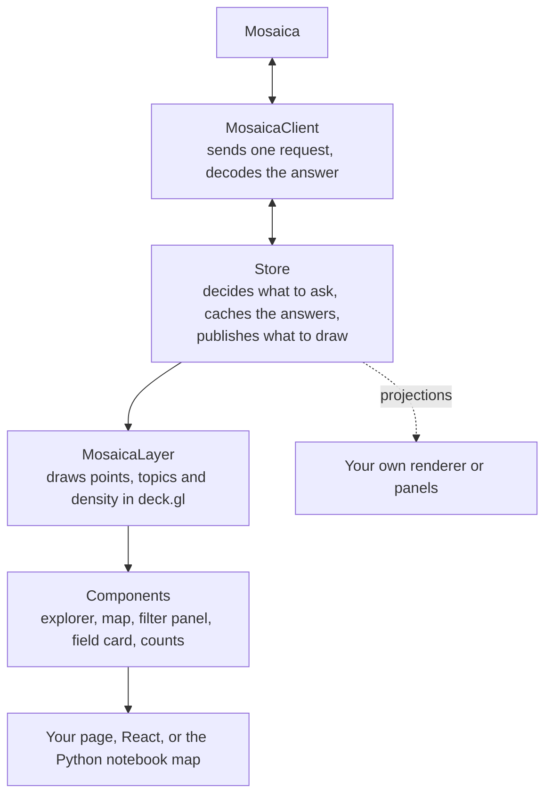

# Maps in the browser

When you put a Mosaica map in a web page, you're using four layers, each built on the one below. You can stop at any of them: take the whole explorer, or take only the parts that suit your application and write the rest yourself.

*Each layer uses the one below it. Your own drawing or panels can read the store's projections directly.*

At the bottom, `MosaicaClient` in `@mosaicajs/client` sends one request and decodes its answer, in a web worker where one is available. The store, in the same package, sits on top of it: it decides what to ask for, caches what comes back, and publishes what to draw as projections, such as the points, the counts, the topics, a legend and the state of the view. The store draws nothing itself. That's the job of `MosaicaLayer`, in `@mosaicajs/deck`, which draws a store's points, topics and density as a deck.gl layer.

The components in `@mosaicajs/components` are web components built on the store and the layer: a whole explorer, a map, and panels such as a filter panel, a field card or a count. `@mosaicajs/react` wraps each one for React, and the Python notebook map embeds them too.

## Building on it

| To | Use | You write |
|---|---|---|
| Put a map with its panels on a page | `<mosaica-explorer>`, or `<mosaica-map>` with the panels you choose | a token source, and any styling |
| Add your own panels beside the map | the components, and the store's projections and `setAggregate` for your panels | the panels |
| Draw Mosaica's points in your own deck.gl scene | the store and `MosaicaLayer` | the scene and its other layers |
| Draw with something other than deck.gl | the store, reading its `marks` projection | the drawing, and telling the store where the camera is |
| Schedule and cache requests yourself | `MosaicaClient` | everything the store does. [Writing your own client](../openapi/README.md#writing-your-own-client) lists what to take care of |

The [TypeScript reference](../reference/typescript.md) and the [components reference](../reference/components.md) list every option.

## What the store does

The store is there to make using the database from a browser cheap and simple, and it does that mostly through caching tuned to how Mosaica serves a map. It asks for as little as it can and reuses everything an answer allows:

- **Samples nest across zoom levels.** A tile's points are always the start of the points its deeper tiles draw. So while new tiles load after a zoom, the store draws the points it already holds from another depth in their place. The map never goes blank, and the stand-in points are ones the finished map will draw too.
- **It asks only for tiles it does not hold.** Mosaica does no work for a tile a request leaves out, so a pan costs only the tiles newly on screen. Held tiles are kept within a memory budget. When it is full, tiles of other views leave first, then empty tiles, then the deepest, then the least recently used.
- **It fetches ahead.** Once the camera settles, it asks for a margin around the screen, reaching further in the direction the camera was moving.
- **It picks the zoom level** whose tiles give about as many points as its point budget, 250,000 by default.
- **It draws as answers arrive.** Counts come first, then points, decoded off the page's main thread and drawn tile by tile.
- **It knows when what it holds is out of date.** It compares each answer's content key and identity key with what it holds, marks the view stale when the data has moved on, and drops everything when the viewer changes.
- **It batches the panels' counts.** A component registers the breakdowns it needs, such as a histogram for a field card. The store sends registrations asked for together that differ only in their groupings as one aggregate request, and asks again only when the filter, the highlight, the selected region or the view changes, at a refresh, and when the data changes.

It also takes care of the rest of talking to Mosaica:

- **Tokens.** The host gives it a fixed `token`, or an `authorise` function, which the store calls for a token and again to renew it 30 seconds before it expires.
- **Topics** come from a request of their own, tile by tile, so they stay put as the held points change.
- **Stable colours.** Mosaica gives each topic a colour slot, the same for this viewer at every zoom and filter, in one of four palettes: Okabe-Ito, Tableau 10 (the default), Tableau 20 or Kelly. Category values are ranked for colouring by Mosaica's count of each over the viewer's items, so a value has the same colour on every load. If that count is refused, the store ranks the values already drawn.

### What the view shows

The store reports the state of the view, so your page can say what's happening:

| State | Meaning |
|---|---|
| `idle` | nothing asked for yet |
| `loading` | a request is out |
| `retrying` | Mosaica was busy (`429`) or still starting (`503`), and the request will be sent again |
| `shown` | points are on screen, with their counts |
| `empty` | the answer holds nothing this viewer may see in view |
| `refused` | the request failed, so what is here is not known |

A refusal carries Mosaica's error code and the HTTP status. An error with no answer from Mosaica in it, such as a gateway's `504`, has the code `http-error`.

Beside the state, three flags tell you about the data and the connection:

- **`stale`**: the data has changed since the points on screen were fetched. The store keeps the points on screen and marks the view, and a refresh is one action away. It fetches the topics and the panels' counts again at once.
- **`unreachable`**: a request could not reach Mosaica, or a proxy in front of it answered `502`. The store asks again after a second, then twice as long each time, up to 30 seconds, and redraws once it answers. A refused request, or an `authorise` that fails, is not an outage.
- **`expired`**: the session has ended, and a new token is needed. On a `401` for a token that had worked, the store calls `authorise` once for a new one. When Mosaica answers `403 expired-token`, because it ended the session, the store shows `expired` and leaves renewal to the host.

A store given a `MosaicaClient` of its own does not watch that client's requests, so `unreachable` stays false and a `401` does not call `authorise`.

### When the store lets go of what it holds

| What happened | What the store does |
|---|---|
| The data changed under the same viewer | Marks the view `stale` and keeps the points on screen until it is refreshed. Fetches topics and counts again |
| An answer carries a different identity key: another viewer, a renewed token whose viewer now holds different access, or a compaction | Drops what Mosaica answered, reads the deployment's description again, and redraws |
| The host calls `clear()` | The same, and also drops a drawn region and the token, then asks `authorise` again. For a host that changes viewer itself |
| The database was rebuilt | Every `mosaica_id` it holds names nothing. Read the items again by a unique field's values |

When the identity key changes, the store keeps the host's own choices: a drawn region, the filter controls, the layers, the colouring, the view and the camera. It drops what came from Mosaica, including a topic picked as a filter or a region taken from a topic's shape.

After a token renewal, the store asks whose the new token is. If the answer doesn't come, because Mosaica is busy, starting or unreachable, it asks again with a growing wait until an answer confirms the viewer or shows another. Until then the previous viewer's data stays on screen, so a host that changes viewer calls `clear()` rather than relying on renewal.

A merge of segments never reaches a client. A compaction reaches it only through the identity key, and every `mosaica_id` stays valid across it.

### Views

The store keeps what it has fetched for each view the viewer has visited, so a view they return to is as they left it. All views share one memory budget, and another view's tiles leave before the current view's.

- **Within a view group sharing one layout**, such as a year shown quarter by quarter, a switch keeps the camera and the selection, and asks the next view for the same tiles.
- **Between layouts**, a switch drops the selection and the camera, since a position in one layout means nothing in another. The host sets a camera for the new view. The components frame it on the items the filters match in the new view.

## What the deck layer and the components add

- **The level.** On a layer with levels, a map with no level chosen colours, names and counts the topics at the top level served at the camera's zoom.
- **Density shading**, counted with the aggregate route, so it follows the filter and the highlight as the points do. The scale is logarithmic by default, since counts on most maps are skewed.
- **Colours.** A category is coloured from Tableau 10 by default, Okabe-Ito, Set 2 or Dark 2, and a number from a ramp: Viridis by default, Cividis, Magma, Greys or Red-blue. A user can pick a value's or a topic's colour on a field card or in the colour editor. Each choice is reported in an event, and the client keeps none of them: a host that wants them kept stores them and passes them back.
- **Status in plain words**, on the status strip and over the map: Connecting or Updating, Up to date, Nothing in view, View refused with the server's reason under it, Server did not answer and Server busy (each with Retry), Reconnecting or Server unreachable, Session expired, and Data updated.

## Basemaps

A geographic view draws an outline of the world under its points unless you say otherwise: land, coastlines and country borders from Natural Earth, which the database serves at `GET /v1/basemaps/world` and the map projects the same way as the points. A view laid out from plain x and y coordinates draws nothing underneath. To choose something else, set `basemap` on `<mosaica-map>` or `<mosaica-explorer>`:

| Value | Draws |
|---|---|
| `"world"` | The world outline. It needs a view with a map projection |
| `"none"` | Nothing |
| `{tiles, attribution}` | Raster tiles from your own tile server: `tiles` is a URL template with `{z}`, `{x}` and `{y}`, and `attribution` is the credit shown in the map's corner. It needs a view whose frame lines up with web map tiles, as `tile_scheme` in `/v1/meta` says. There is no default tile server |
| `{image, bounds}` | One image stretched over `bounds`, `[x0, y0, x1, y1]` in the view's own coordinates, or over the whole frame. The image isn't reprojected |

To give each view its own basemap, pass an object keyed by view id. A view it leaves out gets the default. In a notebook, `db.map`, `Selection.map` and `Viewer.map` take a `basemap=` argument with the same values, and an image there can also be a local file, which Python reads and sends to the page.

If the value doesn't fit the view the map opens on, the map says so and draws the points without it. A value that doesn't fit a view the viewer switches to later draws nothing there, with a note in the map's corner saying why. A basemap that fails to load shows a note too, and is tried again after one second, then two, doubling up to a minute. Each time a note appears, changes or goes, the map fires `mosaica-basemapchange`.

??? info "Details for hosts"
    - An object with a `tiles` or `image` key is one value, and anything else is a mapping, so a view named `tiles` or `image` can't be named in a mapping. A key a form doesn't take is refused.
    - The note and the tile credit are the map's `note` and `attribution` parts, and the explorer forwards them as `map-note` and `map-attribution`.
    - A deck.gl host without the components draws a basemap with `basemapLayers(store, view, value, options)` from `@mosaicajs/deck`, and checks a value against a view with `basemapMisfit(view, value)`. The `colours` option is the only way to restyle the world outline.
    - The map also takes a deck.gl layer you built yourself, drawn in its 512-unit world.

## Not built yet

- **Animating items between layouts.** A switch between views with different layouts redraws, rather than moving each item to its new position.
- **Fetching a view before it is chosen.** A view the viewer has not visited is fetched when they switch to it.
- **An adapter for tile-based map libraries.** The store asks for an area at a time, and nothing sits between it and a library that asks for one tile at a time.
