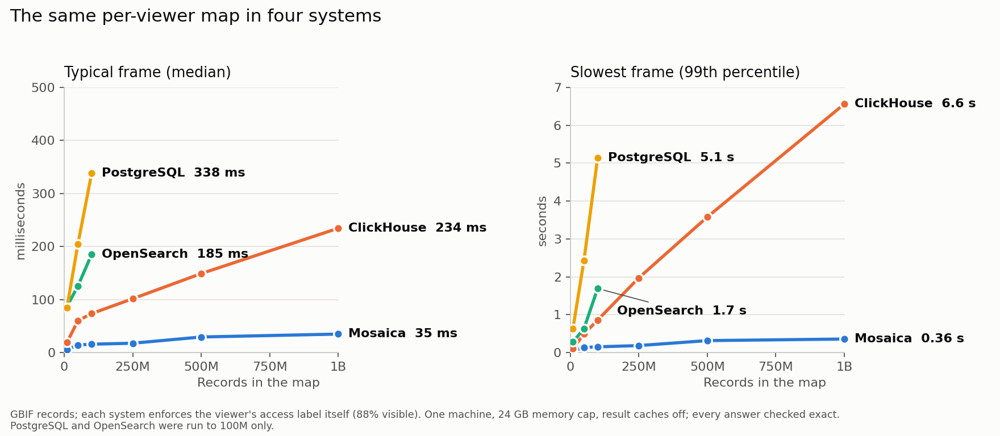

# Compared with other databases

If you already run ClickHouse, PostgreSQL or OpenSearch, you might ask whether one of them could serve the same map. We served one per-viewer map of GBIF's species occurrence records from each of them and from Mosaica, on the same machine, and timed what a viewer panning and zooming would wait for. At a billion records, Mosaica's typical frame took 35 ms and its slowest 0.36 s, while ClickHouse took 234 ms and 6.6 s for the same answers.

*The median and 99th-percentile frame times of a scripted pan and zoom at each size. PostgreSQL and OpenSearch were run up to 100 million records.*

## What was compared

A frame is everything one 1920 by 1080 screen needs from the server: for each 512-pixel tile it touches, the number of the viewer's records in the tile, a grid of counts at two pixels a cell, and the records' positions, with a random sample of 500 in place of the positions when the tile holds more.

Each record carries one access label, its country, and the viewer holds every label but `GB` and `CA`, so it sees 88% of the records. Each system enforces that with its own access control: Mosaica with the view's `point_visibility`, ClickHouse with a row policy, PostgreSQL with row-level security and OpenSearch with document-level security. DuckDB computes the exact answer to every frame from the same source file, and every answer on this page matched it, apart from the ClickHouse run over all 3.5 billion records, which was too large for DuckDB to check on this machine.

The main workload is a scripted camera: it starts on the whole world, zooms into each of the two densest regions to zoom 14, pans at several zooms and zooms back out. The script runs five times with every result cache off. Filter changes and two aggregation tables, counts by kingdom and a histogram of years, are timed at screens along the way.

Every figure is a single run on one development desktop, an AMD Ryzen 9 5900X with 12 logical CPUs under WSL2, with each system in a Docker container capped at 24 GB of memory. ClickHouse, PostgreSQL and OpenSearch each store the records in Morton order, as Mosaica does, so the records of one tile are stored together, and each finds a tile by a range of Morton codes. PostgreSQL uses a plain B-tree on that code rather than a PostGIS spatial index, because PostGIS's index cannot be used under row-level security, and its sampling queries were tuned so that the planner reads each tile rather than walking the whole table.

## Results

The typical frame is the camera script's median, and the slowest is its 99th percentile.

| Records | 10M | 50M | 100M | 250M | 500M | 1B |
|---|---|---|---|---|---|---|
| Typical frame, Mosaica | 6 ms | 14 ms | 16 ms | 18 ms | 29 ms | 35 ms |
| Typical frame, ClickHouse | 19 ms | 60 ms | 73 ms | 102 ms | 149 ms | 234 ms |
| Slowest frame, Mosaica | 0.04 s | 0.13 s | 0.15 s | 0.18 s | 0.32 s | 0.36 s |
| Slowest frame, ClickHouse | 0.11 s | 0.49 s | 0.86 s | 1.97 s | 3.58 s | 6.56 s |

At a billion records, the other measurements were these:

| Measurement | Mosaica | ClickHouse |
|---|---|---|
| Whole world at zoom 0 | 52 ms | 788 ms |
| Filter change, median and slowest | 39 ms, 0.38 s | 245 ms, 1.34 s |
| Aggregation tables, median and slowest | 112 ms, 0.73 s | 145 ms, 0.74 s |
| First frame for a new viewer | 204 ms | 2.72 s |
| Frame after a restart, median and slowest | 135 ms, 0.34 s | 38 ms, 2.69 s |
| Server start | 12.3 s | 0.9 s |
| Build from Parquet | 19 min | 4.7 min |
| Size on disk | 37.1 GiB | 10.3 GiB |

Over all 3.5 billion records, ClickHouse's typical frame took 805 ms and its slowest 24.2 s. Mosaica has not been run at that size yet.

PostgreSQL and OpenSearch fall behind well before a billion records:

| At 100M records | Mosaica | ClickHouse | OpenSearch | PostgreSQL |
|---|---|---|---|---|
| Typical frame | 16 ms | 73 ms | 185 ms | 338 ms |
| Slowest frame | 0.15 s | 0.86 s | 1.69 s | 5.14 s |
| Build | 122 s | 29 s | 702 s | 260 s |
| Size on disk | 3.8 GiB | 1.2 GiB | 5.4 GiB | 10.9 GiB |

## Why the curves differ

A system that applies the viewer's access rule as a condition on each query reads every record in the screen and tests its label before counting, so a frame costs more as the records in view grow. ClickHouse reads quickly, but the whole world at a billion records is most of a billion rows. Mosaica computes a viewer's visible set once per session, as a bitmap over rows stored in Morton order, so each tile is one contiguous range of rows and its count is a count of set bits. A frame's cost then follows the number of tiles on the screen more than the number of records under them. [Serving](serving.md#what-the-server-keeps-ready) describes the visible set.

The same design makes Mosaica's build about four times slower than ClickHouse's and its bundle about three and a half times larger, because the build sorts the records and writes the bitmaps and sample bands that frames are read from. Its server start grows with the data, and its first frames after a restart are slower than ClickHouse's.

## What these figures do not show

They come from one data set, one viewer and one machine, and each system was set up in a limited time, so a specialist could make any of them faster. Many viewers at once and writes while serving were not measured.

The benchmark and its method are in [`bench/compare`](https://github.com/mosaicadb/mosaica/tree/main/bench/compare).
