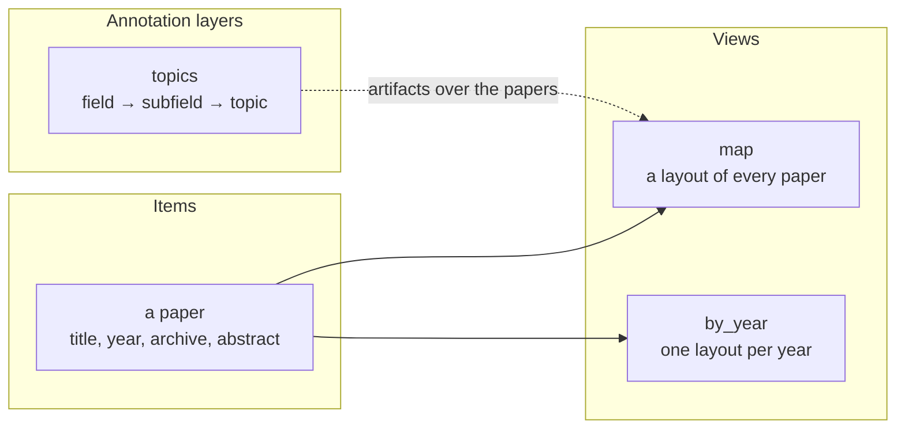

# Data model

This chapter follows one example through everything a Mosaica database holds: a collection of research papers, laid out by what their abstracts say, with a hierarchy of topics drawn over them. Each paper is an **item** with its own field values. You place the items on maps with **views**, draw structure over them, such as clusters, topics or regions, with **annotation layers**, and give category fields their lists of values with **vocabularies**. Each cluster, topic or region in a layer is called an **artifact**.

*Each paper is one item. Views place it on maps. A layer groups papers into topics drawn over a view.*

??? info "How does Mosaica compare to a relational database?"

    | Mosaica | Nearest relational idea |
    |---|---|
    | Item | A row of a main table, keyed by its `mosaica_id` or by a unique field |
    | Field | A column of that table |
    | View | A child table of positions, one row per item placed in it, stored in order of position |
    | View group | A table partitioned by key, with partitions added and dropped while running, where dropping a partition also deletes any item left in no partition |
    | Annotation layer | A table of artifacts. Members are listed in a join table, or computed like a SQL view (the items inside a shape, or carrying a value). Parents are a column, or a join table where an artifact has several |
    | Vocabulary | A lookup table that a category column refers to |
    | Access label | A label column on each row, checked against the viewer's roles by a row-level security policy |

    A relational database is built to answer any query, planned when you ask it. Mosaica is built to answer one question quickly over billions of rows: what is in this map tile, for this viewer, under these filters.

    - **Each layout is stored in its own order.** A tile is quick to read when its points are stored together. A table has one physical order, and a second order needs a second copy, as a covering index is. Mosaica keeps one such copy per view, ordered by position, and keeps what is true of the item in every view apart from them.
    - **Drawn columns sit beside the positions.** A rendered field is copied next to each position, so drawing a tile reads one place. Turning `render` on later would rewrite every view, so it can only be done by rebuilding.
    - **Annotations are built in.** In SQL, counting the papers a viewer may see in each topic on screen is a join and a grouping on every request. Mosaica stores each artifact's members as a bitmap over the same item numbers as the viewer's visible items, so each count is one bitmap intersection.
    - **Rows are matched to items when they are written.** Mosaica has no query language and joins none of your tables at request time. Each row from a separate file, such as a field's values or a cluster's members, is tied to its item once, when it is inserted, by a unique field or, once the database is running, a `mosaica_id`. That is why a unique field matters.

## Items and fields

In the example, each paper is an item, and its data is held in fields, one for each column you declare, such as `title`, `year`, `archive` and `abstract`. Each item also carries an access label, which decides which viewers may see it ([access control](access-control.md)). What a viewer can do with a field depends first on its type:

| Kind | For example | Once indexed, a viewer can filter it by |
|---|---|---|
| Number | `year`, `citations` | an exact value, a set of values, or a range |
| True or false | `open_access` | the same as numbers |
| Date and time | `published` | the same as numbers |
| Category | `archive`, from a list of archives | a value or a set of values, and can pick values from a list |
| Keyword | `doi` | an exact value, a set, a prefix, or a substring |
| Text | `abstract` | the words or phrases it contains |

Then you decide what each field is for. If the map should colour or size points by it, **render** it: its value is sent with every point drawn, so you'd render `archive` to colour the map by archive. A rendered field can be filtered and counted too, but it makes every point larger to send, so render only what the map needs. Keywords and text can't be rendered.

If viewers should filter, count or search by a field without it travelling with the points, **index** it. You'd index `year` to filter by a range of years, and `abstract` to search it. An index costs disc space and build time. A field can be both rendered and indexed.

A field that is neither is still stored. It's shown when someone opens the item and returned when items are read in bulk, so it suits anything a viewer reads but never filters on, such as the full author list.

### Naming an item

Every response that returns an item includes its `mosaica_id`, which Mosaica gives each item and which stays the same for the item's whole life in the database, through edits and restarts.

Your data probably has its own identifier too, such as a DOI. If you declare that field `unique`, you can name items by it wherever Mosaica asks which item you mean: to edit one, delete it, add it to a view, or put it in a cluster. It can be a keyword, an integer or a timestamp, and you can always look it up by exact value, whether or not it's indexed.

!!! note "Declare a unique field if an item appears in more than one file"
    In a first load from files, rows in different files, such as a second view's points or a cluster's members, are matched to an item only by a unique field. Without one, each row of a view's points file becomes a new item, and other files cannot name items at all. A unique field also survives a rebuild, which gives every item a new `mosaica_id`.

## Views

The example has a view called `map`, which places each paper at a UMAP projection of its abstract's embedding, so papers on similar subjects sit together. A view takes any x and y, or longitude and latitude drawn with a map projection, and one paper can have a position in several views while keeping its fields and access label. A view group holds many views of the same kind, such as one layout per year.

[Views and projections](views.md) covers the kinds of view, their frames, view groups and what is drawn under the points.

## Annotation layers

In the example, the `topics` layer groups papers into fields, subfields and topics, and each field, subfield and topic is an artifact, with the papers in it as its members. An artifact can carry:

- a **title** or other text you supply, such as "Graph Neural Networks". Text made from the members, such as a generated topic name, can be limited to viewers who may see all of them;
- a **count** of its members, which Mosaica works out for each viewer from the members that viewer may see;
- a **centre**, a **bounding box** and a **hull**, which Mosaica computes for each viewer from the members that viewer may see;
- a **shape** you supply, such as a country's border.

You decide how a layer finds each artifact's members:

| Membership | Members are | Example |
|---|---|---|
| Listed | the items a table names for each artifact | the output of a clustering run, one row per paper and cluster |
| By shape | the items whose positions fall inside the artifact's shape | country borders on a world map |
| By an indexed field | the items carrying each value of a category or an unsigned integer field | one artifact per archive |

A layer can be flat, a single set of artifacts, or arranged in levels, as the example's fields, subfields and topics are: each topic names one subfield as its parent, and a viewer chooses which level to show and can colour the map by it. If your hierarchy has no levels, a layer can be a tree, where an artifact may name more than one parent. And for independent analyses, such as clusterings at three resolutions, it can be a stack with one per level.

A layer is drawn on the views you name, or declared for a view group with its own artifacts for each view, such as a separate clustering for each year. It also has its own access label, and can gate each artifact further, so a viewer may see the papers but not a layer of internal labels over them. The [annotations](annotations.md) chapter covers all of this in detail.

## Vocabularies

In the example, `archive` takes its values from a vocabulary of arXiv archives: `cs`, `math`, `astro-ph` and so on, each with an optional title such as "Computer Science". Several fields can share one vocabulary.

When you declare a vocabulary, you choose how many values it can hold (up to 255, 65,535 or about 4.3 billion), which is fixed from then on, and whether it's closed, refusing any value it doesn't hold, or open, adding new values as they arrive. The third choice is who sees the list: a public vocabulary lists every value to every viewer, while a derived one lists to each viewer only the values carried by items they may see. Use derived when the list itself would reveal something, such as the names of clients.

??? info "Codes and keys"
    Each value is stored as a numeric code, drawn at random unless you pin it in the declaration. A rebuild draws unpinned codes again, so name values by their keys rather than their codes.

## What can change while it runs

| | While the database runs |
|---|---|
| Items | Insert, edit, delete, suppress and lift a suppression |
| Fields | Declare a new field. Its type, `render` and `index` are fixed once declared. `unique` can be turned on or off |
| Plain views | Declare a new view. A view cannot be changed or dropped |
| View groups | Declare a group, and create and drop its views. A group declared while running cannot carry category-typed facts about its views. A group's view cannot be changed: drop it, create it again empty, and insert its points again. Items that were in no other view come back as new items |
| Annotation layers | Declare a layer, publish artifacts into it, and drop it |
| Vocabularies | Declare one, add values, and change values' titles |

Anything else about these needs a rebuild.

!!! note "Turning `unique` on for an existing field"
    Mosaica builds the index over every stored value. If any value is held by more than one item, the change is refused with a count and up to ten of the values, and the field stays as it was. Inserts and deletions carry on while the index is built.

## Not built yet

- **Fields holding a list of values.** A field holds at most one value per item.
- **Declaring a rendered field while the database runs.** Declare it in the first load.
- **Titles of fields and vocabularies.** A declaration may give one, but it is not yet sent to clients. Titles of views, view groups, layers, levels and category values are sent.
