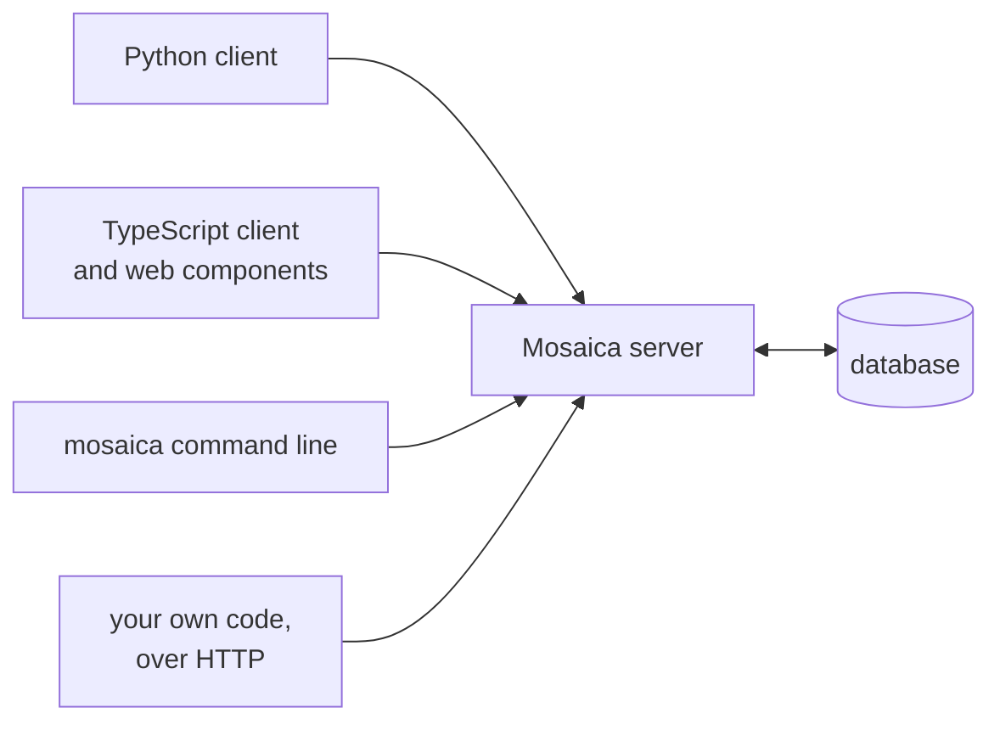

# What Mosaica does

Mosaica is a database for interactive maps of large sets of records, each placed at a point. People pan, zoom, filter and search the map in a browser or a notebook, and every count and sample they see is worked out for the view in front of them. You can add, edit and delete records while the map is in use.

You'd reach for it when you have too many points for a plotting library, or when the data changes too often to bake into map tiles. It also suits data that different people may see different parts of, because each viewer's map is computed from the records that viewer is allowed to see.

## How you work with it

Mosaica runs as a database server. You reach it over its HTTP API, with the `mosaica` command line, or from the Python and TypeScript clients, which are built on the same API. The TypeScript client draws the map in a web page, and the Python client draws it in a notebook and returns counts and records as tables.

You create a database by loading your first data into it, either with `mosaica build`, which loads a set of Parquet files in one pass, or from the Python client. From then on the server takes every change, and you can declare new fields and views and insert or delete records while it serves.

!!! tip "Prototyping in Python"
    For analysis on your own machine, you don't need to run a server yourself. The Python client can start a private one for your notebook, with the same reads and map as a shared server.

The [clients](clients.md) chapter compares the four ways in, and the [capabilities](../reference/capabilities.md) table names the call for each capability on each of them.

## Your data

Each record is an **item**: a place, a paper, a specimen, a log event. An item carries **fields**, one for each column of your data, and has a position in one or more **views**. A view lays the items out on a map, either geographically, from longitude and latitude, or from any two coordinates, such as a UMAP projection of embeddings. Because an item keeps its identity across views, a viewer can switch from a world map to an embedding and keep their filters.

For each field you decide what it's for. A **rendered** field travels with every point drawn, so the map can colour or size points by it. An **indexed** field can be filtered, searched and counted without travelling with the points. A field can be both, or neither, in which case it's stored and shown when someone opens the item, which costs least.

The [data model](data-model.md) chapter covers views, fields and identifiers in full.

## On the map

A viewer can pan and zoom, with a count of what's in view and density shading where there are too many points to draw. When they zoom in, the points already drawn stay where they are and more appear around them. On top of that, they can:

- colour points by a category or a cluster, and size them by a number;
- filter by ranges of numbers and dates, by category values, and by exact, prefix or substring matches on keywords;
- search free text by word;
- draw a box or a freehand shape to select an area. Code can also send a circle, an ellipse or a polygon;
- combine any of these filters with and, or and not;
- highlight the items that match a test, without hiding the rest;
- open an item to see all of its fields.

Every count follows the filters. The [queries](queries.md) chapter covers each kind of filter, and how Mosaica chooses which points to draw.

??? info "One limit on combining filters"
    A free-text search can't be negated, so "not containing the word *neural*" isn't a filter Mosaica can answer.

## Annotations

Annotation layers add structure over the points: clusters from any clustering you've run, hierarchies such as field, subfield and topic, regions with a shape such as a country border, and labels attached to other annotations. A node in a hierarchy can have more than one parent.

Each annotation has a count of its members and can have a title, and Mosaica can work out its centre, its bounding box and a hull around its points. A viewer can colour the map by a layer, pick which level of a hierarchy to show, and filter to the members of the annotations they choose.

An annotation's count covers every member the viewer may see, whatever their filters, so annotations don't come and go as the viewer types. Instead, a filter marks which annotations hold a match. When you want the number of matching members in each, ask for a breakdown by the layer, as the next section describes.

The [annotations](annotations.md) chapter covers declaring and publishing layers.

## Counts and records

Besides drawing the map, you can ask for numbers and records directly. A **breakdown** counts the matching items by the values of a category, or by the annotations of a layer, largest first. You can compare one set with another, such as a filtered set with everything, and see how much more common each group is in one than the other. A **density grid** counts the matching items in cells as fine or as coarse as you choose. And a **bulk read** returns every matching item, or every annotation, page by page as Apache Arrow tables.

## Changing data while it serves

A running server takes new items, edits to existing ones, and deletions, which are permanent. You can also suppress an item to hide it and lift the suppression later, and declare new views, fields and annotation layers.

A deletion or a suppression applies to every request that starts after the server accepts it. New and edited items appear at the next flush, which runs every 90 seconds by default, or sooner once 40,000 rows are waiting; an edited item leaves the map when the edit is accepted, and comes back, changed, at that flush. If you need to know when a write is visible, the write can ask to be answered only then. Because the server records every write in a log before it answers, an accepted write survives a restart.

Anything you can declare in the first load, you can also declare to a running server, apart from one thing. Not built yet: declaring a rendered field at a running server, so declare those in the first load.

[Changing data](write-path.md) covers ingest, flushes and compaction.

## Who sees what

Mosaica can give each viewer a map computed only from the items they're allowed to see. You give an item an **access label**, an expression over terms such as `secret&(team_a|team_b)`, and each viewer's session holds a set of terms. The viewer sees the items whose labels their terms satisfy, and nothing they receive is computed from anything else: every count, sample, density and annotation count comes from those items alone. A filter can narrow that set but never widen it, and a viewer who may see only a few items still gets a full sample of them.

A viewer signs in with a password or an API key, or with an access token from your OpenID Connect provider, or your own backend starts a session on their behalf. If your data has no access rules, give every item the default label `public`, which every viewer holds. The Python client does this unless you say otherwise.

The [access control](access-control.md) chapter covers labels and sessions, [users and roles](users-and-roles.md) covers who can sign in, and the [security](security.md) chapter sets out what a viewer can and cannot learn.

## How it serves large data

Mosaica is designed to serve billions of points from one machine, by keeping the work each request does small:

- **A tile is a run of rows.** Mosaica stores each view's items in Morton order, which puts points that are near each other on the map near each other on disc. Every map tile, at every zoom, is then one contiguous run of rows.
- **Counts are set arithmetic.** What a viewer may see is a compressed bitmap of row numbers, and a filter is another. A tile's count is the size of their intersection within the tile's rows.
- **The data stays on disc.** The server maps its files rather than loading them, so the operating system keeps the parts people are looking at in memory and drops the rest when memory runs short. A memory cap that's too low makes the server slower before it makes it fail.
- **What's reused stays warm.** Each viewer's visible set and the counts of each annotation level are cached, within limits you set, and also kept on disc, so a restart reads them back.
- **Loading streams.** A build reads its input in passes sized to a memory budget, so your source files don't need to fit in memory either.

The [queries](queries.md) and [serving](serving.md) chapters explain these in full, and the [operating guide](../guides/operating.md#memory) explains how to size the caches and the cap.

## What is built

| Feature | Status |
|---|---|
| Building, serving, live ingest, deletion and suppression | Built |
| Filters and search over numbers, dates, categories, keywords and text | Built. A field holds one value per item; fields holding a list of values are not built yet |
| Several views over one set of items, and view groups | Built |
| Annotation layers: clusters, hierarchies, regions and hulls | Built |
| Reading records and annotations in bulk | Built, on all four surfaces. A read pinned to one version of the data is not built yet |
| Declaring a rendered field at a running server | Not built yet. Declare it in the first load |
| Starting from an empty database | Not built yet. A database starts with a first load of at least one view's data |
| Writing to a running server, and drawing a map, from the command line | Not built yet |
| Python and TypeScript packages | Built. Not yet published to PyPI or npm |
| A conformance suite that checks a running server's answers against an independent reference implementation | Built |
| Running across several machines, and replicas | Not built |
