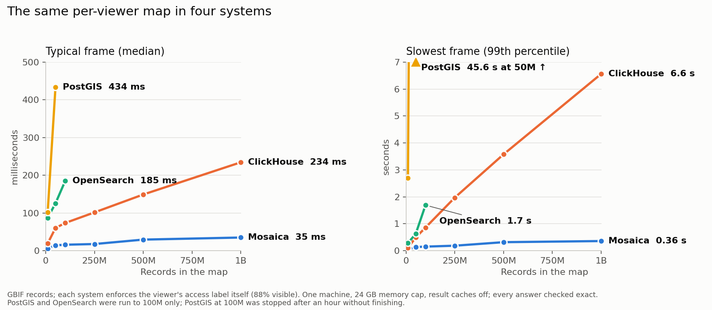

# Performance

If you are deciding whether Mosaica will keep a map interactive at your data's size, or whether a database you already run could serve the same map, this page gives the measurements we have. We served one per-viewer map of GBIF's species occurrence records from Mosaica, ClickHouse, PostGIS and OpenSearch on the same machine, and timed what a viewer panning and zooming would wait for. At a billion records, Mosaica's typical frame took 35 ms and its slowest 0.36 s, while ClickHouse took 234 ms and 6.6 s for the same answers.

*The camera script's median and 99th-percentile frame times at each size. PostGIS and OpenSearch were run up to 100 million records.*

## What a frame is

A frame is everything one screen of a map needs from the server. The screen is 1920 by 1080 pixels, divided into 512-pixel tiles at the current zoom. For every tile the screen touches, the server returns how many of the viewer's records fall in the tile, a grid of counts at two pixels a cell, and the positions of the records. A tile holding more than 500 records sends a random sample of 500 instead, so a dense area of the map still draws without sending every point.

Every answer is computed over the records this viewer may see. Each record carries one access label, its country, and the viewer holds every label but two (`GB` and `CA`), which leaves 88% of the records visible. Each system enforces that restriction with its own access control, so no query written by the benchmark mentions the viewer's labels:

| System | Access control |
|---|---|
| Mosaica | a view whose `point_visibility` is the label, and a principal granted the viewer's labels |
| ClickHouse | a row policy on the viewer's user, `label IN (...)` |
| PostGIS | row-level security on the viewer's role, `label IN (...)` |
| OpenSearch | document-level security on the viewer's role, a `terms` query on the label |

DuckDB computes the exact answer to every frame from the same Parquet file the systems were built from, and the benchmark compares each system's answer with it count by count. Every answer on this page matched, except the 3.5 billion record run, which was too large for DuckDB on this machine and is marked as unchecked. Each system draws its 500-point samples in its own way, so a sample cannot be compared point by point; the benchmark checks instead that every sampled record is one the viewer may see, and that the sample is spread over the tile as a uniform random sample would be. Mosaica samples the 500 records with the lowest `mosaica_id`, which is a keyed scrambling of each record's number, and the other systems take the 500 with the lowest value of a random `rank` column stored with each record.

## What was timed

The **camera script** is the main workload. It starts on the whole world, zooms into each of the two densest regions through zooms 3, 6, 9, 12 and 14, pans half a screen at several of those zooms and zooms back out, which gives 27 frames. Each frame is timed from the first byte of the request to the last byte of the answer, and the script runs five times. A **filter change** applies a category, a year range, a region and a combination of them at two screens of the script, each at about 50%, 5% and 0.1% of the records. **Aggregation** asks for two tables over the records in the screen at every filter change: the count of each kingdom and a histogram of years.

Result caches are off in every system, so each frame is computed from the stored data. Mosaica keeps each viewer's visible set for the length of a session, and that is part of how it answers rather than a result cache, so its cost appears in the first frame of each session.

## The machine and the setup

Every run used one desktop: an AMD Ryzen 9 5900X with 12 logical CPUs and 47 GiB of memory, running Linux under WSL2. Each system ran in its own Docker container with a 24 GB memory cap, one run at a time, from the same Parquet file. The versions were ClickHouse 26.8, PostgreSQL 18.6 with PostGIS 3.6.4, and OpenSearch 3.9.

Each system was set up as its documentation recommends for spatial data. ClickHouse stores the records in a MergeTree table ordered by each position's Morton code, so the records of a tile are stored together, and it answers a frame with one grouped query for the counts and one for the positions. PostGIS stores each position as quantised integers in a table sorted by them, with a B-tree index on the position and another on `rank`, and it answers a dense tile with one query per tile. OpenSearch holds one shard, sorted by Morton code, with half the container's memory as heap. Every setting is in the benchmark's adapters, and each run's record keeps the configuration it ran with.

[PostGIS: figures and set-up to be updated after the tuning pass.]

## Results

### Mosaica and ClickHouse up to a billion records

| Records | 10M | 50M | 100M | 250M | 500M | 1B |
|---|---|---|---|---|---|---|
| Typical frame, Mosaica | 6 ms | 14 ms | 16 ms | 18 ms | 29 ms | 35 ms |
| Typical frame, ClickHouse | 19 ms | 60 ms | 73 ms | 102 ms | 149 ms | 234 ms |
| Slowest frame, Mosaica | 0.04 s | 0.13 s | 0.15 s | 0.18 s | 0.32 s | 0.36 s |
| Slowest frame, ClickHouse | 0.11 s | 0.49 s | 0.86 s | 1.97 s | 3.58 s | 6.56 s |

The typical frame is the camera script's median, and the slowest is its 99th percentile. The whole world at zoom 0 is the most expensive screen in both systems, because every record the viewer may see is in it: at a billion records Mosaica answered it in 52 ms and ClickHouse in 788 ms.

At a billion records, the rest of the measurements were these:

| Measurement | Mosaica | ClickHouse |
|---|---|---|
| Filter change, median and slowest | 39 ms, 0.39 s | 245 ms, 1.34 s |
| Aggregation tables, median and slowest | 112 ms, 0.73 s | 145 ms, 0.74 s |
| First frame of a new session | 127 ms | 791 ms |
| Frame after a restart with caches dropped, median and slowest | 135 ms, 0.34 s | 38 ms, 2.69 s |
| Server start | 12.3 s | 0.9 s |
| Build from Parquet | 19 min | 4.7 min |
| Size on disk | 37.1 GiB | 10.3 GiB |

ClickHouse was also run over all 3,495,729,729 records, with a typical frame of 805 ms, a slowest of 24.2 s and 4.5 s for the whole world. Those answers were not checked. Mosaica has not been run at that size, because its build needs more free disk than the machine had.

### Four systems up to 100 million records

| Measurement | Mosaica | ClickHouse | OpenSearch | PostGIS |
|---|---|---|---|---|
| Typical frame, 10M | 6 ms | 19 ms | 87 ms | 102 ms |
| Typical frame, 50M | 14 ms | 60 ms | 125 ms | 434 ms |
| Typical frame, 100M | 16 ms | 73 ms | 185 ms | did not finish |
| Slowest frame, 10M | 0.04 s | 0.11 s | 0.28 s | 2.7 s |
| Slowest frame, 50M | 0.13 s | 0.49 s | 0.63 s | 45.6 s |
| Slowest frame, 100M | 0.15 s | 0.86 s | 1.69 s | did not finish |
| Whole world, 100M | 26 ms | 131 ms | 1.35 s | 1.58 s at 50M |
| Aggregation, median, 100M | 45 ms | 45 ms | 155 ms | 343 ms at 50M |
| Server start, 100M | 1.6 s | 1.3 s | 16.1 s | 0.3 s at 50M |
| Build, 100M | 122 s | 29 s | 702 s | 100 s at 50M |
| Size on disk, 100M | 3.8 GiB | 1.2 GiB | 5.4 GiB | 5.2 GiB at 50M |

PostGIS was stopped at 100 million records after an hour in the camera script. Its slow frames are all at zooms 0 and 4, where it samples tiles holding millions of records, while its frames at zoom 8 and closer took about 10 ms.

## Why the curves differ

The explanation in this section comes from how the systems answer, and the measurements above are consistent with it, but it was not measured separately. A system that applies the viewer's access rule as a condition on each query reads every record in the screen, tests its label and then groups what survives, so a frame's cost grows with the number of records in view. ClickHouse does that reading quickly, but at a billion records the whole world holds most of a billion rows, which is where its slowest frames come from. Mosaica computes a viewer's visible set once per session, as a bitmap over the stored rows. Because the rows are stored in Morton order, the records of one tile are one contiguous range of rows, so a tile's count is a count of set bits in that range, and its sample is read from stored bands of the lowest `mosaica_id` values. A frame's cost then grows with the number of tiles on the screen far more than with the number of records under them. [Serving](serving.md#what-the-server-keeps-ready) describes the visible set, and the [overview](overview.md) describes the storage order.

That design costs Mosaica elsewhere. Its build is about four times slower than ClickHouse's and its bundle about three and a half times larger, because the build sorts the records into Morton order and writes the bitmaps and sample bands that frames are later read from. Its server start grows with the data, to 12 seconds at a billion records, and its median frame straight after a restart with the page cache dropped is slower than ClickHouse's. Not investigated yet: what the server start and the first frames after a restart spend their time on.

## What these figures do not show

These are the measurements of one data set, one viewer and one machine, and they do not predict another deployment's figures. A desktop under WSL2 runs every system through a virtualisation layer that a server would not have, and a viewer who sees a smaller share of the records changes every system's costs.

Each system was set up from its own documentation in a limited time, and a specialist in any of them could make it faster. The method commits to asking each project's maintainers to review its configuration before the results are published. Not done yet: none of them has been asked.

Not measured yet: many viewers at once, inserting and deleting while serving, and the time a client spends decoding and drawing a frame. The figures for Mosaica and ClickHouse from 50 million to a billion records came from an earlier version of the benchmark than the 10 million and the OpenSearch and PostGIS figures, with the same frames, workloads and checks.

## Running it yourself

The benchmark is in [`bench/compare`](https://github.com/mosaicadb/mosaica/tree/main/bench/compare). Its README says how to prepare the data, build each system and run each workload, and `METHOD.md` defines the frame, the checks and the fairness rules. Every run appends one JSON record holding its timings, its errors against DuckDB, the system's configuration and version, and the machine's description.
